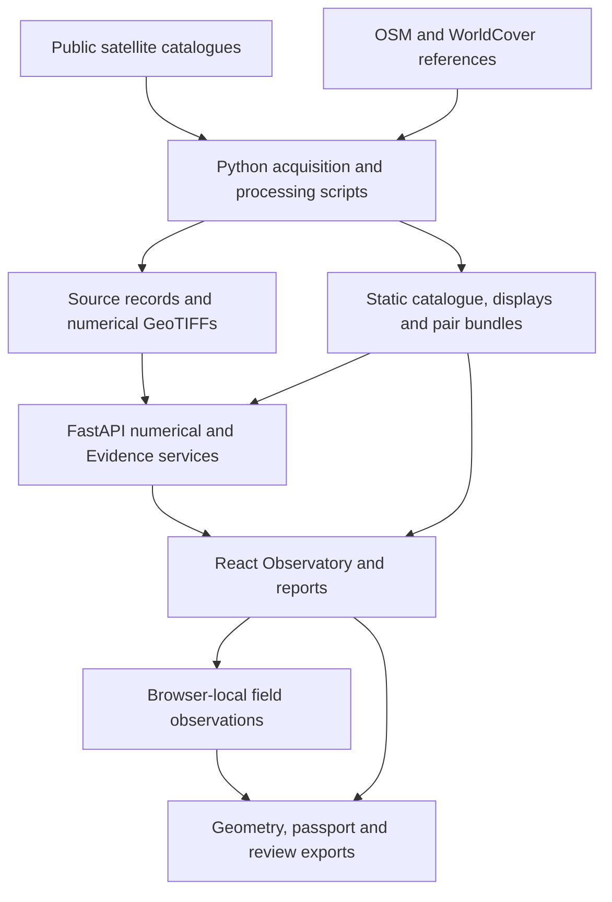

# FluviSAR — Satellite Observatory & Evidence Platform

**Observe change. Challenge the evidence. Document the follow-up.**

A dual-region Earth-observation application for exploring Bangladesh's **Jamuna River** and **Sundarbans mangrove landscape**, built for a NASA Space Apps demonstration. FluviSAR connects dated satellite imagery, numerical radar measurements, reproducible water-transition screening, human field observations and source-linked reports in one investigation workflow.

**Application:** React 19 · TypeScript 7 · Vite 8 · MapLibre GL JS

**Scientific services:** Python 3.12 · FastAPI · Rasterio · NumPy · SciPy · Shapely

**Current observation sources:** Copernicus Sentinel-1D RTC and Sentinel-2 L2A

[Quick start](#3-quick-start) · [Observatory](#5-observatory-workspace) · [Live Analysis](#6-evidence-and-live-analysis) · [Methods](#11-scientific-method-and-interpretation) · [API](#14-api-reference) · [Testing](#16-testing-and-verification)

> **Current implementation — 7 November 2026**
>
> The operational observation catalogue uses **Sentinel-1 C-band VV/VH**, not NISAR L-band measurements. Each region has six radar and six optical acquisitions. NISAR, interferometry and generated ML experiments are included as educational material. Mapped transitions are **screening candidates**, not confirmed erosion, flooding, habitat loss or damage.

---

## Table of contents

1. [Project overview](#1-project-overview)
2. [Study areas and observation inventory](#2-study-areas-and-observation-inventory)
3. [Quick start](#3-quick-start)
4. [Landing page and regional atlas](#4-landing-page-and-regional-atlas)
5. [Observatory workspace](#5-observatory-workspace)
6. [Evidence and Live Analysis](#6-evidence-and-live-analysis)
7. [Field observations and exports](#7-field-observations-and-exports)
8. [Decision Desk](#8-decision-desk)
9. [ML Intelligence](#9-ml-intelligence)
10. [SAR Lab, stories and reports](#10-sar-lab-stories-and-reports)
11. [Scientific method and interpretation](#11-scientific-method-and-interpretation)
12. [Data sources and provenance](#12-data-sources-and-provenance)
13. [Architecture and repository structure](#13-architecture-and-repository-structure)
14. [API reference](#14-api-reference)
15. [Data acquisition and reproduction](#15-data-acquisition-and-reproduction)
16. [Testing and verification](#16-testing-and-verification)
17. [Build, hosting and troubleshooting](#17-build-hosting-and-troubleshooting)
18. [Current boundaries and next steps](#18-current-boundaries-and-next-steps)
19. [Documentation and contribution](#19-documentation-and-contribution)
20. [Licensing and attribution](#20-licensing-and-attribution)

---

## 1. Project overview

### 1.1 The investigation problem

A river channel moves, water recedes from a sandbar, or a wetland's radar response changes. A before/after image can reveal a difference, but that difference alone cannot establish its cause, permanence or impact.

FluviSAR provides a traceable way to move from **observation → comparison → challenge → explanation → field review → potential exposure**. Acquisition dates, processing parameters, numerical support and source records remain beside the visual result.

### 1.2 What users can do

- Browse actual dated optical and radar imagery over two configured study areas.
- Compare acquisitions with a draggable swipe or synchronized side-by-side maps.
- Inspect VV, VH, dual-polarization displays, water masks and transition candidates.
- Sample numerical radar values from retained GeoTIFFs.
- Test how a result changes under three declared water-screening thresholds.
- Follow a six-stage Evidence review or open a stage directly.
- Record a dated field note, optional photograph and requested device GPS location.
- Examine intersections with mapped assets and historical land-cover classes.
- Export geometry, source lineage, field records and evidence-review receipts.
- Learn SAR physics and experiment with explicitly generated ML scenarios.

### 1.3 Three distinct kinds of output

| Output | Meaning | Example |
| --- | --- | --- |
| **Satellite observation** | An acquisition or value tied to an identified source product | A Sentinel-1 VV pixel or dated Sentinel-2 image |
| **Computed result** | A calculation from retained inputs and declared parameters | Component-filtered land-to-water area |
| **Educational or hypothetical scenario** | A teaching model or user-assumed situation | InSAR fringe experiment or flood-planning assumption |

A sensitivity result is not a calibrated probability. An exposure intersection is not a damage assessment. A saved field observation awaits human review.

## 2. Study areas and observation inventory

### 2.1 Active regions

| Region | Investigation context | Analysis bounds `[west, south, east, north]` |
| --- | --- | --- |
| **Jamuna · Chilmari–Roumari** | Braided river channels, sandbars, floodplain water transitions and field-review priorities | `[89.60, 25.40, 89.90, 25.75]` |
| **Sundarbans · Passur** | Tidal landscape, shoreline transitions, radar response and mangrove-reference context | `[89.55, 21.75, 89.85, 22.00]` |

Numerical analysis uses a **30 m EPSG:32645 grid**. Dated optical displays can cover the larger source tile; the dashed study box identifies the smaller analysis footprint.

### 2.2 Actual acquisition dates

All dates below are in **2026**. Original UTC timestamps are retained in the catalogue.

| Region | Sentinel-1 radar: six dates | Sentinel-2 optical: six dates |
| --- | --- | --- |
| Jamuna | Jul 3 · Aug 20 · Sep 25 · Oct 7 · Oct 19 · Oct 31 | Jun 2 · Sep 15 · Oct 10 · Oct 15 · Oct 20 · Oct 25 |
| Sundarbans | Jul 6 · Aug 23 · Sep 28 · Oct 10 · Oct 22 · Nov 3 | Jun 4 · Sep 14 · Oct 12 · Oct 17 · Oct 22 · Oct 27 |

The archive contains **24 source acquisitions** across the two regions. Six radar dates provide **15 chronological comparison pairs per region**: one default pair and 14 additional retained pair bundles. Optical and radar timelines are separate because their acquisition dates differ.

### 2.3 Default radar comparisons

| Region | Default pair | Land → water | Water → land | Retained polygons |
| --- | --- | ---: | ---: | ---: |
| Jamuna | 19 Oct → 31 Oct 2026 | 248.76 ha | 1,496.25 ha | 735 |
| Sundarbans | 22 Oct → 3 Nov 2026 | 18.18 ha | 21.96 ha | 24 |

These are component-filtered **water-transition candidates**, not independently verified erosion/accretion estimates. Their source of record is the [runtime observation catalogue](fluvisar-next/apps/web/public/observations/index.json). Selecting another radar pair loads that pair's own results.

## 3. Quick start

### 3.1 Prerequisites

- **Node.js 22.12+** and npm. Local development uses Node 24; the installed Vite engine also supports Node 20.19+.
- **Python 3.12** for the pinned scientific environment.
- **uv**, or Python's standard `venv` and pip.
- Git and a modern WebGL-capable browser.
- Internet access for initial dependency/data downloads and external context tiles.

The active application is under `fluvisar-next/`. The repository root is the documentation entry point.

### 3.2 Windows / PowerShell

From the repository root:

```powershell
cd fluvisar-next
uv venv --python 3.12 .venv-data
uv pip install --python .venv-data/Scripts/python.exe -r requirements-data.txt

cd apps/web
npm ci
npm run dev
```

### 3.3 macOS / Linux

```bash
cd fluvisar-next
uv venv --python 3.12 .venv-data
uv pip install --python .venv-data/bin/python -r requirements-data.txt

cd apps/web
npm ci
npm run dev
```

Without uv, create `.venv-data` with Python 3.12 and install the same `requirements-data.txt` using that environment's `python -m pip`.

### 3.4 Open the application

| Service | Local address |
| --- | --- |
| Web application | [localhost:5173](http://localhost:5173) |
| Jamuna Observatory | [localhost:5173/observatory/jamuna](http://localhost:5173/observatory/jamuna) |
| Sundarbans Observatory | [localhost:5173/observatory/sundarbans](http://localhost:5173/observatory/sundarbans) |
| API health | [127.0.0.1:8000/api/health](http://127.0.0.1:8000/api/health) |
| Interactive API documentation | [127.0.0.1:8000/docs](http://127.0.0.1:8000/docs) |

`npm run dev` starts or reuses the numerical API on port **8000**, then starts Vite. Vite proxies `/api` to the local service. No external AI-service key is required for this workflow.

The observation catalogue and registered artifacts must be present. If a checkout does not include the local archive, follow [Data acquisition and reproduction](#15-data-acquisition-and-reproduction) before using scientific features.

### 3.5 A first investigation

1. Open Jamuna or Sundarbans and inspect the dated satellite view.
2. Select a date in the optical timeline, or switch to **Radar** for its timeline.
3. Open **Comparison Pair**, choose Before/After acquisitions and use Swipe or Split.
4. Open **Evidence** for a specific stage, or press **Live Analysis** to start at Detect.
5. Review each result and select **Proceed to …**. Finish with **Complete Analysis**.
6. Export the review or collect a field observation for independent follow-up.

## 4. Landing page and regional atlas

### 4.1 Landing page — `/`

The landing page introduces the observation-to-evidence workflow through:

- A source-backed radar-image hero and investigation entry point.
- Four concepts: active sensing, backscatter, water screening and change detection.
- Jamuna and Sundarbans study-area cards.
- A processing-chain overview and evidence-trail explanation.
- Acquisition/source records connected to the current catalogue.

**Implementation:** [LandingPageView.tsx](fluvisar-next/apps/web/src/components/LandingPageView.tsx).

### 4.2 Regional atlas — `/atlas`

The atlas presents the two regions, their acquisition windows, sensor metadata, valid support and processed area. Opening a region enters its Observatory.

**Implementation:** [AtlasView.tsx](fluvisar-next/apps/web/src/components/AtlasView.tsx).

## 5. Observatory workspace

**Routes:** `/observatory/jamuna` and `/observatory/sundarbans`.

### 5.1 Map, geography and display modes

The MapLibre workspace fits the actual study bounds and supports:

- **Satellite:** dated Sentinel-2 L2A true-colour source imagery.
- **Radar:** calibrated Sentinel-1 RTC displays registered to the numerical footprint.
- **Carto:** OpenStreetMap context.
- Recenter, zoom buttons, a precision zoom slider, scale and attribution.
- Map-image download and outline/tinted display options.

Esri World Imagery supplies context beyond valid dated optical coverage. It is a context mosaic, not another date-matched observation. Optical clouds remain in the original images.

The map includes a synchronized geographic fly-in with Skip, Replay, reduced-motion support and exact study-area framing.

### 5.2 Before/after comparison

Two synchronized maps share center, zoom, bearing and pitch.

| Control | Behavior |
| --- | --- |
| **Dates** | Compares actual acquisitions from the active optical/radar collection |
| **Sat vs Radar** | Compares optical and radar acquisitions with explicit source/date labels |
| **Swipe** | Clips one full-size map with a draggable, keyboard-accessible divider |
| **Split** | Displays equally sized, geographically synchronized panes |
| **Single** | Returns to one observation |
| **Comparison Pair** | Selects a chronological Before/After pair |

Selecting a timeline date opens that single observation. Playback cycles the available acquisitions at the chosen speed; it does not manufacture intermediate daily imagery.

### 5.3 Feature discovery

The feature rail organizes controls into **Explore**, **Radar** and **More tools**. Users can compare observations, open findings, inspect channels or choose regional investigation/planning tools. On smaller screens, the feature rail becomes a drawer.

Radar displays include **VV**, **VH**, **VV/VH ratio** and a declared **RGB display composite**. That composite is not a full-polarimetric Pauli decomposition.

### 5.4 Numerical inspection and support

- Clicking a visible radar pixel samples its retained GeoTIFF through the API.
- Ratio samples use both measured channels.
- Coverage controls expose the comparison's common valid support.
- Candidate polygons open area, lineage, audit and export information.
- Measured signal tracks show VV/VH statistics and classified water area.

Outside valid numerical support, samples are masked/null. Values are not generated from a coordinate formula.

### 5.5 Regional and educational tools

Jamuna includes river/floodplain evidence and service-continuity planning. Sundarbans includes wetland/mangrove response context and polarization exploration. Both expose a declared scenario planner and an educational ground-motion experiment.

InSAR phase/coherence controls are teaching models: the RTC intensity archive does not contain interferometric phase. Budgets, stage changes and other user assumptions remain separate from satellite observations.

**Key implementation:** [MapWorkspace](fluvisar-next/apps/web/src/components/MapWorkspace.tsx), [SwipeCompareMap](fluvisar-next/apps/web/src/components/SwipeCompareMap.tsx), [TimelinePlayer](fluvisar-next/apps/web/src/components/TimelinePlayer.tsx), [feature rail](fluvisar-next/apps/web/src/components/ObservatoryFeaturePanel.tsx), [finding inspector](fluvisar-next/apps/web/src/components/FindingInspectorDrawer.tsx).

## 6. Evidence and Live Analysis

### 6.1 Six stages, one investigation context

Evidence is bound to the selected **region, radar run, acquisition pair and optional finding**. The optical comparison supplies cross-sensor context.

| Stage | Main question | Actual output |
| --- | --- | --- |
| **Detect** | What did the radar comparison measure? | VV previews, source-pixel histogram, transition areas and parameters |
| **Investigate** | What supports or complicates interpretation? | Source records, quality checks, optical date offsets and cloud fractions |
| **Challenge** | Does the result survive another threshold? | Recomputed −18/−17/−16 dB results, stable core and sensitive fringe |
| **Explain** | What conclusion does the evidence support? | Rule-based screening verdict, limits, provenance and follow-up questions |
| **Field** | What can a person observe at the site? | Context-bound task and authored records with optional GPS/photos |
| **Impact** | What mapped features overlap the candidates? | Asset intersections, road length and historical land-cover overlap |

### 6.2 Guided execution

**Live Analysis** starts at Detect. Each stage reads or computes its evidence, displays the result and enables **Proceed to the next stage**. Future stages stay locked until reached; reviewed stages can be revisited. Restart begins a fresh review.

Region, radar pair, finding or optical-context changes reset the guided context. In-flight requests are cancelled. A Jamuna result is not carried into a Sundarbans review.

Processing details describe operations performed against retained artifacts. This is an **on-demand review of the registered archive**, not a streaming connection to a satellite, a field team or an operational alert system.

### 6.3 Full Analysis Report

On larger displays, the map and report occupy separate panes. Large metrics, a measured histogram and detection parameters appear before the source previews. Processing logs sit in expandable audit details.

The report supports dark/light presentation, mobile layouts, JSON export, browser printing/Save PDF and a completion summary. Completing the workflow records that the review finished; it does not independently verify a scientific claim.

### 6.4 Impact for both landscapes

Impact uses an archived OpenStreetMap extract and an aligned **ESA WorldCover 2021 v200** reference grid.

- Jamuna emphasizes infrastructure, cropland, built-up and water-reference overlap.
- Sundarbans emphasizes mangroves, tree cover, wetland and water-reference overlap.
- Asset intersections are measured geometrically in the projected CRS.
- Road length refers to intersected mapped geometry.
- The land-cover table includes the historical study-area inventory and its overlap with each transition category.

A zero mapped intersection can reflect sparse mapping or the selected geometry. It is not proof that no assets exist. A 2021 reference-class overlap does not establish current habitat or crop loss.

**Implementation:** [EvidenceWorkbench](fluvisar-next/apps/web/src/components/EvidenceWorkbench.tsx), [stage panels](fluvisar-next/apps/web/src/components/EvidenceStagePanels.tsx), [workflow state](fluvisar-next/apps/web/src/store/evidenceWorkflowStore.ts), [review service](fluvisar-next/services/api/app/evidence.py). See the [Evidence workflow guide](docs/EVIDENCE_WORKFLOW.md).

### 6.5 Ask FluviSAR and Chat with Data

A shared assistant explains the active region, radar pair and selected finding, with source links, map handoffs, English/Bengali questions and on-device conversation export/history. Chat with Data opens a discussion for highlighted metrics, diagnostic panels or the current Evidence stage without resizing the page cards.

Data-based answers use registered backend calculations. Optional Gemini function calling adds natural-language interpretation when a server-side credential is configured; provider errors and unsupported numerical output fall back to the verified data answer. Model experiments remain explicitly synthetic. See [Assistant and map implementation](docs/ASSISTANT_AND_MAP.md) for configuration, scope and limitations.

## 7. Field observations and exports

### 7.1 On-device field records

Field accepts an observer name, actual observation time, condition and note. Users can request device GPS and attach an optional photograph.

Records retain:

- Region, radar run, pair and optional finding ID.
- Observation and recording timestamps.
- Observer-authored condition and note.
- Optional longitude, latitude and reported GPS accuracy.
- Optional photo bytes, filename and SHA-256 checksum.
- An **awaiting-review** state.

Storage uses the browser's `fluvisar-field-evidence` **IndexedDB** database. Records persist in the same browser/profile and are separated by investigation context. Saving a record does not upload it, synchronize with a team or change the satellite verdict. Clearing browser data removes local records; export a copy when it must be retained.

### 7.2 Export options

| Export | Contents |
| --- | --- |
| Candidate geometry | Selected geometry and recorded processing context |
| Change Passport | Source IDs, acquisition metadata, artifact checksums and interpretation evidence |
| Evidence review | Reviewed stage results, scope, pair and computation timestamps |
| Field task | Context, target geometry and observation questions |
| Field observations | Authored records, GPS metadata and optional embedded photo data |
| Exposure review | Source-linked intersections and reference land-cover results |
| Printable explanation/report | Current evidence rendered through browser print/Save PDF |

**Implementation:** [FieldEvidenceForm](fluvisar-next/apps/web/src/components/FieldEvidenceForm.tsx) and [field storage/export utilities](fluvisar-next/apps/web/src/data/fieldEvidence.ts).

## 8. Decision Desk

**Route:** `/impact`.

The Decision Desk presents any registered comparison for the active region as a human review workspace:

- Dated optical satellite context, VV/VH radar, water masks and a geographically aligned before/after divider.
- All six radar acquisitions, fifteen selectable pairs per region and measured water-area histories.
- Every candidate in a searchable ledger; ordering by area, mapped-asset intersection count, threshold sensitivity or outstanding review.
- Exact building/road/facility intersections, road overlap length and historical land-cover overlap for the study area or selected finding.
- Source-specific NASA rainfall context and archived NISAR GCOV discovery records through November 7, 2026.
- Candidate provenance, numerical hashes, quality checks and browser-local review status.
- Real authored field observations with optional requested GPS and photo, stored on the device.
- A separately labelled **What-if scenario**, preserving corridor controls and live OSM queries.
- A source-linked printable decision brief, pair-specific case JSON and working region/pair/finding deep links.

Actual exposure and the **What-if scenario** are distinct outputs. Exposure is spatial intersection, not confirmed damage or population affected. Priority ordering is not a calibrated risk score. NISAR catalog/browse context does not replace the numerical Sentinel-1 observations underlying the transition metrics. NASA POWER supplies IMERG where valid; recent gaps use explicitly labelled MERRA-2/GEOS-IT model precipitation. Field data and review states remain device-local.

**Implementation:** [ImpactDesk.tsx](fluvisar-next/apps/web/src/features/legacy/pages/ImpactDesk.tsx). See [Decision Desk methods and workflow](docs/DECISION_DESK.md).

## 9. ML Intelligence

**Route:** `/intelligence`.

### 9.1 Generated-data model sandbox

The **Model playground** demonstrates a **Random Forest** and **Temporal MLP** using generated radar-change scenarios. Both models' responses are visible for the same input, with explicit disagreement/review states, named local experiments, reset/original comparison and reproducible JSON export. It preserves what-if inputs and diagnostics including:

- Feature-space and pixel-scenario exploration.
- Training behavior and generated-data confusion matrices.
- Input sensitivity and class stability under speckle perturbation.
- Novelty/domain checks and temporal onset exploration.
- Connected-component segmentation filtering.
- Coverage/error trade-offs for selective review.

Scores describe the generated exercise. They are not real-case accuracy, calibrated probabilities or evidence that the demo models have been independently validated on Jamuna/Sundarbans imagery.

### 9.2 Workspace evidence

**Real observations** is the default workspace. It reads the selected registered pair, masks, georeferenced candidates, numerical statistics and quality record for either region, with all six radar acquisitions and every available comparison pair. Candidate review ordering, repeat observations, source-linked explanations and Observatory/Decision Desk handoffs retain the selected evidence context. Operational labels are VV/VH; generated HH examples remain in the model workspaces.

Four visible workspaces organize all tools: **Real observations**, **Model playground**, **Robustness & review**, and **Model evaluation**. Diagnostic controls persist across tabs and saved experiment snapshots. A guided walkthrough explains scenario selection, pixel inspection, model comparison, speckle and review decisions. Desktop/mobile and both themes share a consistent container grid.

**Implementation:** [IntelligenceWorkspace.tsx](fluvisar-next/apps/web/src/features/legacy/pages/IntelligenceWorkspace.tsx), retaining the scientific modules in [Intelligence.tsx](fluvisar-next/apps/web/src/features/legacy/pages/Intelligence.tsx). See [Intelligence workspace methods and preservation map](docs/INTELLIGENCE_WORKSPACE.md).

## 10. SAR Lab, stories and reports

### 10.1 Interactive SAR Lab — `/sar-lab`

The science lab combines source-backed image exploration with explicitly educational experiments:

| Module family | Concepts and interaction |
| --- | --- |
| Radar/optical viewing | Actual project displays, change masks and optical/cloud context |
| Scattering and geometry | Surface/vegetation interactions, flood mechanisms, layover, foreshortening and shadow |
| Speckle and filtering | Generated intensity scenes, looks and Lee-filter behavior |
| Polarimetry | Channel notation and synthetic decomposition concepts |
| Wavelength and material response | Dielectric and target-scale experiments; L-/S-/C-band concepts |
| Interferometry | Phase/fringe synthesis, line-of-sight relationships and coherence teaching models |
| Processing walkthrough | Data-to-mask-to-transition interpretation and its limits |

NISAR, HH/HV and full-polarimetric examples belong to the educational material. The operational archive is Sentinel-1 **VV/VH**. Simulated phase or decomposition controls do not turn RTC intensity into a measured interferogram or quad-polarimetric product.

**Implementation:** [SARLab.tsx](fluvisar-next/apps/web/src/features/legacy/pages/SARLab.tsx).

### 10.2 Observation stories — `/stories`

Five chapters explain the active region's bundle: start with the signal, classify open water, compare like with like, challenge the result and return to the landscape. They use retained measurements rather than invented field testimony.

**Implementation:** [StoryModeView.tsx](fluvisar-next/apps/web/src/components/StoryModeView.tsx).

### 10.3 Source-linked reports — `/reports`

Reports expose the default comparison's measurements, quality record, source list, interpretation and manifest export. For a custom radar pair or selected finding, use the context-bound Evidence report and Change Passport.

**Implementation:** [ReportsView.tsx](fluvisar-next/apps/web/src/components/ReportsView.tsx).

## 11. Scientific method and interpretation

### 11.1 From RTC intensity to a common analysis grid

1. Discover actual Sentinel-1 RTC acquisitions covering the configured area.
2. Retain source STAC records, identifiers, timestamps and unsigned asset URLs.
3. Select the same platform, relative orbit, acquisition direction and VV/VH channels within each region's radar series.
4. Average calibrated linear intensity onto the common **30 m EPSG:32645** grid.
5. Convert valid positive power to decibels:

   ```text
   backscatter_dB = 10 × log10(linear_power)
   ```

6. Mask nodata/nonpositive inputs and restrict calculations to the study region.
7. Use the support valid on both acquisitions for the pairwise comparison.

The input product is already radiometrically terrain corrected. The application preserves that source identity rather than claiming a new NISAR calibration.

### 11.2 Water screening and transition candidates

```text
water(t)       = valid(t) AND VV_dB(t) < -17
common         = valid(t0) AND valid(t1)
land_to_water  = common AND NOT water(t0) AND water(t1)
water_to_land  = common AND water(t0) AND NOT water(t1)
```

Four-connected components smaller than **9 pixels** are removed. One analysis pixel represents **900 m² = 0.09 ha**, so the minimum retained component is **0.81 ha**. Area comes from numerical pixel counts, not the size of a rendered PNG.

The fixed threshold screens low backscatter. It is not an independently validated universal water classifier.

### 11.3 Threshold sensitivity

Challenge recomputes masks at **−18, −17 and −16 dB** with the declared component filter. It reports both transition categories, the stable intersection across tests and the threshold-sensitive fringe. For a selected finding, the scope is clipped after pair-wide component filtering.

### 11.4 Polarization displays

```text
VV/VH ratio in dB = VV_dB - VH_dB
RGB display       = scaled VV, VH and ratio channels
```

The RGB display is a declared visualization composite. True Pauli decomposition requires polarimetric information not supplied by this dual-pol RTC archive.

### 11.5 Interpretation limits

Acquisition geometry, roughness, wind, surface wetness, water level, tides and vegetation can affect radar response. Clouds can obscure optical evidence. Seasonal or tidal transitions do not by themselves establish permanent erosion, damage or sub-canopy flooding.

The archive does not provide a continuous daily/three-day flood history. Acquisition gaps remain gaps. Independent stage/tide context, persistence checks and field/reference observations are needed to strengthen a geomorphic interpretation.

## 12. Data sources and provenance

| Source | Current use | Provenance / interpretation |
| --- | --- | --- |
| [Sentinel-1 RTC / Planetary Computer](https://planetarycomputer.microsoft.com/dataset/sentinel-1-rtc) | Actual calibrated VV/VH inputs, masks, sampling and radar comparisons | Source IDs, orbit metadata, numerical paths and hashes retained |
| [Sentinel-2 L2A / Earth Search](https://element84.com/earth-search/) | Dated true-colour imagery and optical context | Actual times, source-tile bounds, cloud/shadow statistics and display hashes |
| [OpenStreetMap](https://www.openstreetmap.org/copyright) | Archived mapped-asset geometry for Evidence Impact | Query, snapshot time, source links and checksum retained; coverage is incomplete |
| [ESA WorldCover 2021 v200](https://esa-worldcover.org/en/data-access) | Historical inventory and transition overlap | Reference year and aligned categorical GeoTIFF retained |
| Esri World Imagery | Context beyond dated optical coverage | Context mosaic, not a selected acquisition date |
| OpenStreetMap raster tiles | Cartographic display mode | Map attribution retained |

The current asset archive contains **180,474 mapped records in Jamuna** and **14 in the configured Sundarbans footprint**. These counts describe the extract, not all real assets in either landscape.

### 12.1 Source records and checksums

- `data/raw/{region}/`: source metadata and asset extracts.
- `data/derived/`: numerical radar grids, common masks and land-cover references.
- `apps/web/public/observations/index.json`: runtime observation catalogue.
- `apps/web/public/observations/manifest.json`: retained catalogue record.
- `apps/web/public/observations/{region}/pairs/`: additional comparison bundles and displays.
- `apps/web/public/observations/{region}/evidence-context.json`: exposure-source metadata and checksums.

Signed access URLs used to read cloud assets are transient; access signatures are not persisted in the catalogue. See [Real observations](docs/REAL_OBSERVATIONS.md) for the retained artifact method.

## 13. Architecture and repository structure

### 13.1 Runtime data flow



### 13.2 Technology stack

| Layer | Implementation |
| --- | --- |
| Frontend | React 19, TypeScript 7, Vite 8, React Router |
| Mapping | MapLibre GL JS; registered image sources and synchronized maps |
| State | Zustand workspace/workflow stores and a shared evidence provider |
| Presentation | Scoped CSS, Tailwind CSS 4 and Lucide icons |
| API | FastAPI and Uvicorn |
| Raster processing | Rasterio/GDAL, NumPy, SciPy and Pillow |
| Spatial intersections | Shapely and projected geometry |
| Local field storage | IndexedDB; browser Geolocation and file APIs |
| Verification | Playwright, pytest and retained-artifact validation |

Exact dependency versions are recorded in [package.json](fluvisar-next/apps/web/package.json), its lockfile and [requirements-data.txt](fluvisar-next/requirements-data.txt).

### 13.3 Workspace layout

```text
NASA-web/
├── README.md                         # Current platform entry point
├── docs/                             # Evidence/data guides and design documents
├── plan.md                           # Broader project specification
├── PROGRESS.md                       # Historical milestone tracking
├── fluvisar-next/                    # Active application workspace
│   ├── apps/web/
│   │   ├── src/components/           # Observatory, report and field interfaces
│   │   ├── src/features/legacy/      # Integrated Desk, ML and SAR Lab modules
│   │   ├── src/data/                 # Catalogue loading and field utilities
│   │   ├── src/store/                # Workspace and Evidence workflow state
│   │   ├── public/observations/      # Displays, manifests and pair bundles
│   │   └── tests/                    # Browser regression suites
│   ├── scripts/                      # Active acquisition and validation
│   ├── services/api/app/             # Sampling and Evidence calculations
│   ├── data/raw/                     # Original source metadata/extracts
│   ├── data/derived/                 # Registered numerical artifacts
│   ├── pipeline/fluvisar/            # Broader adapters/method prototypes
│   ├── packages/contracts/           # Pydantic models, schemas and TS contracts
│   ├── configs/regions/              # Region configuration and boundaries
│   ├── tests/                        # Python tests
│   └── requirements-data.txt         # Pinned runtime/data dependencies
├── nasa-2026-web/                    # Earlier reference project, when present
└── graphify-out/                     # Generated codebase knowledge graph
```

The active reproduction path uses `scripts/`, the runtime catalogue and `services/api/`. Broader `pipeline/fluvisar/` modules and milestone contracts contain earlier/prototype capabilities; their presence does not establish that every proposed integration is active.

### 13.4 Application routes

| Route | View |
| --- | --- |
| `/` | Landing page |
| `/atlas` | Two-region atlas |
| `/observatory` | Redirect to the selected region |
| `/observatory/jamuna` | Jamuna workspace |
| `/observatory/sundarbans` | Sundarbans workspace |
| `/impact` | Decision Desk |
| `/intelligence` | ML sandbox and workspace evidence |
| `/sar-lab` | SAR science lab |
| `/stories` and `/stories/:chapterId` | Observation stories |
| `/reports` | Default-pair source-linked report |
| `/learn` and `/learn/:experimentId` | Compatibility redirects to SAR Lab |
| `/imact` | Compatibility redirect to `/impact` |

**Route source:** [App.tsx](fluvisar-next/apps/web/src/App.tsx). The earlier project's `/app`, `/cases`, `/methods`, `/about` and authentication routes are not the active structure documented here.

## 14. API reference

The API serves registered artifacts and calculations. Interactive schemas are available at `/docs` on the API service.

| Method | Endpoint | Purpose |
| --- | --- | --- |
| GET | `/api/health` | Service health |
| GET | `/api/regions` | Regions and registered radar/optical dates |
| GET | `/api/regions/{region_id}` | Region details and default run |
| GET | `/api/cases/{case_id}` | Configured case metadata |
| GET | `/api/evidence` | Observation catalogue |
| GET | `/api/runs/{run_id}/bundle` | Default or historical radar comparison |
| GET | `/api/artifacts/{artifact_id}/sample` | Numerical sample; `lon`, `lat`, optional `channel=vv` or `vh` |
| GET | `/api/runs/{run_id}/evidence/{stage}` | Source-backed Evidence stage |
| GET | `/api/assistant/status` | Assistant mode and supported data tools |
| POST | `/api/assistant/ask` | Run-scoped, source-linked data answers with optional generative explanation |
| GET | `/api/runs/{run_id}/decision-context` | Actual observation history, exposure, candidate review statistics and NASA context; optional `finding_id` |

Stage values are `detect`, `investigate`, `challenge`, `explain`, `field` and `impact`. Optional parameters are `finding_id`, `optical_before` and `optical_after`; dates must exist in the catalogue.

Unknown runs/findings/stages return 404. Invalid optical dates return 400. A missing registered numerical dependency produces a service error rather than an invented result. Samples outside valid support return `masked: true` with `value: null`.

Field notes/photos are device-local; this workflow has no automatic field-upload or team-sync endpoint.

**Implementation:** [main.py](fluvisar-next/services/api/app/main.py) and [evidence.py](fluvisar-next/services/api/app/evidence.py).

## 15. Data acquisition and reproduction

### 15.1 Rebuild the retained archive

From `fluvisar-next/`, with the environment from Quick start:

```powershell
.venv-data/Scripts/python.exe scripts/ingest_sentinel1.py --before 2026-11-05
.venv-data/Scripts/python.exe scripts/extend_observation_history.py
.venv-data/Scripts/python.exe scripts/ingest_evidence_context.py
.venv-data/Scripts/python.exe scripts/ingest_decision_context.py
.venv-data/Scripts/python.exe scripts/warm_decision_cache.py
.venv-data/Scripts/python.exe scripts/validate_observations.py
```

On macOS/Linux, replace `.venv-data/Scripts/python.exe` with `.venv-data/bin/python`.

| Script | Responsibility |
| --- | --- |
| `ingest_sentinel1.py` | Default RTC pair; numeric rasters, source records, masks, metrics and candidates |
| `extend_observation_history.py` | Same-orbit history, dated optical scenes and additional radar pair results |
| `expand_optical_context.py` | Larger dated optical source tile; invoked by history extension |
| `ingest_evidence_context.py` | Archived OSM geometry and aligned WorldCover reference |
| `ingest_decision_context.py` | NASA POWER IMERG/model rainfall, raw response hashes and ASF NISAR discovery |
| `warm_decision_cache.py` | Precompute all thirty registered Decision Desk comparisons; source/method signatures invalidate cache |
| `render_polarizations.py` | Source-derived ratio and RGB displays |
| `validate_observations.py` | Catalogue consistency, pixel statistics, masks, geometry areas and checksums |

The history script targets the declared **2026 demonstration archive**, with cached discovery records. It is not a rolling daily scheduler. Duration and availability depend on upstream catalogues, cloud assets and Overpass access. Public endpoints may rate-limit downloads.

### 15.2 What must travel with a deployment

Static rendering needs the catalogue, registered PNGs, pair JSON and geometry artifacts. Numerical sampling and Evidence additionally need the API and registered `data/derived/` files. Impact also needs its archived asset extract and land-cover reference.

Keep a published catalogue consistent with the artifacts it references. Do not replace a missing acquisition with a differently dated image under the original filename.

## 16. Testing and verification

### 16.1 Frontend build and browser suite

From `fluvisar-next/apps/web/`:

```bash
npm ci
npx playwright install chromium
npm run build
npm run test:e2e -- --workers=1
```

The current browser suite registers **38 tests in eight files**:

| Suite | Main coverage |
| --- | --- |
| `legacy-pages.spec.ts` | Routes, navigation, report/source consistency, exports and learning modules |
| `observatory-controls.spec.ts` | Study framing, camera alignment, controls, tools and region navigation |
| `observation-history.spec.ts` | Served-image checksums, date/image mapping, pair persistence, metrics and themes |
| `evidence-workflow.spec.ts` | Both six-stage reviews, field photo/GPS storage/export, isolation and mobile access |
| `evidence-readability.spec.ts` | Adjacent report/map panes, typography and mobile tab layout |
| `impact-desk.spec.ts` | Both regions, history, divider alignment, pair-specific metrics/exports, exposure, scenarios, deep links and mobile/light theme |
| `assistant.spec.ts` | Geographic fly-in/alignment, scoped source-linked chat, map handoffs/export, card inspection, mobile/light theme and connection retry |
| `intelligence-workspace.spec.ts` | Real-data identity/pairs/handoffs, linked model experiments and save/restore, retained diagnostics, walkthrough, panel alignment and mobile/light theme |

### 16.2 Active API and scientific checks

From `fluvisar-next/`:

```powershell
.venv-data/Scripts/python.exe -m pytest tests/test_b02_source_and_api.py tests/test_evidence_workflow.py tests/test_decision_desk.py -q
.venv-data/Scripts/python.exe scripts/validate_observations.py
```

These API/Evidence suites currently contain **18 tests**. They check stored numerical samples, histogram counts, retained threshold results, finding scope, source-date rejection, exposure records, historical inventories, actual water-area histories, review statistics and NASA archive integrity. Artifact validation checks all selectable radar comparisons and optical/radar display lineage.

Additional milestone tests live in `tests/`. The older `run_all_tests.py` runs a fixed milestone list and is not a substitute for the active pytest/browser suites above. Passing implementation tests does not establish independent ground-truth validation or real-data ML accuracy.

## 17. Build, hosting and troubleshooting

### 17.1 Run the API separately

From `fluvisar-next/`:

```powershell
.venv-data/Scripts/python.exe -m uvicorn app.main:app --app-dir services/api --host 127.0.0.1 --port 8000
```

Then run the frontend from `apps/web/`. The dev launcher reuses a responding local API.

### 17.2 Production hosting

`npm run build` writes the web bundle to `fluvisar-next/apps/web/dist/`. A production host needs:

1. SPA fallback to `index.html` for the documented client routes.
2. Static serving for the observation archive.
3. `/api` forwarding to the Python service.
4. Numerical/reference files at their registered paths.
5. HTTPS for deployed location/photo workflows and normal browser security requirements.

The checked-in Dockerfile/Compose setup is an earlier scaffold. It references a missing `requirements.txt`, an older Python runtime, and does not package the current archive or configure the required SPA/API behavior. It is **not the supported reproduction path for this build**; use the local commands until the container setup is updated.

### 17.3 Troubleshooting

| Symptom | Check |
| --- | --- |
| Dev launcher requests a data environment | Create `fluvisar-next/.venv-data` and install `requirements-data.txt` |
| Catalogue cannot load | Verify `apps/web/public/observations/index.json`; reproduce the archive if absent |
| Maps display but numerical/Evidence actions fail | Check API health, `/api` proxy and numerical paths |
| Old UI remains after a change | Hard-refresh; Vite polling is enabled for the OneDrive-hosted workspace |
| Date changes leave the same view | Check the active optical/radar timeline and Single/Compare mode |
| A snapshot/data download fails | Check tiles, browser permissions and network access |
| GPS is not captured | Request location in Field and inspect browser location permission |
| Local records are missing | Use the same browser/profile/origin; restore an exported copy if storage was cleared |
| First Impact review is slow | The larger Jamuna source index is loaded and cached by the API process |
| Hosted deep links return 404 | Configure the SPA fallback and API reverse proxy |

## 18. Current boundaries and next steps

### 18.1 Current boundaries

- Quantitative evidence uses Sentinel-1 RTC and the declared threshold method; it is not an operational NISAR product service.
- No continuous daily flood history, automated evacuation alert or calibrated erosion forecast is established.
- Generated ML performance and physics simulations are educational, separate from real-case validation.
- Field records are browser-local and await review; there is no automatic remote-team verification.
- WorldCover is historical and OSM is incomplete. No source-backed exposed-population or financial-loss estimate is supplied by Evidence.
- The interface is English-first. Language/audience controls and some Bangla content exist, but reviewed end-to-end bilingual coverage is incomplete.
- The separate **Govt Brief / PDF + QR template modal** still contains illustrative values and historical sensor wording. Use the source-linked Evidence report, Change Passport and `/reports` for measured results; the template is not an authoritative analytical brief.
- Older architecture, feature catalogues and milestone documents describe a broader target design. Use this README's source-linked runtime sections when describing the current build.

### 18.2 Next integration work

- Independent stage/tide, water-reference and temporal-persistence validation.
- Real-product NISAR or interferometric integration after appropriate inputs are acquired and verified.
- Reviewed field synchronization, consent and human revision workflows.
- Complete bilingual coverage and replacement of remaining illustrative brief templates.
- Production packaging, reverse-proxy setup and deployment validation.

## 19. Documentation and contribution

### 19.1 Documentation map

| Document | Role |
| --- | --- |
| [Real observations](docs/REAL_OBSERVATIONS.md) | Current archive, processing method and reproduction |
| [Evidence workflow](docs/EVIDENCE_WORKFLOW.md) | Six stages, context, field storage and verification |
| [Legacy integration](docs/LEGACY_PAGE_INTEGRATION.md) | Imported page integration context |
| [Architecture](docs/ARCHITECTURE.md) | Broader/historical design; check active integrations against code |
| [Developer guide](docs/DEVELOPER_GUIDE.md) | Existing conventions; use this README's current setup commands |
| [Project specification](plan.md) | Target scope and contracts, including future capabilities |
| [Feature catalogue](docs/all_feature.md) | Detailed descriptions, including historical/planned material |
| [Milestone progress](PROGRESS.md) | Historical tracking, not scientific validation |

### 19.2 Contribution workflow

1. Identify whether a change affects observations, derived results, education or a scenario.
2. Keep source IDs, acquisition times, masks, parameters and relevant checksums traceable.
3. Run appropriate checks using meaningful assertions; do not present generated fixtures as observations.
4. Update affected runtime/data documentation and interpretation limits.
5. Review both study regions and relevant desktop/mobile interactions.

Use `requirements-data.txt` and the frontend lockfile for the active environment. Do not commit access signatures, private field exports or a local virtual environment. Identify reference/prototype files explicitly when reused.

## 20. Licensing and attribution

A root software `LICENSE` file has not yet been added. This README does not assert an Apache/MIT license grant for the application. Dependencies and datasets retain their own licenses and attribution requirements.

- **Copernicus Sentinel-1/2:** retain product IDs, provider information and applicable source terms.
- **OpenStreetMap:** © OpenStreetMap contributors, [ODbL 1.0](https://www.openstreetmap.org/copyright).
- **ESA WorldCover 2021:** ESA WorldCover project 2021 / Contains modified Copernicus Sentinel data (2021), processed by the ESA WorldCover consortium; [CC BY 4.0 and source documentation](https://esa-worldcover.org/en/data-access).
- **Esri and other imagery:** respect attribution and service terms displayed by the map.
- **Authored field media:** remain subject to observer rights, consent and sharing decisions.

---

**FluviSAR connects an observation to the evidence needed to interpret it.**
