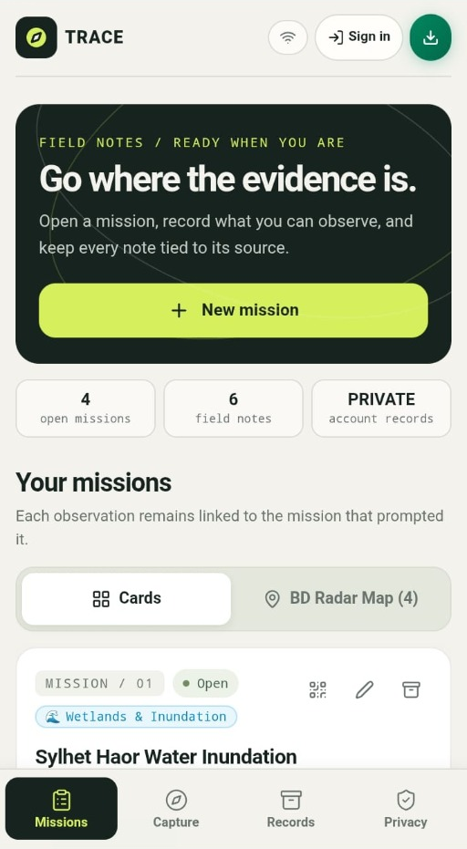
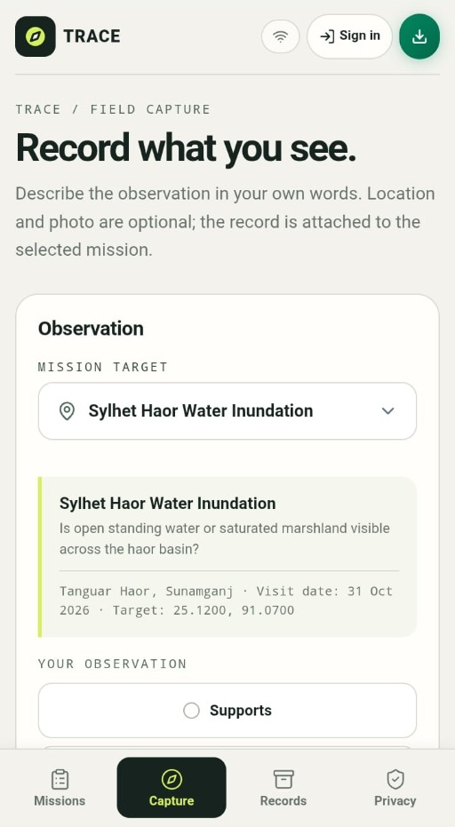
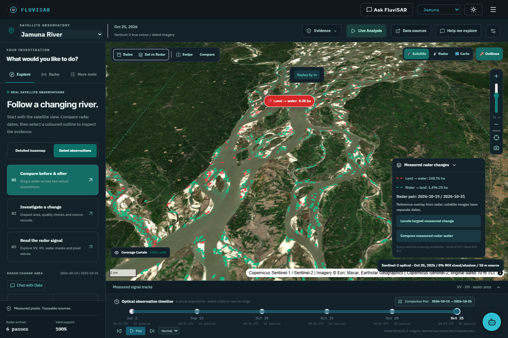
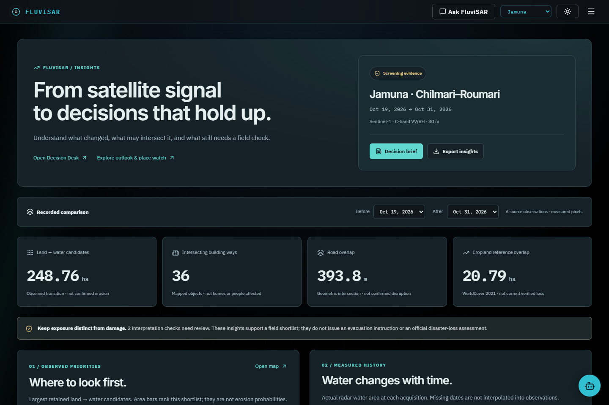
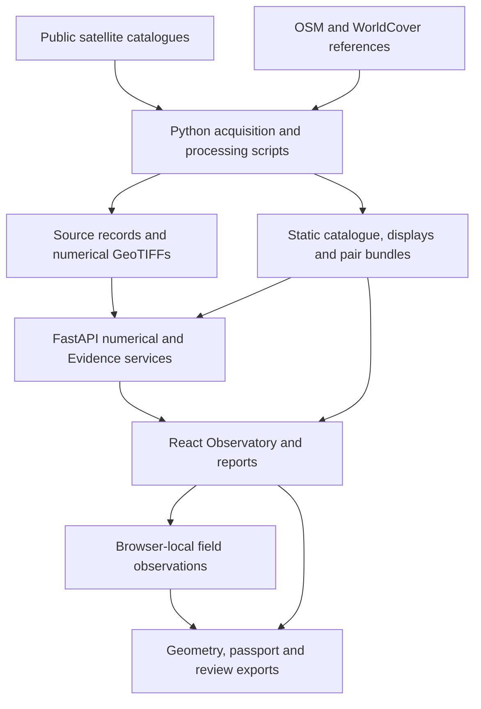

# FluviSAR — Satellite Observatory & Evidence Platform

**Observe change. Challenge the evidence. Document the follow-up.**

A dual-region Earth-observation application for exploring Bangladesh's **Jamuna River** and **Sundarbans mangrove landscape**, built for a NASA Space Apps demonstration. FluviSAR connects dated satellite imagery, numerical radar measurements, reproducible water-transition screening, human field observations and source-linked reports in one investigation workflow.

**Application:** React 19 · TypeScript 7 · Vite 8 · MapLibre GL JS

**Scientific services:** Python 3.12 · FastAPI · Rasterio · NumPy · SciPy · Shapely

**Current observation sources:** Copernicus Sentinel-1D RTC and Sentinel-2 L2A

[Feature guide](#feature-guide--what-can-i-do-here) · [Judge walkthrough](#a-five-minute-project-walkthrough) · [Quick start](#3-quick-start) · [Live Analysis](#6-evidence-and-live-analysis) · [Methods](#11-scientific-method-and-interpretation) · [Testing](#16-testing-and-verification)

> **Current implementation — 12 November 2026**
>
> The operational observation catalogue uses **Sentinel-1 C-band VV/VH**, not NISAR L-band measurements. Each region has six radar and six optical acquisitions. NISAR, interferometry and generated ML experiments are included as educational material. Mapped transitions are **screening candidates**, not confirmed erosion, flooding, habitat loss or damage.

---

## 🌐 The Integrated Dual-Platform Ecosystem

FluviSAR connects spaceborne radar intelligence with boots-on-the-ground verification through two dedicated, interconnected applications:

| Component | Platform | Live URL | Source Repository |
| :--- | :--- | :--- | :--- |
| **🛰️ FluviSAR Web Observatory** | Desktop / Web GIS | [Active Deployment*](https://nasa-web-240sec-chi.vercel.app/) | [Current Repository](https://github.com/Tony1254-CS/nasa-web-240sec-) |
| **📱 TRACE Field Companion App** | Mobile / Web PWA | [🚀 Live App (Vercel)](https://nasa-space-apps-2026-trace.vercel.app/) | [💻 TRACE Repository](https://github.com/sanjidtalukder/Nasa-Space-Apps-2026-TRACE) |

### 🔄 Space-to-Ground Synergy (How They Work Together)
1. **Detect from Orbit (FluviSAR Web Observatory):** Multi-temporal Sentinel-1 C-band and NISAR L-band simulation algorithms screen floodwaters, sandbar shifts, and riverbank slumping across the Jamuna and Sundarbans.
2. **Verify in the Field (TRACE Companion App):** Field volunteers, researchers, and local responders receive screened candidate coordinates on their mobile devices, capture georeferenced field photos, log riverbank stability stages, and submit ground-truth telemetry directly back into the scientific verification loop.

<p align="center">
  
  &nbsp; &nbsp;
  
</p>

<p align="center">
  <em>Figure: TRACE Mobile Companion App — (Left) Field mission inbox with real-time radar hazard tasks; (Right) On-site ground-truth observation capture with GPS and verification telemetry.</em>
</p>

---

## Why FluviSAR?

**A coloured change on a map is a question. FluviSAR helps people investigate it.**

On the Jamuna, a newly dark radar patch might reflect water-level change, exposed
sediment becoming inundated, or a moving channel. In the Sundarbans, tide,
vegetation and surface conditions complicate the same comparison. Decision-makers
need to know where to look, which observations support the result and what still
needs a visit on the ground.

FluviSAR brings that investigation into one workspace: compare real acquisitions,
inspect numerical evidence, challenge the classification, identify mapped assets,
record field observations and take a source-linked brief into a discussion.
The intended benefit is **better targeted review with an auditable handoff**;
community deployment and avoided-loss outcomes have not yet been measured.



*Current application capture, 9 November 2026. The satellite acquisition and radar
comparison have separate dates, shown on the map; coloured polygons are measured
radar-transition candidates rather than confirmed erosion.*

| Current project at a glance | What is available |
| --- | --- |
| Two contrasting Bangladesh landscapes | Jamuna braided river and Sundarbans tidal mangroves |
| 24 source acquisitions | Six radar + six optical dates in each region |
| 30 registered radar comparisons | Fifteen chronological pairs per region |
| Six-stage evidence workflow | Detect → Investigate → Challenge → Explain → Field → Impact |
| One connected investigation | Region, dates and finding travel with supported reports, exports and map handoffs |
| Real evidence alongside learning tools | Observations, calculations, generated experiments and user assumptions are labelled separately |

## Feature guide — what can I do here?

Use this table as a product tour. The numbered chapters below explain controls,
methods, outputs and setup in more detail.

| Feature / where to open it | What you can do | What you get |
| --- | --- | --- |
| **Regional Atlas** · `/atlas` | Explore two case studies, dated previews, acquisition windows, measured transitions and expandable quality checks | A geographic starting point with original source links and a direct route into either Observatory |
| **Satellite & Radar Observatory** · `/observatory/jamuna`, `/observatory/sundarbans` | Fly into the study area; switch detailed context, dated optical, VV/VH radar and Carto; zoom, recenter and inspect outlines | Georeferenced observations with visible sensor, date, coverage and attribution |
| **Time machine & comparison** · Observatory → Dates / Swipe / Split | Select actual dates, play the six-pass timeline, drag the before/after divider or compare synchronized maps | A visual comparison of recorded acquisitions, with separate optical and radar dates |
| **Pixel & channel inspection** · Observatory → Radar | Read VV, VH and ratio values; toggle water masks and transitions; click supported pixels | Numerical GeoTIFF samples, coordinates, units and valid-support information |
| **Evidence workbench** · Evidence menu | Open any of the six stages and examine the current run or selected finding | Histograms, quality checks, sensitivity, interpretation, field tasks and exposure in one scoped review |
| **Live Analysis** · Observatory toolbar | Start at Detect and move through the stages one by one | An on-demand evidence review with visible progress, stage results and an exportable receipt |
| **Threshold challenge** · Evidence → Challenge | Compare −18, −17 and −16 dB water screens | Threshold-stable core and sensitive fringe; a test of robustness rather than a probability |
| **Finding inspector & Change Passport** · select a map outline | Inspect area, source pixels, geometry, lineage and audit information | A specific candidate that can be reopened, reviewed or exported with its provenance |
| **Decision Desk** · `/impact` | Search findings, choose a review order, examine repeated observations, mapped assets and NASA context | A practical queue for investigation and field follow-up, scoped to the selected comparison |
| **Executive Insights** · `/insights` | Read regional KPIs, area-ranked candidates, six-pass water history and the Sendai evidence bridge | A compact overview that connects measured screening results to the evidence still needed for impact reporting |
| **Economic planning scenario** · Insights | Enter local building/road/cropland rates, duration and an assumed affected share | Conditional BDT physical-cost and revenue-interruption calculations, chart and explicit assumption export |
| **Experimental water-area outlook** · Atlas | Compare persistence and elapsed-time drift over 6/12/24 days; inspect historical errors | An aggregate screened-water-area baseline with three chronological validation checks and an auditable export |
| **Place watch & timing sandbox** · Atlas | Filter retained mapped places by type/distance; inspect the nearest observed change; enter an assumed advance rate | A field-review shortlist and conditional gap-spanning time, without a predicted bank-failure date |
| **Field notebook** · Evidence → Field / Decision Desk | Write a dated note, request GPS and attach a real photo | Device-local, context-bound records with timestamps, optional accuracy/photo hash and export |
| **TRACE Field Companion App** · [Open Live App](https://nasa-space-apps-2026-trace.vercel.app/) | Mobile field mission inbox, on-site GPS verification, rapid photo logging and community hazard alerts | Ground-truth validation receipts that feed back into the 6-stage Evidence Workbench |
| **Ask FluviSAR** · header / bottom-right launcher | Ask English or Bengali questions about supported data, methods and the active finding | Source-linked data answers, supported map handoffs and local conversation history/export |
| **Chat with Data** · supported data sections | Activate selection, see eligible boxes highlighted, then choose one | A conversation scoped to that metric, Evidence stage or model explanation |
| **ML Intelligence** · `/intelligence` | Inspect real registered observations, then explore RF/MLP scenarios, robustness and evaluation | Four workspaces that keep measured evidence separate from reproducible generated-data diagnostics |
| **Interactive SAR Lab** · `/sar-lab` | Explore radar physics, scattering, speckle, geometry, dielectric response and phase models | Hands-on explanations and teaching experiments, with their input/model limits visible |
| **Stories, reports & team** · `/stories`, `/reports`, `/about` | Follow the evidence narrative, print a decision brief and meet the team | An accessible explanation of the project, source-linked reporting and a one-page PDF/QR handoff |

**Reading “prediction” correctly:** the Atlas outlook estimates aggregate water
area from a small archive; the place-timing sandbox uses a rate supplied by the
user. Neither predicts where or on which day a riverbank will fail. See
[outlook methods and limitations](docs/ATLAS_OUTLOOK.md).

### Who is it for?

| Intended user | A useful task | Relevant output |
| --- | --- | --- |
| Government / disaster-management staff | Shortlist changes for inspection and discuss service continuity | Decision Desk, mapped road/facility intersections, printable brief |
| NGO / field teams | Visit a selected finding and preserve what was actually observed | Field task, GPS/photo notebook and portable evidence packet |
| Researchers | Reproduce a comparison and test parameter sensitivity | Numerical samples, source IDs/hashes, threshold results and JSON exports |
| Resource managers | Review wetland, mangrove or cropland-reference overlap | Historical land-cover inventory with explicit reference year and scope |
| Union / community leaders | Understand the selected change and prepare questions for technical teams | Map, source-linked explanation, local notes and a shareable comparison QR |
| Students / educators | Learn why a radar signal or model output needs careful interpretation | SAR Lab, observation stories and generated ML experiments |

These are intended workflows, not claims of government adoption, surveyed
beneficiaries or an operational emergency-response deployment.

## A five-minute project walkthrough

This is a suggested product demonstration, not an event submission-duration rule.
Start the local application using [Quick start](#3-quick-start).

1. **Locate the question — Atlas.** Open `/atlas`, choose Jamuna and identify the
   study box, sensor and recorded dates. Explain why Sundarbans needs a different
   tidal/vegetation interpretation of the same workflow.
2. **See the evidence — Observatory.** Let the geographic fly-in complete, switch
   from Satellite to Radar and compare the default pair with Swipe. Select an
   outline and read its measured area and original acquisition IDs.
3. **Challenge the result — Live Analysis.** Begin at Detect, inspect the measured
   histogram, then review optical offsets/clouds and threshold sensitivity.
   Explain what survives the tests and what still needs independent confirmation.
4. **Plan the follow-up — Decision Desk / Insights.** Review mapped asset overlap,
   open the matched finding, and inspect the six recorded water-area observations.
   If demonstrating an economic scenario, supply explicit example rates and call
   the result a conditional scenario.
5. **Make the handoff — Field / Report.** Save a clearly labelled demo field note,
   export its context and print the source-linked one-page brief with comparison
   QR. Show that the exported dates/finding match the map.
6. **Explain the learning layer — Intelligence / SAR Lab.** Contrast real VV/VH
   observations with a generated RF/MLP experiment or speckle simulation. Close
   with the data gap and validation needed before an operational forecast.

The differentiator is the **connected evidence trail**: an image, its numerical
inputs, the challenge to its interpretation and the next human action remain
linked throughout the demonstration.

### Hackathon context and evidence for reviewers

The project's stated theme is **Dancing with the SARs**. The earlier prototype
provided the product concept; this build centres two retained Sentinel-1 case
archives and makes their investigation reproducible. NASA POWER precipitation
and NISAR catalogue records provide additional context. The quantitative change
algorithm currently uses Copernicus Sentinel-1, **not numerical NISAR GCOV**.

The official [2025 Space Apps judging guidance](https://spaceapps-v2-staging.s3.amazonaws.com/media/documents/Final_Space_Apps_2025_Judging_Guidelines_for_web.pdf)
is a useful presentation reference for impact, creativity, validity, relevance
and communication. It is cited as prior-year guidance, not as confirmed 2026
submission rules. Review the current event's official instructions separately.

| Review question | Evidence to inspect in this repository |
| --- | --- |
| Who could benefit, and how? | Intended-user workflows above; scoped field tasks and decision briefs rather than unmeasured beneficiary claims |
| What is distinctive? | Six-stage challenge/review, context-preserving handoffs, supported-box data chat and separate learning experiments |
| Is the method inspectable? | Retained acquisition IDs, numerical GeoTIFFs, declared thresholds, source checksums and reproducible exports |
| How are NASA resources used? | The source-role table, archived POWER context and NISAR acquisition metadata; numerical NISAR processing remains a gap |
| Can someone understand and reproduce it? | The demo walkthrough, per-feature instructions, installation commands, API reference and dated QA records |

**AI use disclosure:** AI coding assistance was used for implementation,
documentation and research support. The optional in-app language model explains
allowed backend data-tool results; its presence is distinct from the deterministic
numerical pipeline. Generated ML datasets and physics experiments are labelled
as such. The team remains responsible for code, scientific interpretation,
attribution and the final submission. No AI-generated satellite observation is
substituted for a registered acquisition.

## Table of contents

1. [Project overview](#1-project-overview)
2. [Study areas and observation inventory](#2-study-areas-and-observation-inventory)
3. [Quick start](#3-quick-start)
4. [Landing page and regional atlas](#4-landing-page-and-regional-atlas)
5. [Observatory workspace](#5-observatory-workspace)
6. [Evidence and Live Analysis](#6-evidence-and-live-analysis)
7. [Field observations and exports](#7-field-observations-and-exports)
8. [Decision Desk](#8-decision-desk)
9. [ML Intelligence](#9-ml-intelligence)
10. [SAR Lab, stories and reports](#10-sar-lab-stories-and-reports)
11. [Scientific method and interpretation](#11-scientific-method-and-interpretation)
12. [Data sources and provenance](#12-data-sources-and-provenance)
13. [Architecture and repository structure](#13-architecture-and-repository-structure)
14. [API reference](#14-api-reference)
15. [Data acquisition and reproduction](#15-data-acquisition-and-reproduction)
16. [Testing and verification](#16-testing-and-verification)
17. [Build, hosting and troubleshooting](#17-build-hosting-and-troubleshooting)
18. [Current boundaries and next steps](#18-current-boundaries-and-next-steps)
19. [Documentation and contribution](#19-documentation-and-contribution)
20. [Licensing and attribution](#20-licensing-and-attribution)

---

## 1. Project overview

### 1.1 The investigation problem

A river channel moves, water recedes from a sandbar, or a wetland's radar response changes. A before/after image can reveal a difference, but that difference alone cannot establish its cause, permanence or impact.

FluviSAR provides a traceable way to move from **observation → comparison → challenge → explanation → field review → potential exposure**. Acquisition dates, processing parameters, numerical support and source records remain beside the visual result.

### 1.2 What users can do

- Browse actual dated optical and radar imagery over two configured study areas.
- Compare acquisitions with a draggable swipe or synchronized side-by-side maps.
- Inspect VV, VH, dual-polarization displays, water masks and transition candidates.
- Sample numerical radar values from retained GeoTIFFs.
- Test how a result changes under three declared water-screening thresholds.
- Follow a six-stage Evidence review or open a stage directly.
- Record a dated field note, optional photograph and requested device GPS location.
- Examine intersections with mapped assets and historical land-cover classes.
- Export geometry, source lineage, field records and evidence-review receipts.
- Learn SAR physics and experiment with explicitly generated ML scenarios.

### 1.3 Three distinct kinds of output

| Output | Meaning | Example |
| --- | --- | --- |
| **Satellite observation** | An acquisition or value tied to an identified source product | A Sentinel-1 VV pixel or dated Sentinel-2 image |
| **Computed result** | A calculation from retained inputs and declared parameters | Component-filtered land-to-water area |
| **Educational or hypothetical scenario** | A teaching model or user-assumed situation | InSAR fringe experiment or flood-planning assumption |

A sensitivity result is not a calibrated probability. An exposure intersection is not a damage assessment. A saved field observation awaits human review.

## 2. Study areas and observation inventory

### 2.1 Active regions

| Region | Investigation context | Analysis bounds `[west, south, east, north]` |
| --- | --- | --- |
| **Jamuna · Chilmari–Roumari** | Braided river channels, sandbars, floodplain water transitions and field-review priorities | `[89.60, 25.40, 89.90, 25.75]` |
| **Sundarbans · Passur** | Tidal landscape, shoreline transitions, radar response and mangrove-reference context | `[89.55, 21.75, 89.85, 22.00]` |

Numerical analysis uses a **30 m EPSG:32645 grid**. Dated optical displays can cover the larger source tile; the dashed study box identifies the smaller analysis footprint.

### 2.2 Actual acquisition dates

All dates below are in **2026**. Original UTC timestamps are retained in the catalogue.

| Region | Sentinel-1 radar: six dates | Sentinel-2 optical: six dates |
| --- | --- | --- |
| Jamuna | Jul 3 · Aug 20 · Sep 25 · Oct 7 · Oct 19 · Oct 31 | Jun 2 · Sep 15 · Oct 10 · Oct 15 · Oct 20 · Oct 25 |
| Sundarbans | Jul 6 · Aug 23 · Sep 28 · Oct 10 · Oct 22 · Nov 3 | Jun 4 · Sep 14 · Oct 12 · Oct 17 · Oct 22 · Oct 27 |

The archive contains **24 source acquisitions** across the two regions. Six radar dates provide **15 chronological comparison pairs per region**: one default pair and 14 additional retained pair bundles. Optical and radar timelines are separate because their acquisition dates differ.

### 2.3 Default radar comparisons

| Region | Default pair | Land → water | Water → land | Retained polygons |
| --- | --- | ---: | ---: | ---: |
| Jamuna | 19 Oct → 31 Oct 2026 | 248.76 ha | 1,496.25 ha | 735 |
| Sundarbans | 22 Oct → 3 Nov 2026 | 18.18 ha | 21.96 ha | 24 |

These are component-filtered **water-transition candidates**, not independently verified erosion/accretion estimates. Their source of record is the [runtime observation catalogue](fluvisar-next/apps/web/public/observations/index.json). Selecting another radar pair loads that pair's own results.

## 3. Quick start

### 3.1 Prerequisites

- **Node.js 22.12+** and npm. Local development uses Node 24; the installed Vite engine also supports Node 20.19+.
- **Python 3.12** for the pinned scientific environment.
- **uv**, or Python's standard `venv` and pip.
- Git and a modern WebGL-capable browser.
- Internet access for initial dependency/data downloads and external context tiles.

The active application is under `fluvisar-next/`. The repository root is the documentation entry point.

### 3.2 Windows / PowerShell

From the repository root:

```powershell
cd fluvisar-next
uv venv --python 3.12 .venv-data
uv pip install --python .venv-data/Scripts/python.exe -r requirements-data.txt

cd apps/web
npm ci
npm run dev
```

### 3.3 macOS / Linux

```bash
cd fluvisar-next
uv venv --python 3.12 .venv-data
uv pip install --python .venv-data/bin/python -r requirements-data.txt

cd apps/web
npm ci
npm run dev
```

Without uv, create `.venv-data` with Python 3.12 and install the same `requirements-data.txt` using that environment's `python -m pip`.

### 3.4 Open the application

| Service | Local address |
| --- | --- |
| Web application | [localhost:5173](http://localhost:5173) |
| Jamuna Observatory | [localhost:5173/observatory/jamuna](http://localhost:5173/observatory/jamuna) |
| Sundarbans Observatory | [localhost:5173/observatory/sundarbans](http://localhost:5173/observatory/sundarbans) |
| API health | [127.0.0.1:8000/api/health](http://127.0.0.1:8000/api/health) |
| Interactive API documentation | [127.0.0.1:8000/docs](http://127.0.0.1:8000/docs) |

`npm run dev` starts or reuses the numerical API on port **8000**, then starts Vite. Vite proxies `/api` to the local service. No external AI-service key is required for this workflow.

The observation catalogue and registered artifacts must be present. If a checkout does not include the local archive, follow [Data acquisition and reproduction](#15-data-acquisition-and-reproduction) before using scientific features.

### 3.5 A first investigation

1. Open Jamuna or Sundarbans and inspect the dated satellite view.
2. Select a date in the optical timeline, or switch to **Radar** for its timeline.
3. Open **Comparison Pair**, choose Before/After acquisitions and use Swipe or Split.
4. Open **Evidence** for a specific stage, or press **Live Analysis** to start at Detect.
5. Review each result and select **Proceed to …**. Finish with **Complete Analysis**.
6. Export the review or collect a field observation for independent follow-up.

## 4. Landing page and regional atlas

### 4.1 Landing page — `/`

The landing page introduces the observation-to-evidence workflow through:

- A source-backed radar-image hero and investigation entry point.
- Four concepts: active sensing, backscatter, water screening and change detection.
- Jamuna and Sundarbans study-area cards.
- A processing-chain overview and evidence-trail explanation.
- Acquisition/source records connected to the current catalogue.

**Implementation:** [LandingPageView.tsx](fluvisar-next/apps/web/src/components/LandingPageView.tsx).

### 4.2 Regional atlas — `/atlas`

The atlas combines a geographic overview with two source-backed case studies. Each case preserves acquisition windows, sensor metadata, valid support and processed area, and adds dated optical previews, measured transitions, expandable quality checks and original radar-source links. Opening a region enters its Observatory.

A prominent experimental water-area outlook compares persistence and elapsed-time drift using chronological rolling-origin checks. Users select the region, a 6/12/24-day horizon and a method, inspect measured history and historical errors, and export the complete inputs/calculation. This small-sample baseline estimates aggregate screened water area; it does not predict future flood boundaries or damage. A place watchlist adds source-backed proximity to observed land-to-water polygons, filters, matched-finding map links and a user-assumed gap-spanning timing scenario. It never assigns a bank-failure date or hazard probability. See [Atlas outlook methods and limitations](docs/ATLAS_OUTLOOK.md).

**Implementation:** [AtlasView.tsx](fluvisar-next/apps/web/src/components/AtlasView.tsx).

#### Outlook and place-watch controls

| Control / view | How it works | Why it is useful |
| --- | --- | --- |
| Regional case card | Shows actual optical preview, radar dates, support, transition metrics and QC | Establishes what data exists before entering an investigation |
| Forecast horizon | Select 6, 12 or 24 days after the latest recorded radar observation | Makes the forecast origin and target explicit |
| Method comparison | Inspect persistence, elapsed-time drift and automatic selection by historical absolute error | Makes the small baseline understandable and challengeable |
| Measured/projected chart | Separates six measurements from the continuation and historical-error envelope | Avoids presenting projected values as observed imagery |
| Place filters | Filter retained OSM records by category and geometric distance to observed land → water | Helps select places for field review |
| Matched-finding link | Opens the actual nearest transition with its evidence context | Connects a place to the measurement behind its shortlist position |
| Assumed-rate sandbox | Calculates time to span the measured gap at a user-entered constant rate | Supports a disclosed planning exercise; the rate is not learned from bank retreat |
| Export | Includes observations, source IDs, method checks, geometry/proximity and assumptions | Allows another person to inspect the calculation outside the UI |

The current place shortlist contains 60 Jamuna and 14 Sundarbans records, selected
from the archived map using the documented eligibility rules. These are mapped
records, not counts of all important places or people at risk.

### 4.3 Decision insights - `/insights`



*Current application capture, 9 November 2026. Mapped exposure remains distinct
from confirmed damage or people affected.*

The executive overview adapts the previous project's Insights concepts to actual
registered data: transition area, mapped building/road exposure, historical
land-cover overlap, area-ranked candidates and six-pass water history. A Sendai
evidence bridge uses the official indicator meanings while separating screening
inputs from confirmed people affected, damaged facilities and monetary losses.

A conditional BDT scenario accepts explicit local unit rates, affected share and
interruption duration. It separates physical-cost assumptions from cumulative
revenue interruption, with no hidden prices or fixed damage/loss split. Review
steps persist by run; exact-comparison map links, a scope-correct brief and a JSON
packet preserve observations, sources, quality, assumptions and user status.

See [Insights analysis, methods and research](docs/INSIGHTS.md).

#### What the Insights sections communicate

- **Measured overview:** land → water area, intersected building ways, road metres
  and relevant historical land-cover overlap for the selected radar pair.
- **Review priorities:** the largest land → water components with coordinates,
  measured area and exact finding links. Bar lengths represent area, not risk.
- **Observation history:** all six radar passes, with original acquisition links
  and gaps kept visible rather than filled with invented daily values.
- **Sendai evidence bridge:** six cards covering B-3/B-4, B-5, C-2, C-4, C-5 and
  D-2/D-3 explain which screening inputs are available and which confirmed human,
  damage or monetary records would still be needed.
- **Planning economics:** explicit local rates, affected share and duration feed
  separate physical-cost and revenue-flow terms. No total appears before all
  required rates are supplied; an explicit zero excludes a term.
- **Review and handoff:** four run-local review steps, quality/source details,
  current-comparison brief and a JSON packet containing assumptions and lineage.

## 5. Observatory workspace

**Routes:** `/observatory/jamuna` and `/observatory/sundarbans`.

### 5.1 Map, geography and display modes

The MapLibre workspace opens on the configured study areas and fits shared study bounds during comparisons. It supports:

- **Satellite:** detailed Esri context or dated Sentinel-2 L2A true-colour observations, explicitly labelled.
- **Radar:** calibrated Sentinel-1 RTC displays registered to the numerical footprint.
- **Carto:** OpenStreetMap context.
- Recenter, zoom buttons, a precision zoom slider, scale and attribution.
- Map-image download and outline/tinted display options.

Esri World Imagery supplies context beyond valid dated optical coverage. It is a context mosaic, not another date-matched observation. Optical clouds remain in the original images.

Each fresh Observatory visit animates from a wide geographic view into the existing zoom 11.4 / 55-degree study-area camera, including sessions that previously viewed the area. Skip, Replay, interaction cancellation and reduced-motion support remain available; comparison views share exact study-area framing.

The desktop Observatory keeps the investigation panel on the left; phones use a
feature drawer. Both regions open on Satellite at zoom 11.4 with a 55-degree tilted overview. Switching Radar, Satellite or Carto preserves the live camera rather than refitting the image. Sundarbans offers
the detailed Esri satellite mosaic as an optional context view, labelled without an acquisition
date. In Satellite mode, selecting an optical timeline pass or date comparison opens actual Sentinel-2
observations. Initial optical comparisons use the two least-cloudy retained
scenes, and cloud/shadow percentages remain visible. A floating launcher opens
the source-connected assistant from the bottom right in a docked, non-modal chat window.

Dated optical detail loads from locally served lossless tiles generated from
original 10 m Sentinel-2 sources. See [map layout, imagery provenance and rebuild
instructions](docs/MAP_FIRST_OBSERVATORY.md).

### 5.2 Before/after comparison

Two synchronized maps share center, zoom, bearing and pitch.

| Control | Behavior |
| --- | --- |
| **Dates** | Compares actual acquisitions from the active optical/radar collection |
| **Sat vs Radar** | Compares optical and radar acquisitions with explicit source/date labels |
| **Swipe** | Clips one full-size map with a draggable, keyboard-accessible divider |
| **Split** | Displays equally sized, geographically synchronized panes |
| **Single** | Returns to one observation |
| **Comparison Pair** | Selects a chronological Before/After pair |

Selecting a timeline date opens that single observation. Playback cycles the available acquisitions at the chosen speed; it does not manufacture intermediate daily imagery.

### 5.3 Feature discovery

The feature rail organizes controls into **Explore**, **Radar** and **More tools**. Users can compare observations, open findings, inspect channels or choose regional investigation/planning tools. On smaller screens, the feature rail becomes a drawer.

Radar displays include **VV**, **VH**, **VV/VH ratio** and a declared **RGB display composite**. That composite is not a full-polarimetric Pauli decomposition.

| Left-panel tab | What to try | Expected result |
| --- | --- | --- |
| **Explore** | Choose Detailed basemap or Dated observations; open Compare before & after, Investigate a change or Read the radar signal | A clear starting action, current-pair transition summary, source access and decision-brief entry point |
| **Radar** | Switch polarization/channel, display VV/VH amplitude, water mask or transitions, then click the map | The active layer and valid numerical pixel sample, with coordinates and units |
| **More tools** | Open the region's investigation tools, declared scenario planner or ground-motion teaching experiment | Specialized views whose evidence and hypothetical inputs remain distinct |

The full-height rail uses the space beside the map and timeline; its footer
reports the actual radar-pass count and valid support. Phones expose the same
features through **Explore features**, with a closable drawer rather than a
permanently narrow map.

### 5.4 Numerical inspection and support

- Clicking a visible radar pixel samples its retained GeoTIFF through the API.
- Ratio samples use both measured channels.
- Coverage controls expose the comparison's common valid support.
- Candidate polygons open area, lineage, audit and export information.
- Measured signal tracks show VV/VH statistics and classified water area.

Outside valid numerical support, samples are masked/null. Values are not generated from a coordinate formula.

### 5.5 Regional and educational tools

Jamuna includes river/floodplain evidence and service-continuity planning. Sundarbans includes wetland/mangrove response context and polarization exploration. Both expose a declared scenario planner and an educational ground-motion experiment.

InSAR phase/coherence controls are teaching models: the RTC intensity archive does not contain interferometric phase. Budgets, stage changes and other user assumptions remain separate from satellite observations.

**Key implementation:** [MapWorkspace](fluvisar-next/apps/web/src/components/MapWorkspace.tsx), [SwipeCompareMap](fluvisar-next/apps/web/src/components/SwipeCompareMap.tsx), [TimelinePlayer](fluvisar-next/apps/web/src/components/TimelinePlayer.tsx), [feature rail](fluvisar-next/apps/web/src/components/ObservatoryFeaturePanel.tsx), [finding inspector](fluvisar-next/apps/web/src/components/FindingInspectorDrawer.tsx).

| Regional / planning tool | Available interaction | Meaning |
| --- | --- | --- |
| River change / Wetland change evidence | Open the current pair's inspector | Measured evidence for the active region |
| Floodplain & farmland / Mangrove response | Inspect recorded channels and reference context | A regional interpretation lens, not a crop-loss or habitat-loss verdict |
| Jamuna Service continuity | Set an inspection-team budget, declare a ferry interruption and enter an assumed isolated population; open area-ranked candidates | A field-planning shortlist; entered population and crossing status are assumptions |
| Scenario planner | Set hypothetical stage change, ferry/breach assumptions and review cost per hectare; export the receipt | A disclosed scenario budget based on candidate reference area, not hydraulic flood depth |
| Ground motion experiment | Explore phase, coherence and line-of-sight concepts | Educational InSAR controls rather than measured displacement from the RTC archive |

## 6. Evidence and Live Analysis

### 6.1 Six stages, one investigation context

Evidence is bound to the selected **region, radar run, acquisition pair and optional finding**. The optical comparison supplies cross-sensor context.

| Stage | Main question | Actual output |
| --- | --- | --- |
| **Detect** | What did the radar comparison measure? | VV previews, source-pixel histogram, transition areas and parameters |
| **Investigate** | What supports or complicates interpretation? | Source records, quality checks, optical date offsets and cloud fractions |
| **Challenge** | Does the result survive another threshold? | Recomputed −18/−17/−16 dB results, stable core and sensitive fringe |
| **Explain** | What conclusion does the evidence support? | Rule-based screening verdict, limits, provenance and follow-up questions |
| **Field** | What can a person observe at the site? | Context-bound task and authored records with optional GPS/photos |
| **Impact** | What mapped features overlap the candidates? | Asset intersections, road length and historical land-cover overlap |

### 6.2 Guided execution

**Live Analysis** starts at Detect. Each stage reads or computes its evidence, displays the result and enables **Proceed to the next stage**. Future stages stay locked until reached; reviewed stages can be revisited. Restart begins a fresh review.

Region, radar pair, finding or optical-context changes reset the guided context. In-flight requests are cancelled. A Jamuna result is not carried into a Sundarbans review.

Processing details describe operations performed against retained artifacts. This is an **on-demand review of the registered archive**, not a streaming connection to a satellite, a field team or an operational alert system.

### 6.3 Full Analysis Report

Live Analysis opens in **Focus Mode** with a narrow live map on the left and the main reading workspace on the right on laptops/desktops. **Hide preview / Show preview** toggles that map without recreating it; phones retain the full-width report. Each stage uses a two-column dashboard so its primary content fits at 1366 x 768 without scrolling. Longer source, audit and saved-record lists open in separate detail panels; **Reading view** restores the flowing layout. The workspace has a compact header, collapsible context, visible six-step navigation, one scrolling content area and a compact action bar. **Present** optionally enters browser fullscreen for recording. **View map** restores adjacent map/report panes without losing the active stage; **Focus analysis** expands it again. Individual Evidence stages retain the map/report view by default. Large metrics, a measured histogram and detection parameters appear before source previews; processing logs remain expandable.

The report supports dark/light presentation, mobile layouts, JSON export, browser printing/Save PDF and a completion summary. Completing the workflow records that the review finished; it does not independently verify a scientific claim.

### 6.4 Impact for both landscapes

Impact uses an archived OpenStreetMap extract and an aligned **ESA WorldCover 2021 v200** reference grid.

- Jamuna emphasizes infrastructure, cropland, built-up and water-reference overlap.
- Sundarbans emphasizes mangroves, tree cover, wetland and water-reference overlap.
- Asset intersections are measured geometrically in the projected CRS.
- Road length refers to intersected mapped geometry.
- The land-cover table includes the historical study-area inventory and its overlap with each transition category.

A zero mapped intersection can reflect sparse mapping or the selected geometry. It is not proof that no assets exist. A 2021 reference-class overlap does not establish current habitat or crop loss.

**Implementation:** [EvidenceWorkbench](fluvisar-next/apps/web/src/components/EvidenceWorkbench.tsx), [stage panels](fluvisar-next/apps/web/src/components/EvidenceStagePanels.tsx), [workflow state](fluvisar-next/apps/web/src/store/evidenceWorkflowStore.ts), [review service](fluvisar-next/services/api/app/evidence.py). See the [Evidence workflow guide](docs/EVIDENCE_WORKFLOW.md).

### 6.5 Ask FluviSAR and Chat with Data

A shared assistant explains the active region, radar pair and selected finding, with source links, map handoffs, English/Bengali questions and on-device conversation export/history. Ask FluviSAR in the header and the bottom-right floating launcher open the same docked, non-modal chat window. Users can minimize it and continue using the page. Contextual Chat with Data buttons appear only beside supported metrics, model explanations or the current Evidence stage; the button first highlights supported boxes, then selecting a box opens its chat. Atlas forecasts do not send unsupported prediction values to the assistant.

Data-based answers use registered backend calculations. Optional Gemini function calling adds natural-language interpretation when a server-side credential is configured; provider errors and unsupported numerical output fall back to the verified data answer. Model experiments remain explicitly synthetic. See [Assistant and map implementation](docs/ASSISTANT_AND_MAP.md) for configuration, scope and limitations.

**Example questions to demonstrate:** “What changed in this comparison?”, “Which
are the largest candidates?”, “How sensitive is the result to the threshold?”
and “What mapped assets intersect this finding?” Select the finding first when
asking a local question. Answers retain their own region, pair and finding
context even if later questions move to another scope.

The assistant reads allowed backend tools, not arbitrary values supplied by the
browser. It does not send local field photographs to the model, generate a
verified erosion forecast or turn a synthetic model score into real-case accuracy.

## 7. Field observations and exports

### 7.1 On-device field records

Field accepts an observer name, actual observation time, condition and note. Users can request device GPS and attach an optional photograph.

Records retain:

- Region, radar run, pair and optional finding ID.
- Observation and recording timestamps.
- Observer-authored condition and note.
- Optional longitude, latitude and reported GPS accuracy.
- Optional photo bytes, filename and SHA-256 checksum.
- An **awaiting-review** state.

Storage uses the browser's `fluvisar-field-evidence` **IndexedDB** database. Records persist in the same browser/profile and are separated by investigation context. Saving a record does not upload it, synchronize with a team or change the satellite verdict. Clearing browser data removes local records; export a copy when it must be retained.

### 7.2 Export options

| Export | Contents |
| --- | --- |
| Candidate geometry | Selected geometry and recorded processing context |
| Change Passport | Source IDs, acquisition metadata, artifact checksums and interpretation evidence |
| Evidence review | Reviewed stage results, scope, pair and computation timestamps |
| Field task | Context, target geometry and observation questions |
| Field observations | Authored records, GPS metadata and optional embedded photo data |
| Exposure review | Source-linked intersections and reference land-cover results |
| Printable explanation/report | Current evidence rendered through browser print/Save PDF |

**Implementation:** [FieldEvidenceForm](fluvisar-next/apps/web/src/components/FieldEvidenceForm.tsx) and [field storage/export utilities](fluvisar-next/apps/web/src/data/fieldEvidence.ts).

## 8. Decision Desk

**Route:** `/impact`.

The Decision Desk presents any registered comparison for the active region as a human review workspace:

- Dated optical satellite context, VV/VH radar, water masks and a geographically aligned before/after divider.
- All six radar acquisitions, fifteen selectable pairs per region and measured water-area histories.
- Every candidate in a searchable ledger; ordering by area, mapped-asset intersection count, threshold sensitivity or outstanding review.
- Exact building/road/facility intersections, road overlap length and historical land-cover overlap for the study area or selected finding.
- Source-specific NASA rainfall context and archived NISAR GCOV discovery records through November 7, 2026.
- Candidate provenance, numerical hashes, quality checks and browser-local review status.
- Real authored field observations with optional requested GPS and photo, stored on the device.
- A separately labelled **What-if scenario**, preserving corridor controls and live OSM queries.
- A source-linked printable decision brief, pair-specific case JSON and working region/pair/finding deep links.

Actual exposure and the **What-if scenario** are distinct outputs. Exposure is spatial intersection, not confirmed damage or population affected. Priority ordering is not a calibrated risk score. NISAR catalog/browse context does not replace the numerical Sentinel-1 observations underlying the transition metrics. NASA POWER supplies IMERG where valid; recent gaps use explicitly labelled MERRA-2/GEOS-IT model precipitation. Field data and review states remain device-local.

**Implementation:** [ImpactDesk.tsx](fluvisar-next/apps/web/src/features/legacy/pages/ImpactDesk.tsx). See [Decision Desk methods and workflow](docs/DECISION_DESK.md).

### 8.1 From candidate list to review task

| Feature | Interaction | Interpretation / output |
| --- | --- | --- |
| Pair-specific map | Change region or actual Before/After dates; compare radar and optical context | All candidate geometry, metrics and exports follow the registered run |
| Searchable candidate ledger | Find a component and choose largest area, awaiting review, mapped overlap or threshold-sensitive ordering | A transparent review queue; order is not a hazard probability |
| Candidate details | Read area, source pixels, coordinates, follow-up observations and stable-core fraction | Evidence for deciding what to inspect next |
| Assets & land use / Habitat & assets | Select one finding for local intersections, or clear it for study-wide results | Mapped-object counts, projected road length and historical class overlap |
| Evidence & context | Inspect optical offsets/clouds, rainfall series and NISAR catalogue entries | Context with provider, time, missing-data and sensor limitations preserved |
| Field queue | Set browser-local review status and author dated notes/GPS/photos | A task and record tied to the same candidate, awaiting independent review |
| What-if corridor | Set length, depth and orientation; inspect the hypothetical envelope and queried assets | Assumption-only service-continuity planning, exported separately from measured exposure |
| Case handoff | Export JSON or print the brief | Matching region/pair/finding, geometry, sources, QC and review context |

### 8.2 Decision Desk versus Insights

Use **Decision Desk** to work through individual findings and field tasks. Use
**Insights** to communicate the selected comparison's overall evidence, priorities
and conditional planning assumptions. Both use the same registered observations
and numerical context; switching presentation does not create a new measurement.

## 9. ML Intelligence

**Route:** `/intelligence`.

### 9.1 Generated-data model sandbox

The **Model playground** demonstrates a **Random Forest** and **Temporal MLP** using generated radar-change scenarios. Both models' responses are visible for the same input, with explicit disagreement/review states, named local experiments, reset/original comparison and reproducible JSON export. It preserves what-if inputs and diagnostics including:

- Feature-space and pixel-scenario exploration.
- Training behavior and generated-data confusion matrices.
- Input sensitivity and class stability under speckle perturbation.
- Novelty/domain checks and temporal onset exploration.
- Connected-component segmentation filtering.
- Coverage/error trade-offs for selective review.

Scores describe the generated exercise. They are not real-case accuracy, calibrated probabilities or evidence that the demo models have been independently validated on Jamuna/Sundarbans imagery.

### 9.2 Workspace evidence

**Real observations** is the default workspace. It reads the selected registered pair, masks, georeferenced candidates, numerical statistics and quality record for either region, with all six radar acquisitions and every available comparison pair. Candidate review ordering, repeat observations, source-linked explanations and Observatory/Decision Desk handoffs retain the selected evidence context. Operational labels are VV/VH; generated HH examples remain in the model workspaces.

Four visible workspaces organize all tools: **Real observations**, **Model playground**, **Robustness & review**, and **Model evaluation**. Diagnostic controls persist across tabs and saved experiment snapshots. A guided walkthrough explains scenario selection, pixel inspection, model comparison, speckle and review decisions. Desktop/mobile and both themes share a consistent container grid.

### 9.3 What each Intelligence workspace lets you explore

| Workspace | Features and controls | What the output means |
| --- | --- | --- |
| **Real observations** | Region/pair selection, six-pass history, VV/VH imagery, masks, candidate filters, largest patches, QC, source details and numerical summaries | Actual registered measurements and screening candidates |
| **Model playground** | Random Forest / Temporal MLP, presets and input sliders, linked generated pixels/feature-space points, three-step schematic, score/entropy maps and perturbation controls | How two models respond to the same generated example; disagreement is made visible |
| **Robustness & review** | Gamma-speckle Monte Carlo resampling, CUSUM onset/duration, novelty/domain-distance checks, component filtering, IoU/Dice/precision/recall and coverage/error trade-offs | Controlled generated-data stress tests and review choices, not field-validated confidence |
| **Model evaluation** | Both models' holdout confusion matrices and class metrics, MLP training/validation curves and epoch slider, RF description, permutation sensitivity and architecture/data card | Reproducible diagnostics of the generated training exercise |

Named experiments can be saved and restored locally (up to eight), compared with
the original settings, reset and exported as JSON with seeds, inputs and outputs.
Model playground uses 720 generated examples: 500 training, 112 validation and
108 held-out test examples. The 31-tree forest and 4 → 16 → 8 → 4 MLP are
demonstration models, not a deployed satellite erosion classifier. Real-evidence
handoffs to Observatory and Decision Desk retain the selected pair and finding.

**Implementation:** [IntelligenceWorkspace.tsx](fluvisar-next/apps/web/src/features/legacy/pages/IntelligenceWorkspace.tsx), retaining the scientific modules in [Intelligence.tsx](fluvisar-next/apps/web/src/features/legacy/pages/Intelligence.tsx). See [Intelligence workspace methods and preservation map](docs/INTELLIGENCE_WORKSPACE.md).

## 10. SAR Lab, stories and reports

### 10.1 Interactive SAR Lab — `/sar-lab`

The science lab combines source-backed image exploration with explicitly educational experiments:

| Module family | Concepts and interaction |
| --- | --- |
| Radar/optical viewing | Actual project displays, change masks and optical/cloud context |
| Scattering and geometry | Surface/vegetation interactions, flood mechanisms, layover, foreshortening and shadow |
| Speckle and filtering | Generated intensity scenes, looks and Lee-filter behavior |
| Polarimetry | Channel notation and synthetic decomposition concepts |
| Wavelength and material response | Dielectric and target-scale experiments; L-/S-/C-band concepts |
| Interferometry | Phase/fringe synthesis, line-of-sight relationships and coherence teaching models |
| Processing walkthrough | Data-to-mask-to-transition interpretation and its limits |

NISAR, HH/HV and full-polarimetric examples belong to the educational material. The operational archive is Sentinel-1 **VV/VH**. Simulated phase or decomposition controls do not turn RTC intensity into a measured interferogram or quad-polarimetric product.

**Implementation:** [SARLab.tsx](fluvisar-next/apps/web/src/features/legacy/pages/SARLab.tsx).

#### Hands-on experiments

| Lab module | What you change or inspect | Learning objective |
| --- | --- | --- |
| Change Detection Explorer / Water and Change Map Lens | Inspect the retained project image pair and classified overlays | Separate a display image, a classified mask and a geospatial area result |
| SAR and Optical in Cloudy Conditions | Compare radar/optical observation concepts | Understand why microwave sensing complements cloud-limited optical views |
| Flood Signal Mechanism Simulator | Choose land cover and toggle inundation | Smooth open water can darken while some flooded vegetation can brighten |
| Speckle Statistics & Lee Filtering Lab | Adjust looks/noise and inspect a local Lee estimate | Understand Gamma intensity speckle and the smoothing/detail trade-off |
| Radar Geometry Cross-Section | Adjust incidence angle | Explore foreshortening, layover and shadow |
| H/α Eigenvalue Decomposition | Change a synthetic three-component coherency model | Explore entropy and mean scattering angle without claiming quad-pol measurements |
| SweepSAR animation | Compare conceptual antenna operation | Connect wide-swath coverage with scan-on-receive geometry |
| Dielectric Interface | Change representative permittivity and incidence angle | Distinguish idealized Fresnel reflection from actual SAR backscatter |
| L-/S-band Target-Scale Simulator | Change effective scatterer size | Compare wavelength and dimensionless target scale; avoid fixed penetration-depth claims |
| Temporal Coherence Model | Change time separation and decay constant | Read a parameterized exponential model rather than a measured coherence product |
| Synthetic histogram threshold | Move the threshold across generated distributions | See how a classification rule changes the split |
| InSAR Fringe Synthesizer | Adjust displacement controls | Explore phase/fringe relationships without presenting simulated phase as measured motion |

The Lab retains legacy case-specific explanatory material and teaching pipeline
examples. Its HH, Otsu, filtering and HAND examples are not a description of the
active Observatory's VV-based −17 dB production method. Use
[Scientific method](#11-scientific-method-and-interpretation) for that method.

### 10.2 Observation stories — `/stories`

Five chapters explain the active region's bundle: start with the signal, classify open water, compare like with like, challenge the result and return to the landscape. They use retained measurements rather than invented field testimony.

**Implementation:** [StoryModeView.tsx](fluvisar-next/apps/web/src/components/StoryModeView.tsx).

### 10.3 Source-linked reports — `/reports`

Reports expose the default comparison's measurements, quality record, source list, interpretation and manifest export. The shared one-page brief opens in an isolated, scrollable paper dialog, prints to A4 with working comparison QR and uses actual source-linked exposure rather than legacy demo figures. For a custom radar pair or selected finding, use the context-bound Evidence report and Change Passport.

**Implementation:** [ReportsView.tsx](fluvisar-next/apps/web/src/components/ReportsView.tsx).

### 10.4 About FluviSAR - `/about`

A four-chapter story follows the project question, Jamuna and Sundarbans, the evidence workflow and the original four-person team. Registered satellite imagery and source dates ground the story. The original names, roles and available profile link are retained; no fabricated biographies are added. The page supports both themes and mobile chapter navigation. `/about-us` is an alias.

SAR Lab now shares the analysis workspace palette, typography and spacing through CSS only. Its page source, all content, controls, numerical logic and references remain unchanged. See [About and Lab design preservation](docs/ABOUT_AND_LAB_DESIGN.md).

## 11. Scientific method and interpretation

### 11.1 From RTC intensity to a common analysis grid

1. Discover actual Sentinel-1 RTC acquisitions covering the configured area.
2. Retain source STAC records, identifiers, timestamps and unsigned asset URLs.
3. Select the same platform, relative orbit, acquisition direction and VV/VH channels within each region's radar series.
4. Average calibrated linear intensity onto the common **30 m EPSG:32645** grid.
5. Convert valid positive power to decibels:

   ```text
   backscatter_dB = 10 × log10(linear_power)
   ```

6. Mask nodata/nonpositive inputs and restrict calculations to the study region.
7. Use the support valid on both acquisitions for the pairwise comparison.

The input product is already radiometrically terrain corrected. The application preserves that source identity rather than claiming a new NISAR calibration.

### 11.2 Water screening and transition candidates

```text
water(t)       = valid(t) AND VV_dB(t) < -17
common         = valid(t0) AND valid(t1)
land_to_water  = common AND NOT water(t0) AND water(t1)
water_to_land  = common AND water(t0) AND NOT water(t1)
```

Four-connected components smaller than **9 pixels** are removed. One analysis pixel represents **900 m² = 0.09 ha**, so the minimum retained component is **0.81 ha**. Area comes from numerical pixel counts, not the size of a rendered PNG.

The fixed threshold screens low backscatter. It is not an independently validated universal water classifier.

### 11.3 Threshold sensitivity

Challenge recomputes masks at **−18, −17 and −16 dB** with the declared component filter. It reports both transition categories, the stable intersection across tests and the threshold-sensitive fringe. For a selected finding, the scope is clipped after pair-wide component filtering.

### 11.4 Polarization displays

```text
VV/VH ratio in dB = VV_dB - VH_dB
RGB display       = scaled VV, VH and ratio channels
```

The RGB display is a declared visualization composite. True Pauli decomposition requires polarimetric information not supplied by this dual-pol RTC archive.

### 11.5 Interpretation limits

Acquisition geometry, roughness, wind, surface wetness, water level, tides and vegetation can affect radar response. Clouds can obscure optical evidence. Seasonal or tidal transitions do not by themselves establish permanent erosion, damage or sub-canopy flooding.

The archive does not provide a continuous daily/three-day flood history. Acquisition gaps remain gaps. Independent stage/tide context, persistence checks and field/reference observations are needed to strengthen a geomorphic interpretation.

## 12. Data sources and provenance

| Source | Current use | Provenance / interpretation |
| --- | --- | --- |
| [Sentinel-1 RTC / Planetary Computer](https://planetarycomputer.microsoft.com/dataset/sentinel-1-rtc) | Actual calibrated VV/VH inputs, masks, sampling and radar comparisons | Source IDs, orbit metadata, numerical paths and hashes retained |
| [Sentinel-2 L2A / Earth Search](https://element84.com/earth-search/) | Dated true-colour imagery and optical context | Actual times, source-tile bounds, cloud/shadow statistics and display hashes |
| [OpenStreetMap](https://www.openstreetmap.org/copyright) | Archived mapped-asset geometry for Evidence Impact | Query, snapshot time, source links and checksum retained; coverage is incomplete |
| [ESA WorldCover 2021 v200](https://esa-worldcover.org/en/data-access) | Historical inventory and transition overlap | Reference year and aligned categorical GeoTIFF retained |
| Esri World Imagery | Context beyond dated optical coverage | Context mosaic, not a selected acquisition date |
| OpenStreetMap raster tiles | Cartographic display mode | Map attribution retained |

| NASA / NASA–ISRO resource | Actual role in this build | What it does not establish |
| --- | --- | --- |
| [NASA POWER](https://power.larc.nasa.gov/docs/methodology/data/sources_meteorology/) | Archived daily precipitation context in Decision Desk; IMERG where supplied, separately labelled MERRA-2/GEOS-IT model values for gaps | Acquisition-matched river/tide level or parcel-scale flood causation |
| [NISAR GCOV via ASF](https://nisar-docs.asf.alaska.edu/gcov/) | Identified catalogue acquisitions, metadata and product links; mission concepts in SAR Lab | A numerical NISAR change result or a replacement for the Sentinel-1 analysis |

The current asset archive contains **180,474 mapped records in Jamuna** and **14 in the configured Sundarbans footprint**. These counts describe the extract, not all real assets in either landscape.

### 12.1 Source records and checksums

- `data/raw/{region}/`: source metadata and asset extracts.
- `data/derived/`: numerical radar grids, common masks and land-cover references.
- `apps/web/public/observations/index.json`: runtime observation catalogue.
- `apps/web/public/observations/manifest.json`: retained catalogue record.
- `apps/web/public/observations/{region}/pairs/`: additional comparison bundles and displays.
- `apps/web/public/observations/{region}/evidence-context.json`: exposure-source metadata and checksums.

Signed access URLs used to read cloud assets are transient; access signatures are not persisted in the catalogue. See [Real observations](docs/REAL_OBSERVATIONS.md) for the retained artifact method.

## 13. Architecture and repository structure

### 13.1 Runtime data flow



### 13.2 Technology stack

| Layer | Implementation |
| --- | --- |
| Frontend | React 19, TypeScript 7, Vite 8, React Router |
| Mapping | MapLibre GL JS; registered image sources and synchronized maps |
| State | Zustand workspace/workflow stores and a shared evidence provider |
| Presentation | Scoped CSS, Tailwind CSS 4 and Lucide icons |
| API | FastAPI and Uvicorn |
| Raster processing | Rasterio/GDAL, NumPy, SciPy and Pillow |
| Spatial intersections | Shapely and projected geometry |
| Local field storage | IndexedDB; browser Geolocation and file APIs |
| Verification | Playwright, pytest and retained-artifact validation |

Exact dependency versions are recorded in [package.json](fluvisar-next/apps/web/package.json), its lockfile and [requirements-data.txt](fluvisar-next/requirements-data.txt).

### 13.3 Workspace layout

```text
NASA-web/
├── README.md                         # Current platform entry point
├── docs/                             # Evidence/data guides and design documents
├── plan.md                           # Broader project specification
├── PROGRESS.md                       # Historical milestone tracking
├── fluvisar-next/                    # Active application workspace
│   ├── apps/web/
│   │   ├── src/components/           # Observatory, report and field interfaces
│   │   ├── src/features/legacy/      # Integrated Desk, ML and SAR Lab modules
│   │   ├── src/data/                 # Catalogue loading and field utilities
│   │   ├── src/store/                # Workspace and Evidence workflow state
│   │   ├── public/observations/      # Displays, manifests and pair bundles
│   │   └── tests/                    # Browser regression suites
│   ├── scripts/                      # Active acquisition and validation
│   ├── services/api/app/             # Sampling and Evidence calculations
│   ├── data/raw/                     # Original source metadata/extracts
│   ├── data/derived/                 # Registered numerical artifacts
│   ├── pipeline/fluvisar/            # Broader adapters/method prototypes
│   ├── packages/contracts/           # Pydantic models, schemas and TS contracts
│   ├── configs/regions/              # Region configuration and boundaries
│   ├── tests/                        # Python tests
│   └── requirements-data.txt         # Pinned runtime/data dependencies
├── nasa-2026-web/                    # Earlier reference project, when present
└── graphify-out/                     # Generated codebase knowledge graph
```

The active reproduction path uses `scripts/`, the runtime catalogue and `services/api/`. Broader `pipeline/fluvisar/` modules and milestone contracts contain earlier/prototype capabilities; their presence does not establish that every proposed integration is active.

### 13.4 Application routes

| Route | View |
| --- | --- |
| `/` | Landing page |
| `/atlas` | Two-region atlas |
| `/observatory` | Redirect to the selected region |
| `/observatory/jamuna` | Jamuna workspace |
| `/observatory/sundarbans` | Sundarbans workspace |
| `/impact` | Decision Desk |
| `/insights` | Executive insights, Sendai evidence bridge and conditional economic planning |
| `/intelligence` | ML sandbox and workspace evidence |
| `/sar-lab` | SAR science lab |
| `/about` and `/about-us` | Project story and original team |
| `/stories` and `/stories/:chapterId` | Observation stories |
| `/reports` | Default-pair source-linked report |
| `/learn` and `/learn/:experimentId` | Compatibility redirects to SAR Lab |
| `/imact` | Compatibility redirect to `/impact` |

**Route source:** [App.tsx](fluvisar-next/apps/web/src/App.tsx). The earlier project's `/app`, `/cases`, `/methods` and authentication flows are not the active structure documented here; this build provides its own `/about` page.

## 14. API reference

The API serves registered artifacts and calculations. Interactive schemas are available at `/docs` on the API service.

| Method | Endpoint | Purpose |
| --- | --- | --- |
| GET | `/api/health` | Service health |
| GET | `/api/regions` | Regions and registered radar/optical dates |
| GET | `/api/regions/{region_id}` | Region details and default run |
| GET | `/api/cases/{case_id}` | Configured case metadata |
| GET | `/api/evidence` | Observation catalogue |
| GET | `/api/runs/{run_id}/bundle` | Default or historical radar comparison |
| GET | `/api/artifacts/{artifact_id}/sample` | Numerical sample; `lon`, `lat`, optional `channel=vv` or `vh` |
| GET | `/api/runs/{run_id}/evidence/{stage}` | Source-backed Evidence stage |
| GET | `/api/assistant/status` | Assistant mode and supported data tools |
| POST | `/api/assistant/ask` | Run-scoped, source-linked data answers with optional generative explanation |
| GET | `/api/runs/{run_id}/decision-context` | Actual observation history, exposure, candidate review statistics and NASA context; optional `finding_id` |

Stage values are `detect`, `investigate`, `challenge`, `explain`, `field` and `impact`. Optional parameters are `finding_id`, `optical_before` and `optical_after`; dates must exist in the catalogue.

Unknown runs/findings/stages return 404. Invalid optical dates return 400. A missing registered numerical dependency produces a service error rather than an invented result. Samples outside valid support return `masked: true` with `value: null`.

Field notes/photos are device-local; this workflow has no automatic field-upload or team-sync endpoint.

**Implementation:** [main.py](fluvisar-next/services/api/app/main.py) and [evidence.py](fluvisar-next/services/api/app/evidence.py).

## 15. Data acquisition and reproduction

### 15.1 Rebuild the retained archive

From `fluvisar-next/`, with the environment from Quick start:

```powershell
.venv-data/Scripts/python.exe scripts/ingest_sentinel1.py --before 2026-11-05
.venv-data/Scripts/python.exe scripts/extend_observation_history.py
.venv-data/Scripts/python.exe scripts/ingest_evidence_context.py
.venv-data/Scripts/python.exe scripts/ingest_decision_context.py
.venv-data/Scripts/python.exe scripts/warm_decision_cache.py
.venv-data/Scripts/python.exe scripts/validate_observations.py
```

On macOS/Linux, replace `.venv-data/Scripts/python.exe` with `.venv-data/bin/python`.

| Script | Responsibility |
| --- | --- |
| `ingest_sentinel1.py` | Default RTC pair; numeric rasters, source records, masks, metrics and candidates |
| `extend_observation_history.py` | Same-orbit history, dated optical scenes and additional radar pair results |
| `expand_optical_context.py` | Larger dated optical source tile; invoked by history extension |
| `ingest_evidence_context.py` | Archived OSM geometry and aligned WorldCover reference |
| `ingest_decision_context.py` | NASA POWER IMERG/model rainfall, raw response hashes and ASF NISAR discovery |
| `warm_decision_cache.py` | Precompute all thirty registered Decision Desk comparisons; source/method signatures invalidate cache |
| `render_polarizations.py` | Source-derived ratio and RGB displays |
| `validate_observations.py` | Catalogue consistency, pixel statistics, masks, geometry areas and checksums |

The history script targets the declared **2026 demonstration archive**, with cached discovery records. It is not a rolling daily scheduler. Duration and availability depend on upstream catalogues, cloud assets and Overpass access. Public endpoints may rate-limit downloads.

### 15.2 What must travel with a deployment

Static rendering needs the catalogue, registered PNGs, pair JSON and geometry artifacts. Numerical sampling and Evidence additionally need the API and registered `data/derived/` files. Impact also needs its archived asset extract and land-cover reference.

Keep a published catalogue consistent with the artifacts it references. Do not replace a missing acquisition with a differently dated image under the original filename.

## 16. Testing and verification

### 16.1 Frontend build and browser suite

From `fluvisar-next/apps/web/`:

```bash
npm ci
npx playwright install chromium
npm run build
npm run test:e2e -- --workers=1
```

The current browser suite registers **87 tests in seventeen files**:

| Suite | Main coverage |
| --- | --- |
| `insights.spec.ts` | Explicit valuation arithmetic, real regional exposure, pair-scoped brief/export, review persistence, themes and responsive navigation |
| `decision-brief.spec.ts` | Shared report entry points in both regions, source-bound metrics and QR, isolated responsive layout, A4 printing and region-change fly-in continuity |
| `place-watch.spec.ts` | Source hashes and measured place proximity, assumption-only timing and exports, responsive watchlist, restored tilted Satellite default, camera-preserving imagery switches and right-corner chat |
| `atlas-outlook.spec.ts` | Chronological forecasting, elapsed date gaps, physical bounds, source-linked case cards and exports, responsive themes, docked chat and repeatable automatic zoom-in |
| `responsive-audit.spec.ts` | All eleven public pages at five desktop/laptop/phone sizes in both themes; header reachability, overflow and unclipped intro content |
| `about-lab.spec.ts` | Original crew and imagery provenance, story navigation, themes, responsive layout and preserved Lab controls/interactions |
| `legacy-pages.spec.ts` | Routes, navigation, report/source consistency, exports and learning modules |
| `satellite-interactions.spec.ts` | Mouse capture-loss recovery, phone touch swipe, full-range keyboard controls, both regional cameras and source-labelled satellite overlays |
| `map-first.spec.ts` | Left panel, regional camera defaults, floating chat, cloud/context labels, split alignment and source-linked tiles for every optical date |
| `observatory-controls.spec.ts` | Study framing, camera alignment, controls, tools and region navigation |
| `observation-history.spec.ts` | Served-image checksums, date/image mapping, pair persistence, metrics and themes |
| `evidence-workflow.spec.ts` | Both six-stage reviews, field photo/GPS storage/export, isolation and mobile access |
| `evidence-focus.spec.ts` | Both six-stage laptop reviews, content/footer bounds, map/focus continuity, mobile/light layouts and fullscreen rejection fallback |
| `evidence-readability.spec.ts` | Adjacent report/map panes, typography and mobile tab layout |
| `impact-desk.spec.ts` | Both regions, history, divider alignment, pair-specific metrics/exports, exposure, scenarios, deep links and mobile/light theme |
| `assistant.spec.ts` | Geographic fly-in/alignment, scoped source-linked chat, map handoffs/export, card inspection, mobile/light theme and connection retry |
| `intelligence-workspace.spec.ts` | Real-data identity/pairs/handoffs, linked model experiments and save/restore, retained diagnostics, walkthrough, panel alignment and mobile/light theme |

For an installed approved Chrome runtime, set `$env:PLAYWRIGHT_BROWSER_CHANNEL = 'chrome'` before the test command. The default browser remains unchanged.

The latest [cross-device audit](docs/RESPONSIVE_QA.md) records desktop, laptop and phone coverage, fixes and production-preview checks.

### 16.2 Active API and scientific checks

From `fluvisar-next/`:

```powershell
.venv-data/Scripts/python.exe -m pytest tests/test_b02_source_and_api.py tests/test_evidence_workflow.py tests/test_decision_desk.py -q
.venv-data/Scripts/python.exe scripts/validate_observations.py
```

These API/Evidence suites currently contain **18 tests**. They check stored numerical samples, histogram counts, retained threshold results, finding scope, source-date rejection, exposure records, historical inventories, actual water-area histories, review statistics and NASA archive integrity. Artifact validation checks all selectable radar comparisons and optical/radar display lineage.

Additional milestone tests live in `tests/`. The older `run_all_tests.py` runs a fixed milestone list and is not a substitute for the active pytest/browser suites above. Passing implementation tests does not establish independent ground-truth validation or real-data ML accuracy.

### Read-only numerical runtime

The numerical review API prefers Rasterio/GDAL. When that import cannot load, a
restricted read-only GeoTIFF/UTM runtime supports the retained registered grids.
It does not modify system security settings or source data. See [runtime scope,
validation and setup](docs/READ_ONLY_RASTER_RUNTIME.md); the ingestion pipeline
still requires its normal supported GDAL environment.

## 17. Build, hosting and troubleshooting

### 17.1 Run the API separately

From `fluvisar-next/`:

```powershell
.venv-data/Scripts/python.exe -m uvicorn app.main:app --app-dir services/api --host 127.0.0.1 --port 8000
```

Then run the frontend from `apps/web/`. The dev launcher reuses a responding local API.

### 17.2 Production hosting

`npm run build` writes the web bundle to `fluvisar-next/apps/web/dist/`. A production host needs:

1. SPA fallback to `index.html` for the documented client routes.
2. Static serving for the observation archive.
3. `/api` forwarding to the Python service.
4. Numerical/reference files at their registered paths.
5. HTTPS for deployed location/photo workflows and normal browser security requirements.

The checked-in Dockerfile/Compose setup is an earlier scaffold. It references a missing `requirements.txt`, an older Python runtime, and does not package the current archive or configure the required SPA/API behavior. It is **not the supported reproduction path for this build**; use the local commands until the container setup is updated.

### 17.3 Troubleshooting

| Symptom | Check |
| --- | --- |
| Dev launcher requests a data environment | Create `fluvisar-next/.venv-data` and install `requirements-data.txt` |
| Catalogue cannot load | Verify `apps/web/public/observations/index.json`; reproduce the archive if absent |
| Maps display but numerical/Evidence actions fail | Check API health, `/api` proxy and numerical paths |
| Old UI remains after a change | Hard-refresh; Vite polling is enabled for the OneDrive-hosted workspace |
| Date changes leave the same view | Check the active optical/radar timeline and Single/Compare mode |
| A snapshot/data download fails | Check tiles, browser permissions and network access |
| GPS is not captured | Request location in Field and inspect browser location permission |
| Local records are missing | Use the same browser/profile/origin; restore an exported copy if storage was cleared |
| First Impact review is slow | The larger Jamuna source index is loaded and cached by the API process |
| Hosted deep links return 404 | Configure the SPA fallback and API reverse proxy |

## 18. Current boundaries and next steps

### 18.1 Current boundaries

- Quantitative evidence uses Sentinel-1 RTC and the declared threshold method; it is not an operational NISAR product service.
- No continuous daily flood history, automated evacuation alert or calibrated erosion forecast is established.
- Generated ML performance and physics simulations are educational, separate from real-case validation.
- Field records are browser-local and await review; there is no automatic remote-team verification.
- WorldCover is historical and OSM is incomplete. No source-backed exposed-population or financial-loss estimate is supplied by Evidence.
- The interface is English-first. Language/audience controls and some Bangla content exist, but reviewed end-to-end bilingual coverage is incomplete.
- **Govt Brief / PDF + QR** uses the current registered comparison and, when opened from the finding inspector, its actual finding scope. It reports measured transition areas, sensitivity and mapped intersections without claiming affected population or confirmed damage. Its QR reopens that comparison; a local development address must be deployed before phone sharing.
- Older architecture, feature catalogues and milestone documents describe a broader target design. Use this README's source-linked runtime sections when describing the current build.

### 18.2 Next integration work

- Independent stage/tide, water-reference and temporal-persistence validation.
- Real-product NISAR or interferometric integration after appropriate inputs are acquired and verified.
- Reviewed field synchronization, consent and human revision workflows.
- Complete bilingual coverage and extend independently reviewed report interpretation.
- Production packaging, reverse-proxy setup and deployment validation.

## 19. Documentation and contribution

### 19.1 Documentation map

| Document | Role |
| --- | --- |
| [Real observations](docs/REAL_OBSERVATIONS.md) | Current archive, processing method and reproduction |
| [Evidence workflow](docs/EVIDENCE_WORKFLOW.md) | Six stages, context, field storage and verification |
| [Decision Desk](docs/DECISION_DESK.md) | Candidate review, exact mapped intersections, NASA context and handoffs |
| [Executive Insights](docs/INSIGHTS.md) | Legacy-to-current feature mapping, Sendai definitions and conditional valuation |
| [Atlas outlook and place watch](docs/ATLAS_OUTLOOK.md) | Baselines, chronological checks, source-backed proximity and assumption-only timing |
| [Intelligence workspace](docs/INTELLIGENCE_WORKSPACE.md) | Real evidence, generated models, saved experiments and diagnostic boundaries |
| [Assistant and map](docs/ASSISTANT_AND_MAP.md) | Supported chat tools, optional model configuration and camera behaviour |
| [About and Lab design](docs/ABOUT_AND_LAB_DESIGN.md) | Team story and preservation of existing Lab content/controls |
| [Responsive QA](docs/RESPONSIVE_QA.md) | Dated browser, viewport, theme and report checks |
| [Read-only raster runtime](docs/READ_ONLY_RASTER_RUNTIME.md) | Restricted numerical fallback, setup and parity verification |
| [Legacy integration](docs/LEGACY_PAGE_INTEGRATION.md) | Imported page integration context |
| [Architecture](docs/ARCHITECTURE.md) | Broader/historical design; check active integrations against code |
| [Developer guide](docs/DEVELOPER_GUIDE.md) | Existing conventions; use this README's current setup commands |
| [Project specification](plan.md) | Target scope and contracts, including future capabilities |
| [Feature catalogue](docs/all_feature.md) | Detailed descriptions, including historical/planned material |
| [Milestone progress](PROGRESS.md) | Historical tracking, not scientific validation |

### 19.2 Contribution workflow

1. Identify whether a change affects observations, derived results, education or a scenario.
2. Keep source IDs, acquisition times, masks, parameters and relevant checksums traceable.
3. Run appropriate checks using meaningful assertions; do not present generated fixtures as observations.
4. Update affected runtime/data documentation and interpretation limits.
5. Review both study regions and relevant desktop/mobile interactions.

Use `requirements-data.txt` and the frontend lockfile for the active environment. Do not commit access signatures, private field exports or a local virtual environment. Identify reference/prototype files explicitly when reused.

### 19.3 Team

The names and roles below match the current [About page](fluvisar-next/apps/web/src/features/legacy/pages/About.tsx).

| Team member | Role |
| --- | --- |
| [Sabbir Ahmed](https://github.com/Tony1254-CS) | Mission Commander |
| Sanjid Talukder | Data Scientist |
| Sakibul Hassan Shovon | AI/ML Engineer |
| Yasin Arafat | Hydro Analyst |

The `/about` story follows the question, the two landscapes, the evidence-first
approach and the people behind the project. It does not invent field testimony,
partnerships or deployment achievements.

## 20. Licensing and attribution

A root software `LICENSE` file has not yet been added. This README does not assert an Apache/MIT license grant for the application. Dependencies and datasets retain their own licenses and attribution requirements.

- **Copernicus Sentinel-1/2:** retain product IDs, provider information and applicable source terms.
- **OpenStreetMap:** © OpenStreetMap contributors, [ODbL 1.0](https://www.openstreetmap.org/copyright).
- **ESA WorldCover 2021:** ESA WorldCover project 2021 / Contains modified Copernicus Sentinel data (2021), processed by the ESA WorldCover consortium; [CC BY 4.0 and source documentation](https://esa-worldcover.org/en/data-access).
- **Esri and other imagery:** respect attribution and service terms displayed by the map.
- **Authored field media:** remain subject to observer rights, consent and sharing decisions.

---

**FluviSAR connects an observation to the evidence needed to interpret it.**
