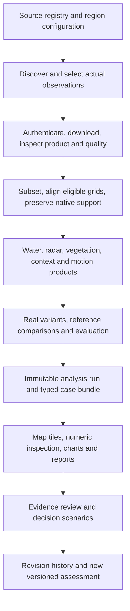

# FluviSAR — Antigravity-ready project specification

**Version:** 2.0 · 31 October 2026 · Asia/Dhaka  
**Deliverable:** complete specification for a fresh project; application implementation is not part of this document-generation task.  
**Team:** five people; motivated beginners in SAR/GIS; two to four weeks.  
**Authority:** this document consolidates and supersedes the active build specification in `plan.md`. Earlier plans, reports and exact chat copies remain historical evidence. Retain them; do not overwrite them.  
**Product:** FluviSAR web observatory. TRACE Field contracts are preserved for later integration; the external mobile application is outside this build.

**সহজ ভাষায়:** Jamuna ও Sundarbans-এর বাস্তব satellite data থেকে পরিবর্তন দেখব, কেন এমন হতে পারে বুঝব, নিজের ফলাফল পরীক্ষা করব, মানুষের/পরিবেশের জন্য এর অর্থ দেখব এবং পরের দরকারি observation বা সিদ্ধান্ত বাছাই করব। পুরো অভিজ্ঞতার কেন্দ্র হবে মানচিত্র।

## Reading and building order

1. Read sections 1–3 for decisions, scope and NASA alignment.
2. Read sections 4–7 for the visual design, screens and exact maps.
3. Read sections 8–11 for source selection, acquisition and scientific outputs.
4. Read sections 12–14 for the complete feature coverage contract.
5. Read sections 15–19 for schemas, architecture, interfaces and agent execution.
6. Read sections 20–23 for acceptance, delivery and the final demonstration.

The English technical specification is intended to be directly usable by a coding agent. Bangla product copy and a short team explanation are included. **A visible button, an empty panel or a placeholder chart does not complete a feature.**

## 1. Locked decisions and completion rules

| Decision | Binding instruction |
|---|---|
| Fresh start | Build in a new sibling folder, `fluvisar-next/`. Inspect existing code only for reusable patterns. Preserve `nasa-2026-web/` and its data. |
| Active regions | Exactly two: Jamuna and Sundarbans. Both appear in the Atlas and both receive real observation pipelines. |
| Jamuna recovery area | Chilmari–Roumari floodplain/char agricultural units inside the Jamuna region replace the earlier polder recovery context. Exact pilot units require data and land-use checks. |
| Polder / additional countries | No active polder or foreign analysis site. Historic glacier, fire and earthquake examples remain attributed Learn/reference material. Adding a region later is configuration-driven. |
| Feature retention | Preserve all PDF web feature families and all accepted research additions. Consolidate duplicate names into shared implementations. Preserve mobile requirements separately. |
| Visual priority | A newcomer must understand the place, date, visible change and current question before encountering advanced analysis controls. |
| Data identity | Every map, number, chart, story, audio explanation and export references the same immutable analysis run. |
| Scientific status | Distinguish source observation, derived result, modeled scenario, educational simulation and external reference. Assessment and review are separate dimensions. |
| Missing inputs | Record the exact missing product, credential, reference or validation step. Never fill the gap with an invented scientific result. |
| Scope versus readiness | A conditional data dependency preserves the feature requirement; it does not mean the measured capability is complete. |
| Mobile | Implement web review, stable links, evidence/task APIs and integration schemas now. Do not rebuild the external APK/PWA or claim its offline sync has been tested. |
| AI | An optional evidence navigator may explain canonical facts and operate UI actions. It cannot generate measurements, scientific probabilities or causal conclusions. |
| Release claims | Separately report interface implementation, real-data connection and scientific evaluation for every requirement. |

### 1.1 What is already known, and what remains to do

Completed before this build: challenge and feature review; prior-art research; old-project audit; public NISAR metadata discovery; new supplementary-source metadata probes. Not completed: fresh application, downloaded-file suitability checks for all new cases, processed results, local scientific validation, stakeholder evaluation or mobile integration.

Existing old-project Jamuna outputs are **reference candidates**, not automatically approved ground truth or a ready scientific baseline. Their area, stage proxy, quality status and provenance require reprocessing and review.

### 1.2 One coherent product statement

**“Follow the change. Test the explanation. Choose the next useful observation.”**

The product joins five previous idea families:

| Earlier idea | Final role | Main region |
|---|---|---|
| AFTERWATER / RE:FLOW | Compare observed water recession and agricultural recovery; choose inspections under a declared budget | Jamuna floodplain; suitable wetland comparisons in Sundarbans |
| CHARKEEP | Track how changing land may affect documented connections to schools, clinics and services | Jamuna |
| ROOTRETURN | Compare optical greenness with radar response and identify interpretations requiring independent checks | Sundarbans |
| RECONNECT | Review a documented restoration/intervention claim against suitable comparison areas | Sundarbans; other documented local interventions only when appropriate |
| STRAINLINE | Inspect valid relative LOS motion, correction/reference sensitivity and unobserved support | Eligible support inside either region |

These are mission types within one investigation system. They do not create five unrelated applications.

## 2. NASA challenge analysis and the contribution to demonstrate

The complete supplied [problem statement](problem.md.txt) was read again. The [official challenge page](https://www.spaceappschallenge.org/2026/challenges/dancing-with-the-sars/?tab=details) was attempted on 31 October but could not be retrieved through the research tool. Use the supplied statement as the working brief; do not invent 2026 scoring weights, submission limits or required hazards.

The statement asks for an interactive, accessible, open-source application using actual NISAR data to explain one or more surface changes. It invites time series, physical-driver hypotheses, polarization/frequency exploration, optical/GIS context, local stories and future applications. A hometown is explicitly allowed. Two Bangladesh regions fit this brief; every example hazard does not need a separate active site.

| Challenge element | Implemented response | Demonstrable artifact |
|---|---|---|
| Actual NISAR | GCOV is the primary observation source; eligible GUNW and SME2 extend it | Real product IDs, downloaded/derived artifacts and inspectable measurements |
| Surface change | River transitions, water recurrence, vegetation/forest response and qualified motion | Dated spatial layers and patch histories |
| Interactive and intuitive | Map-first guided entry plus deeper investigation | A visitor changes date, patch or assumption and sees connected results |
| Patterns at different time steps | Rhythm Player, real acquisition ticks and context tracks | Observation chronology with visible gaps |
| Explain physical drivers, including absent signals | Driver X-Ray, competing hypotheses and Null Result Room | Evidence for/against, observability and next test |
| Polarizations / frequencies | Available-channel prism, suitable covariance composite and optical/C/L comparison | Input-aware controls, temporal offsets and separate sensor legends |
| Human drivers and consequences | Documented land use, service connections, restoration records and attributed accounts | Specific affected assets and questions; no invented beneficiaries |
| Broad audience | Public Bangla, decision and analyst explanations of identical facts | Readable explanations, accessible controls, optional sonification |
| Open source and usable output | Reproduction command, methods, source registry and case-derived brief | Runnable repo, manifest, visual report and stable share URL |
| Future applications | Scenario/response lab and readiness-based future panel | Explicit model assumptions and required future inputs |

### 2.1 The strongest testable contribution

Test whether **context-aware NISAR observations plus visible self-challenge improve a defined investigation or inspection decision compared with a simpler baseline**.

The three signature interactions are:

1. **Break My Finding:** change a real analytical setting; the spatial result and reported sensitivity change.
2. **NISAR Contribution:** compare a fixed task with and without eligible NISAR evidence, controlling temporal support where possible.
3. **Decision Flip:** change an unresolved land-use, crossing or interpretation assumption; see which decision changes and which observation would resolve it.

Do not claim the first-ever flood map, mangrove radar study, sensitivity method or restoration evaluation. Existing [Jamuna Sentinel-1 research](https://nhess.copernicus.org/articles/23/751/2023/nhess-23-751-2023.html) and [Sundarbans multi-frequency research](https://isprs-archives.copernicus.org/articles/XLIX-B3-2026/923/2026/) make those claims untenable. Our proposed distinction is an evaluated, understandable chain from observation to challenged interpretation to decision.

### 2.2 What makes the demonstration competitive

Show two locally meaningful investigations, a real result that survives a challenge, a result that weakens or remains unresolved, and a specific consequence or next observation. Let a judge perform the challenge directly. A negative or null NISAR contribution is a valid result. No feature count or visual style guarantees an award.

## 3. Geographic and user specification

| Region ID | Discovery window `[west,south,east,north]` | Initial map centre `[longitude,latitude]` | User question |
|---|---|---|---|
| `jamuna` | `[89.60,25.40,89.90,25.75]` | `[89.75,25.575]` | What changed in river/floodplain land and water, how does recovery differ, and which service link or site needs checking? |
| `sundarbans` | `[89.55,21.75,89.85,22.00]` | `[89.70,21.875]` | How do wetland water, radar response, greenness and supported forest boundaries change under tidal context? |

These are **search windows**, not legal boundaries, verified study footprints or claims to map all Jamuna/Sundarbans. Display the real approved pilot polygon, source footprint and valid support separately. The Sundarbans search window includes coastal/open-water areas; select a forest/creek pilot after overlaying real mangrove extent and common data coverage.

Start with a roughly 10–15 km-wide pilot per region to keep numeric analysis and interaction manageable. Select the final polygon from actual shared observation support and meaningful local units; record the choice. Never crop a dramatic patch solely to hide poor coverage or failed checks. Additional subareas inside either region appear as case cards on the same map.

### Primary users and decisions

- Jamuna: a local public-service, agriculture or inspection worker choosing a bounded set of places/connections to verify.
- Sundarbans: a forest/wetland monitoring or restoration reviewer choosing plots and interpretations requiring follow-up.
- Public/educator: understand a particular place and the radar evidence without specialist vocabulary.
- Analyst: inspect sources, methods, masks, comparisons and reproducibility.

These are intended users, not partners already secured. During week one, ask actual contacts which decision, units, evidence and constraints they recognize. Maintain interview records without manufacturing endorsements.

## 4. Visual research translated into a concrete design

The following are design precedents, not dependencies on paid story-map software:

| Primary reference | Relevant observation | Our implementation decision |
|---|---|---|
| [NASA Worldview availability research](https://ntrs.nasa.gov/citations/20240015117) | Spatial/temporal availability needs explicit UI | Date ticks reflect actual footprint coverage, with gaps and data-readiness badges |
| [Esri map choreography](https://www.esri.com/arcgis-blog/products/arcgis-storymaps/constituent-engagement/choreograph-your-maps-with-arcgis-storymaps) | A deliberate sequence of map views can explain complexity progressively | A guided story changes camera/layers/finding in the same workspace; free exploration resumes from that state |
| [MapLibre examples and API](https://maplibre.org/maplibre-gl-js/docs/examples/) | Geographic sources and interactive styles support a reusable map workspace | Render actual georeferenced data; reuse one layer registry and map controller |
| [PMTiles MapLibre integration](https://docs.protomaps.com/pmtiles/maplibre) | Browser-readable tiled archives support overlays and basemaps | Publish prepared raster/vector archives; use separate numeric products for measurements |
| [WCAG 2.2 reference](https://www.w3.org/WAI/WCAG22/quickref/) | Colour, motion and pointer-only interactions need alternatives | Labelled classes, visible focus, non-drag controls, reduced motion and equivalent tables |

### 4.1 First 30 seconds

1. Show a large real Bangladesh locator map with **both** study windows and two distinct region cards. No introductory account wall.
2. Each card has a source-derived landscape preview, one short question, observation range and actual processing/readiness state.
3. Offer **“Start guided investigation”** and **“Explore the map”**.
4. The first guided step highlights one real patch and explains what the viewer should notice. Until a measured patch is approved, show actual imagery and a clearly identified question; do not invent a finding.
5. The next step shows a dated comparison; the third offers “Test this finding”. Technical controls expand as needed.

### 4.2 Visual system

Use a calm scientific atlas aesthetic: neutral light panels, deep blue navigation and map-focused colour. Avoid a dense neon command centre, decorative telemetry, animated satellites or walls of unrelated KPI cards. A dark map option is available; default text panels remain readable.

| Token | Starting value / rule |
|---|---|
| Page background | `#F4F7FA` |
| Panel background | `#FFFFFF` |
| Main text | `#102A43` |
| Secondary text | `#475569` |
| Brand/action | `#155E75` |
| Borders | `#CBD5E1` |
| Spacing | 4/8/12/16/24/32 px scale |
| Typography | Locally hosted Inter for English; Noto Sans Bengali for Bangla; tabular numerals for measurements |
| Text sizes | Body 16 px English, approximately 17–18 px Bangla; secondary text at least 14 px; larger headings by hierarchy |
| Controls | Target 44 px interactive height where practical; labelled icons and visible keyboard focus |
| Motion | Brief orientation transitions, typically 300–700 ms; no auto-playing map tour; reduced-motion alternative |

These are starting design tokens, not a claim that every combination passes contrast. Verify normal text at 4.5:1 and large text at 3:1 against its actual background. [W3C contrast guidance](https://www.w3.org/WAI/WCAG22/Understanding/contrast-minimum.html)

### 4.3 Map semantics and legends

| Meaning | Visual encoding | Critical distinction |
|---|---|---|
| Source radar | Fixed greyscale for comparable dates; optional documented RGB lens | Show gamma-zero power/dB and actual channel |
| Observed/classified water | Blue `#0072B2` with text label | Water candidate is not confirmed damage |
| Land→water candidate | Vermilion `#D55E00`, boundary plus category label | “Erosion candidate” requires extra interpretation |
| Water→land candidate | Teal `#009E73`, distinct boundary style | Exposed sediment is a separate supported class |
| Tested robust core | Solid candidate colour and “all eligible tested settings” label | Robustness is not truth probability |
| Contested fringe | Stipple/dashed pattern plus category outline | Not merely low opacity that disappears on imagery |
| No valid observation | Grey hatch with “not observed” label | Never the stable-land or zero-motion colour |
| Relative LOS displacement | Blue–neutral–orange diverging ramp centred on reference zero | Readable units, pair dates and sign definition |
| Wrapped phase | Cyclic ramp with phase legend | A colour cycle is phase wrapping, not a damage class |
| SME2 | Single sequential ramp plus visible native cells | Do not imply field-scale resolution |
| Scenario | Purple dashed outline and persistent “Hypothetical scenario” banner | Keep separate from observation legend |
| Selection | Black/white double halo | Selection is distinct from scientific status |

Use a fixed display stretch across a scientific time comparison. Allow per-scene stretch only as an explicit visualization option that does not change measurements. Mask nodata before stretching. All legends show date, sensor, layer, unit, valid support and source access. Prefer one primary thematic raster plus a small set of outlines/context overlays at a time.

## 5. Navigation, screens and shared layout

Top navigation: **Atlas · Investigate · Stories · Learn · Reports**. Include language, audience and methods/help controls. Evidence review is a contextual workspace within Investigate, with authenticated reviewer controls. Public read-only investigation needs no account.

The workspace has three main modes: **Explore → Investigate → Act & Explain**. Inside them expose the appropriate tools; avoid six competing tab bars.

### 5.1 Desktop wireframe

```text
┌─────────────────────────────────────────────────────────────────────────┐
│ FluviSAR | Atlas Investigate Stories Learn Reports | EN/বাংলা | Audience │
├─────────────────────────────────────────────────────────────────────────┤
│ Jamuna ▾ | case ▾ | actual dates | assessment | Explore / Investigate / Act│
├───────────────┬───────────────────────────────────┬───────────────────────┤
│ Map views     │                                   │ Selected place        │
│ J1 J2 J3      │          REAL GEOGRAPHIC MAP       │ One clear sentence    │
│               │                                   │ Value · unit · dates  │
│ Lens/layers   │ [compare] [transect] [inspect]     │ Evidence / Challenge  │
│ Context       │                                   │ Next useful check     │
│               │ legend + scale + data attribution │ Passport / share      │
├───────────────┴───────────────────────────────────┴───────────────────────┤
│ Rhythm Player: dated ticks, actual gaps, play/pause, pair selection        │
│ Linked tracks: radar | water/greenness | stage/tide | rainfall             │
└─────────────────────────────────────────────────────────────────────────┘
```

At 1440 px: header around 60 px; left panel about 240 px; right inspector about 340–380 px; timeline about 140–190 px; the centre receives remaining width. Panels collapse. At widths below about 1100 px, show one side panel at a time. At 390 px, use a full-width map, compact timeline and accessible bottom sheet with snap buttons. The responsive web is not represented as the external TRACE app.

### 5.2 Screen contracts

| Screen | Visible experience | Required interaction / exit |
|---|---|---|
| Atlas | Bangladesh locator, two regions, actual footprints, case previews and readiness | Select either region and open its correct case; changing region visibly changes geography |
| Explore | Primary map, plain question, real dates, suitable lenses, concise patch explanation | Click patch/date or use an equivalent list; continue into its evidence |
| Investigate | Linked radar/context comparisons, hypotheses, checks and real variants | Change a setting, inspect result and save a variant without altering the base run |
| Act & Explain | Exposure, recovery/inspection shortlist, service/restoration scenario, next observation | Change an assumption, inspect decision sensitivity and export the selected state |
| Stories | Five thematic chapters built from approved case/run states | Pause, step, skip or open the same finding in free exploration |
| Learn | Preserved educational lessons and four named mini-experiments | Experiment is labelled educational; no simulated output enters a real case |
| Reports | Saved investigations, one-page briefs, full reports and manifests | Export matching facts and follow a stable case/run/finding URL |
| Evidence review | References/media, target dates, observation dates and revision history | Reviewer records rationale; conflicting evidence remains independently visible |
| Data & Methods drawer | Input readiness, definitions, source registry, processing and limitations | Any selected metric opens its definition and lineage |

### 5.3 Inspector information order

Always lead with: **what was observed → what it may mean → what remains uncertain → what to inspect next**. Then expose exact numbers, comparison evidence, methods and Passport. Use short human-readable wording tied to the metric, rather than substituting “high confidence” for explanation.

Public Bangla example template: “নির্বাচিত জায়গায় [তারিখ ১] ও [তারিখ ২]-এর observations-এ জমি/পানির শ্রেণি বদলেছে। কারণ বুঝতে [প্রয়োজনীয় পরীক্ষা] দরকার।” Populate only approved fields. Do not turn a dB change into football fields, homes or danger without the required geometry and evidence.

## 6. Exact map views and regional representation

These are modes of one workspace. They share region, case, run, selection and map state. Do not implement eight disconnected dashboards.

| View | Primary data/layers | Visual interaction | Linked result |
|---|---|---|---|
| **M0 Atlas / Place Tour** | Real two-region footprints, approved case polygons, source-derived thumbnails | Click footprint/card; `fitBounds` with panel padding; optional globe orientation before Bangladesh | Question, valid-date inventory and readiness |
| **J1 River Memory** | GCOV, water/non-water candidates, dated waterlines/banklines where supported, transitions, sensitivity | Timeline, before/after swipe, ghost boundaries, patch/transect selection | Area and patch biography; stage/context; classification and permanence limits |
| **J2 Floodplain Recovery & Agriculture** | Unit polygons, observed water recurrence, recession trajectories, cloud-screened greenness, eligible native SME2 cells | Select two comparable units; inspect dated states; change intended-water interpretation and inspection budget | Recovery contrast, crop/land-use context, shortlist and next check |
| **J3 Service Continuity** | Documented settlements, schools/clinics, roads/ferries and uncertain crossing edges; change candidates | Follow a settlement-to-service path; toggle an uncertain edge only in scenario mode; compare approved service candidates | Modeled reach/connectivity, critical edge, Decision Flip and assumptions |
| **S1 Wetland Pulse / Canopy X-Ray** | GCOV channels/ratios, optical context, wet/valid recurrence, sensor disagreement, tide/rain context | Switch channel; select a patch; brush HH/HV response plot; restrict comparisons by tidal context | Measured response fingerprint, disagreement evidence and hypotheses |
| **S2 Forest Response & Restoration** | Supported mangrove/forest boundaries, patch configuration, joint optical–radar trajectories, documented intervention/control units | Select patch pair; scrub trajectory dates; change eligible comparison area; inspect edge transect | Response comparison, boundary metrics, restoration audit and uncertainty |
| **X1 Fringe Stage / Motion** | Eligible GUNW wrapped phase, referenced LOS, coherence, components, corrections and valid support | Toggle phase/coherence; inspect broad support/profile; change a legitimate reference/correction variant | Relative LOS evidence and observability; no building-scale failure inference |
| **C1 Compare / Scenario** | Selected-task baseline versus added-NISAR outputs, or explicitly hypothetical overlays | Linked two-pane comparison; assumption controls; before/after decision receipt | Sensor contribution, tested scenario consequences and decision sensitivity |

### 6.1 Jamuna visual sequence

1. **Orientation:** locate a checked pilot, river channels, settlements and actual observation footprint. Display the question “এই জায়গার পরিবর্তন কীভাবে বুঝব?”
2. **Observation:** radar date A/B, consistent stretch and selected patch. Ghost outlines use actual dated boundaries; do not morph invented intermediate river positions.
3. **Interpretation:** categorical transition overlay and stage/context ladder. Keep land→water as a candidate until persistence, hydrology and reference evidence support the stronger erosion interpretation.
4. **Recovery:** select a cultivated/other documented unit and a suitable comparison. A water-state ribbon beneath the chart shows wet/dry/unresolved/absent observations. Native SME2 cells appear only when eligible.
5. **Consequence:** reveal actual assets and documented network links. Outline an uncertain crossing instead of drawing a simulated flood as a confirmed closed road.
6. **Decision:** the inspection budget or uncertain crossing assumption changes a real shortlist/scenario computation. Show the exact reason and request the observation needed.

**J1 layer order, bottom to top:** muted basemap → source radar/optical primary → valid-support mask → water/transition raster → dated boundary outlines → selected finding → contextual asset symbols → labels and inspector marker.

**J3 layer order:** muted physical context → declared change support → network edges → settlements/services → uncertain-edge symbols → candidate locations → selected path. Use solid documented links, dashed unknown links and an explicit scenario-closed style.

### 6.2 Sundarbans visual sequence

1. **Orientation:** show the selected creek/mangrove pilot and dated historical extent context. Maintain a locator inset so the viewer understands where this small patch sits in the wider forest.
2. **Water pulse:** compare real channel/radar observations, valid-date recurrence and available local tidal context. Show wet/valid counts directly on inspection.
3. **Polarization:** switch actual HH/HV and ratio lenses. Show a small signal-distribution chart and simple scattering illustrations; explanations remain hypotheses.
4. **Joint response:** put the map beside a patch trajectory: optical NDVI on one axis and a declared radar variable on the other. Date labels and non-connected gaps prevent false temporal continuity.
5. **Challenge:** check tide/time mismatch, parameter variants, geometry, quality and sensor disagreement. Brushing points highlights their source patches and dates.
6. **Forest/restoration:** inspect supported boundaries and documented intervention/reference units. If a real intervention is unavailable, show observed response comparisons and keep the intervention-effect claim incomplete.
7. **Follow-up:** select a bounded monitoring question and export the evidence trail.

“Canopy X-Ray” is an accessible name for a multisensor investigation. It is not a literal photograph through the canopy or automatic proof of hidden inundation. A four-quadrant HH/HV change plot uses descriptive measured quadrants; ecological labels require independently evaluated reference examples.

### 6.3 Geographic accuracy rules

- GeoJSON uses longitude,latitude in EPSG:4326. Analyses use documented native/projected grids; both candidates lie in UTM zone 45N, but read and retain each source CRS.
- Derive raster footprints from geotransform/pixel edges. Do not position imagery by guessed corner coordinates or CSS percentages.
- Compute areas in an appropriate projected/equal-area calculation, not the Web Mercator display plane.
- Use actual support polygons for selected measurements. A tidy rectangle is not proof of valid data inside it.
- At high zoom show “display zoom exceeds source detail” when appropriate; do not add fake sharpness, fine soil moisture or building-level motion.
- A study window, legal forest boundary, waterline and classified forest edge have distinct layer names and legends.
- Historical annual layers and daily imagery use separate time controls/labels. Never imply a 2025 extent map was acquired on the selected 2026 SAR date.

## 7. Shared interaction contracts

### 7.1 Timeline / Rhythm Player / Stage Ladder

Use a true time axis: the spatial distance between ticks reflects elapsed time. Only actual acquisitions produce observation frames. A daily context track can exist below it but cannot create extra SAR frames. Show partial/invalid coverage and acquisition geometry groups.

Playback steps between eligible observations, buffers the next frame, pauses on failure and retains the visible date until the matching layer is ready. No interpolation of measured land area through missing dates. Plot radar, water fraction, NDVI, stage/tide and rain in aligned small multiples with separate y-scales and a shared x-axis.

Pair selection exposes elapsed time, track/direction/mode compatibility, coverage, stage/tide source, measurement support and rejection reason. Real gauge stage is in metres with datum; a classifier-derived water fraction remains unitless and is not independent hydrological validation. Equal stage is a useful control; it does not prove permanent land change. Missing or distant hydrological records remain a limitation.

### 7.2 Radar-to-Reality / Sensor Race

Default to two synchronized maps with swipe/side-by-side toggle. A four-pane evidence wall is an expanded desktop view; narrow screens use tabs with a shared selected location. Preserve camera, cursor, selection and footprint between panes.

Each pane has its own sensor, actual time, time offset, layer/units and valid support. A nearest-date match is labelled with its offset. Show AOI-level clear/valid optical fraction computed from quality pixels, not a whole-scene cloud percentage described as local cloud cover. C-band and L-band differ in polarization and observation conditions; disagreement does not establish which sensor is correct. A manufactured cloud slider belongs only to Learn.

### 7.3 Break My Finding

Controls address threshold offset, eligible filter setting, MMU, pair/context restriction and comparison set. The UI states whether an action is **preview on this ROI** or **saved full analysis variant**. A preview never silently replaces the published run.

The result shows base versus variant, stable tested core, contested fringe, unassessable support and area range. There are seven check groups: product/geometry, alignment, classification sensitivity, hydrological context, subsequent observations, independent comparison and controls/plausibility. Each check is pass/warn/fail/not-evaluated/not-applicable with inputs, reason and consequence. Unknown checks never pass by default.

### 7.4 Selection / patch biography / transect

Clicking a finding selects its immutable ID and geography across every view. Clicking outside findings offers a fixed documented patch/ROI selection, not an arbitrary single-pixel causal claim. The biography shows each date's observation, class, valid support and evidence. A line tool samples at meaningful source support; chart gaps remain gaps. A keyboard-accessible finding/patch list provides the same selection without requiring a map click.

### 7.5 Human Translation and evidence navigation

Public, decision and analyst modes use the same fact selectors. They change wording and detail, not measurements, dates, verdicts or source identity. Use reviewed Bangla templates first. An evidence navigator can answer “show water history”, “why uncertain?” or “open source” through typed UI actions and source-linked facts. Label it according to its actual implementation. A paid LLM or secret browser key is not a core dependency.

### 7.6 Sonification / FEEL on web

Audio starts only after user activation. Map a documented real numeric series to pitch/rhythm, show that mapping and retain text/numbers. Missing values have a distinct missing-data cue; they are not silence interpreted as water. Haptics are optional where browser support exists; absence of device support is visible. Audio is an encoding of measurements, not sound recorded from space or a calibrated danger alarm.

## 8. Exact source registry and current access status

Research checked on **31 October 2026**. “Metadata found” is not “downloaded”, “usable”, “classified” or “validated”. Keep a machine-readable source registry with query, selected item, asset URL, licence, acquisition/version, retrieval time and content hash.

### 8.1 Primary NISAR products

| Source ID | Exact collection / access | Data used | Output destination / dependency |
|---|---|---|---|
| D01 | `NISAR_L2_GCOV_PROVISIONAL_V1`; [ASF API](https://docs.asf.alaska.edu/api/keywords/), [Earthaccess](https://nisar-docs.asf.alaska.edu/earthaccess/), Vertex/Earthdata Search | Actual available covariance/power terms, geolocation, masks and product metadata | Core radar/time/change workflows in both regions; real protected-file access required |
| D02 | `NISAR_L2_GUNW_PROVISIONAL_V1`; same search/download ecosystem | Wrapped/unwrapped phase, coherence, components, correction layers and metadata | X1; local support/reference/correction review required |
| D03 | `NISAR_L3_SME2_PROVISIONAL_V1`; same ecosystem | Soil moisture and exact retrieval/quality flags | J2 native-grid context; suitability must be checked |
| D04 | [NISAR Worldview/GIBS](https://nisar-docs.asf.alaska.edu/worldview/), [GIBS access](https://nasa-gibs.github.io/gibs-api-docs/access-basics/) | Documented daily/rolling mosaic imagery | Atlas overview or clearly labelled visual context; not the numeric source for analytical areas or pixel values |

GCOV provides calibrated gamma-zero power on geocoded grids, with available terms and spacing depending on acquisition. GUNW has phase/coherence products at different support; supplied correction estimates are not automatically applied. SME2 has a documented provisional calibration limitation and flagged retrieval conditions. Inspect actual files and current known issues before approving an adapter. [GCOV](https://nisar-docs.asf.alaska.edu/gcov/), [GUNW](https://nisar-docs.asf.alaska.edu/gunw/), [SME2](https://nisar-docs.asf.alaska.edu/sme2/)

Do not confuse `frequencyA/frequencyB` groups within an LSAR product with separate L-band/S-band instruments. S-band is a conditional real-data capability, not a synthetic channel to fill an empty control.

### 8.2 Supplementary sources

| ID | Exact primary source / collection | Select and transform | Map / calculation | Availability at planning time |
|---|---|---|---|---|
| D05 | [Element 84 Earth Search](https://github.com/Element84/earth-search), API `https://earth-search.aws.element84.com/v1`, `sentinel-2-l2a` | Discover items; use asset keys `red`, `green`, `blue`, `nir`, `scl` and metadata scale/offset; crop and quality-screen | Optical, NDVI, local clear fraction, sensor comparison | Collections and two region searches returned HTTP 200; pixel suitability pending |
| D06 | Same STAC, `sentinel-1-grd`; [ASF RTC processing](https://hyp3-docs.asf.alaska.edu/guides/rtc_product_guide/) | Select comparable geometry; acquire calibrated terrain-corrected source through verified OPERA RTC/HyP3 or documented processing; keep processor record | Actual C-band comparison; separate sensor-specific interpretation | GRD metadata found in both windows; GRD assets are not automatically RTC or quantitative gamma-zero |
| D07 | [PO.DAAC DSWx-S1](https://podaac.jpl.nasa.gov/dataset/OPERA_L3_DSWX-S1_V1), `OPERA_L3_DSWX-S1_V1`; [suite specifications](https://www.jpl.nasa.gov/go/opera/products/dswx-product-suite/) | Query CMR/Earthdata Search, inspect exact version bands/classes; subset GeoTIFFs and compare compatible dates/support | Independent product comparison and water baseline | Public CMR requests from this environment returned 403; no local inventory or suitability confirmed |
| D08 | [NASA GPM IMERG](https://gpm.nasa.gov/data/imerg), GES DISC/Earthdata; resolve current collection version for daily Final `GPM_3IMERGDF` or Late `GPM_3IMERGDL` | Prefer complete Final retrospective windows; use Late for newer unavailable periods with distinct labels; preserve units and integrate only when needed | Rainfall context tracks and explicitly defined comparison windows | Product documentation verified; exact selected files and complete windows pending |
| D09 | [FFWC/BWDB official service](https://api.ffwc.gov.bd/) | Obtain registration-provided documentation/station history or a lawful official CSV; retain station, datum, units, time zone, interval and gaps | Jamuna stage ladder and pair context | Homepage HTTP 200; developer documentation stated to be provided after registration; no historical endpoint or 2026 station series verified |
| D10 | [Survey of Bangladesh data service](https://data.sob.gov.bd/) / appropriate official BIWTA or research tide record | Obtain a representative tidal station series with datum/time metadata; import reviewed CSV; a licensed modeled estimate is separately labelled | Sundarbans tide track and matched-condition comparison | Access, licence, station representativeness and 2026 data pending; do not invent a free hourly API |
| D11 | Earth Search `cop-dem-glo-30`; [Copernicus DEM source](https://registry.opendata.aws/copernicus-dem/) | Read `data` COG, crop, retain vertical reference; optional hillshade/context | Terrain context and geographic orientation | One matching metadata tile found per window; not a verified local bare-earth hydraulic terrain model |
| D12 | [ESA WorldCover](https://esa-worldcover.org/en/data-access), 2021 `v200` | Clip categorical map; decode official classes; preserve year/version | Historical land-cover/cropland context; never automatic 2026 crop identity | Source verified; selected assets pending |
| D13 | [Global Mangrove Watch via JAXA](https://www.eorc.jaxa.jp/ALOS/en/dataset/gmw_e.htm), `v4.1.12` | Acquire pinned release and licence; select actual annual epoch bands, including 2025 context; clip | S2 long-term mangrove extent context and pilot selection | Official page documents 41 annual epochs, 1985–2025, 30 m; selected download/pixels pending |
| D14 | [Geofabrik Bangladesh OSM](https://download.geofabrik.de/asia/bangladesh.html), `bangladesh-latest.osm.pbf` then freeze snapshot | Extract schools/clinics, settlements, roads, waterways/ferries; keep OSM IDs/tags, timestamp and actual geometries; deduplicate | Exposure and service graph; named public assets | Download source verified; local completeness/functionality not verified |
| D15 | [WorldPop source guidance](https://hub.worldpop.org/project/categories?id=3); API `https://api.stac.worldpop.org`; collection `BGD-Population-2025-100m` | Fetch collection items/assets; choose one count dataset, preserve units/year/version/licence; aggregate by fractional overlap | Estimated population exposure; not individual displacement | Collection HTTP 200, CC-BY-4.0 metadata verified; raster not downloaded |
| D16 | [PO.DAAC SWOT Hydrocron tutorial](https://podaac.github.io/tutorials/notebooks/datasets/Hydrocron_SWOT_timeseries_examples_basic.html) | Discover a suitable river/node/reach or other supported feature; use current documented endpoint/access, quality and datum | J1/J2 water-elevation context, eligible Sundarbans open channels | Exact local feature IDs, usable observations and access pending |
| D17 | [NASA FIRMS API](https://firms.modaps.eosdis.nasa.gov/api/) | Query only for a relevant documented event; server-side MAP_KEY; retain sensor/date/detection uncertainty | Optional context/reference lesson, not a mandatory invented local fire chapter | Source verified; no local event asserted |
| D18 | Official/partner intervention records, dated field/agency/aerial/lidar/reference observations | Import attributed evidence with dates, geometry/support, licence/permission and review | Restoration, structural interpretation, link checks and independent evaluation | No partner or local reference collection secured yet |
| D19 | [OpenFreeMap](https://openfreemap.org/quick_start/) + OSM or self-hosted regional basemap | Start from official style; simplify labels/POIs; preserve attributions; prepare permitted local tiles separately | Geographic background and locator maps | Service documentation verified; provider availability not a scientific input |

**Important source roles:** IMERG is coarse rainfall context, WorldCover is older categorical context, GMW is annual modeled extent, WorldPop is modeled population, and Copernicus DEM is a surface model. None is automatic ground truth for a 2026 event. DSWx products from different sensors are not guaranteed harmonized. [JPL DSWx documentation](https://www.jpl.nasa.gov/go/opera/products/dswx-product-suite/)

### 8.3 Actual discovery evidence

The earlier ASF period was **17 June–30 October 2026 00:00 UTC**. The following NISAR counts are historical saved metadata results, not fresh 31 October counts:

| Search window | GCOV records | GUNW records | SME2 records | PR/QPDH candidates |
|---|---:|---:|---:|---:|
| Jamuna/Chilmari | 44 | 32 | 42 | 8 |
| Sundarbans/Dublar–Passur | 64 | 52 | 57 | 17 |

Counts include different frames, tracks, modes, processing/release variants and partial support. They are not usable-date totals. Largest metadata-consistent GCOV groups contained ten dates per region. One Sundarbans group has dates 25 June, 7 July, 19 July, 12/24 August, 5/17/29 September and 11/23 October. Actual common support and in-file bands remain unchecked.

Audit sources: [initial metadata discovery](docs/region-discovery/README.md), [grouped sequences](docs/region-discovery/ANALYZED_SUMMARY.json), [phase/soil-moisture/quad candidates](docs/region-discovery/TWO_REGION_EXTENSIONS.md).

New 31 October public metadata probes, using the same date interval and two-item response limits where applicable:

| Probe | Jamuna | Sundarbans | Interpretation |
|---|---|---|---|
| Sentinel-2 L2A `numberMatched` | 69 | 34 | Matching catalog records; no assertion of clear scenes, unique dates or complete coverage |
| Sentinel-1 GRD `numberMatched` | 33 | 34 | Real GRD candidates; quantitative RTC preparation remains work |
| Copernicus GLO-30 | 1 tile | 1 tile | Metadata tiles `N25 E089` and `N21 E089`; not processed terrain |
| DSWx-S1 CMR request | HTTP 403 | HTTP 403 | An access failure here, not proof that products do not exist |

WorldPop Bangladesh 2025/100 m collection metadata also returned HTTP 200. The browser-facing `stac.worldpop.org` URL returns an HTML application; the actual JSON service is `api.stac.worldpop.org`. Store and inspect Content-Type instead of treating any HTTP 200 as data success.

Exact URLs, response summaries and sample item IDs are preserved in [source-probes-2026-10-31.json](docs/rebuild-research/source-probes-2026-10-31.json). No scientific imagery values were downloaded or analyzed during these probes.

## 9. Acquisition recipes and the first real-data milestone

### 9.1 NISAR search, grouping and download

Use ASF metadata search or Earthaccess. This minimal search is a starting recipe, not proof that downloads succeeded:

```python
import earthaccess

results = earthaccess.search_data(
    short_name="NISAR_L2_GCOV_PROVISIONAL_V1",
    bounding_box=(89.60, 25.40, 89.90, 25.75),
    temporal=("2026-06-17", "2026-10-30"),
    count=250,
)
# Inspect metadata and choose an eligible sequence before downloading.
# Authenticate locally through Earthdata Login for protected assets.
# earthaccess.login()
# earthaccess.download(selected_results, local_path="data/raw/nisar")
```

Follow pagination/full-result handling for the chosen API; never silently cap the archive and call it complete. Persist the query and all selection/rejection reasons. Group by product maturity/version, instrument, production type, track, direction, frame, acquisition/bandwidth mode, actual available polarization/frequency and comparable processing. Deduplicate reprocessed copies with a documented choice, not accidental double-counting.

Prefer a compatible multi-date dual-pol sequence for primary temporal analysis and a separate suitable quad-pol observation for the Pauli capability. Do not mix a QP scene into a DH sequence as though their geometry/processing were automatically identical. Choose GUNW and SME2 independently according to their product definitions.

For access, use standard Earthdata Login locally/server-side. Do not put credentials, temporary signed URLs or tokens into frontend code, exported public manifests or git. Public manifests retain stable source identifiers and safe resolvable source links.

### 9.2 Layer extraction options

**Primary repeatable path:** authenticated local HDF5 download → product inspection with h5py/GDAL → selected native datasets → AOI subset → numeric COG and web outputs.

**Supported alternative:** Earthdata Search → add selected granules → Customize Download → Edit Variables → select actual datasets → Harmony extraction → import resulting GeoTIFFs. The current [Harmony guide](https://nisar-docs.asf.alaska.edu/harmony/) describes dataset extraction for GCOV, GUNW, GOFF and SME2; absent variables can be skipped, so inspect the returned inventory. Confirm current capability for the selected collection before relying on it. Do not assume layer extraction also provides arbitrary spatial clipping/reprojection; the [roadmap](https://nisar-docs.asf.alaska.edu/roadmap/) lists these capabilities separately.

Choose full HDF5 when many terms/metadata are needed. Keep extraction-job/source-granule lineage for Harmony outputs. GIBS/Worldview RGB is useful for orientation, but not a substitute for quantitative source terms or their quality masks.

### 9.3 Sentinel-2 and supplementary search

```python
import requests

payload = {
    "collections": ["sentinel-2-l2a"],
    "bbox": [89.55, 21.75, 89.85, 22.00],
    "datetime": "2026-06-17T00:00:00Z/2026-10-30T00:00:00Z",
    "limit": 100,
}
response = requests.post(
    "https://earth-search.aws.element84.com/v1/search",
    json=payload, timeout=60,
)
response.raise_for_status()
items = response.json()
# Follow rel=next and preserve actual items/assets.
# Crop red/green/blue/nir/scl assets; apply metadata scale/offset and quality.
```

Resolve collection schemas at setup and freeze them in the source registry. Search collection definitions before assuming an asset key/version. STAC metadata availability is not a pixel quality assessment.

For FFWC/tide/intervention/reference imports, implement explicit versioned CSV/GeoJSON adapters. These are real integration paths while account-dependent APIs are unresolved. A manual import must preserve the original file, provenance, units and review record. It is not permission to type plausible values.

### 9.4 Initial input-readiness gate

Before promising measured outputs, produce `data-readiness.json` with one row per feature/input and states `not-searched`, `metadata-found`, `access-required`, `downloaded`, `inspected`, `processed`, `evaluated`, `unsuitable` or `unavailable`.

The first milestone requires, for **both** regions:

- A real approved pilot footprint and at least one inspected GCOV source with source metadata and mask interpretation.
- A compatible multi-date candidate sequence; aim for at least four usable dates for the main temporal story and report actual availability.
- One registered numeric source layer and a correctly aligned map preview.
- A Sentinel-2/context inventory with actual temporal offsets and valid support.
- An explicit unresolved-input register for stage, tide, phase, soil moisture, references and intervention records.

A two-date case can support a comparison, but cannot be described as a richly observed recovery trajectory. If a pilot fails the gate, adjust its subarea inside the existing region using a recorded selection rule; do not make the Atlas silently single-region again.

## 10. Scientific pipeline and published artifacts

### 10.1 Processing stages



### 10.2 Product inspection and gridding

Inspect HDF5 groups and attributes; record exact dataset paths, shape/dtype, units, fill values, coordinate vectors, projection, pixel spacing/orientation, calibration/processing and quality definitions. Generate an inventory JSON first. Product-specific adapters resolve names from that inventory and an approved specification; do not guess that every file has an identical band list or mask coding.

GCOV is already calibrated/geocoded/terrain-corrected; do not blindly repeat these operations. Select frequency/channel deliberately. Preserve masks through filtering, reprojection and classification. For comparable observations, build an explicit analysis grid, typically a selected native-compatible 10/20 m grid in UTM 45N; record actual spacing. Use nearest-neighbour for categorical classes/flags, and documented continuous-data resampling for numeric fields. When aggregating radar power, average in linear power where a power mean is intended. [Rasterio resampling reference](https://rasterio.readthedocs.io/en/stable/topics/resampling.html)

Measure and report residual alignment using suitable stable control areas/features. Reprojection alone is not an alignment pass. Do not interpolate across missing support or fill nodata with the scene median. Keep open water, vegetation-associated interpretations and unobserved pixels distinct.

### 10.3 Water, transition and recurrence branch

1. Convert eligible positive power to dB and create valid mask.
2. Compute actual histogram and Otsu exploratory threshold on a defined population. Record channel, binning, support and distribution diagnostics. Water/sand/forest conditions may violate a simple bimodal split; expose that limitation.
3. Apply documented water/non-water candidate rules, using local references where available. A backscatter threshold alone does not establish exposed sand, vegetation class or permanent erosion.
4. Build pairwise transitions on common valid support: water→water, non-water→non-water, non-water→water, water→non-water and unresolved. Keep ambiguous/conflicting/unobserved categories explicit.
5. Apply a documented minimum mapping unit in **area**, not an unexplained fixed pixel count. Preserve both pre/post-MMU areas and actual grid spacing.
6. Generate dated boundaries from the supported class. Label a waterline as waterline until evidence supports a bankline interpretation.
7. Use subsequent valid observations and context to describe persistence/reversal; do not hard-code persistence zero or assume missing dates are confirming dates.
8. For recurrence, retain wet count and valid count plus dates. `2 wet / 2 valid` has different support from `10 / 10` even when the fraction is identical.

### 10.4 Actual robustness variants

Start with a manageable registered grid, for example threshold offsets `[-2,-1,0,+1,+2] dB`, optional filter windows `[1,3,5]` pixels, and two locally justified MMU choices. These are **candidate experimental settings**, not universal scientifically approved bounds. Inspect sensitivity and revise the configuration with reasons.

Keep hydrological/pair eligibility separate from pixel-threshold perturbation; a rejected pair cannot become valid by widening an unexplained tolerance. Filter choice must respect the source's existing multilooking and masks.

For each eligible variant publish mask, area, support, settings and checks. On fixed common support:

`agreement_i = count(eligible variants selecting pixel i) / count(eligible variants evaluating pixel i)`.

Store the denominator. Where eligibility varies, show the difference rather than silently declaring unanimous agreement. A robust-core overlay means agreement within the declared tested family; systematic errors may survive every setting. A sensitivity area range is not a 95% confidence interval.

**Correct threshold interaction:** with `water = backscatter_dB <= threshold`, lowering the threshold selects fewer qualifying pixels on fixed valid support. Verify UI direction against actual computation.

### 10.5 Vegetation, forest response and restoration branch

- Extract scaled, quality-screened optical reflectance and NDVI. Use documented SCL/quality rules; unknown/no-data/cloud/shadow/snow support is not valid vegetation evidence. Preserve acquisition dates and local valid fraction.
- Calculate comparable HH/HV/ratio distributions, patch medians or explicitly defined summaries. Name whether the statistic is median dB, mean power converted to dB or another quantity.
- Match optical/radar observations only within a declared task-appropriate time tolerance; report offsets and sensitivity. Do not connect distant unmatched dates into a measured continuous loop.
- Build joint trajectories and descriptive response fingerprints. Moisture, tides, phenology, geometry and disturbance are possible explanations, not automatic class labels.
- Use GMW annual extent for historical context. A 2026 forest boundary requires a documented local classification/reference workflow, with real training/evaluation if a classifier is fitted. An experimental boundary without evaluation remains a candidate.
- Compute patch areas, component counts, edge length/density and transect shifts on consistent class/support/grid definitions. Resolution and mask changes can create apparent fragmentation; report sensitivity.
- Restoration requires an actual location, date, intended response and suitable pre/post/control evidence. Compute exploratory difference-in-differences only with explicit assumptions; allow control changes, placebo checks where data permit and neighboring/spillover review. Missing intervention history cannot yield a measured intervention-effect result.

Radar response/greenness is not a direct biomass, carbon, tree-height, salinity or ecosystem-health measurement. A carbon consequence panel may display a separately sourced contextual inventory or explicitly declared valuation scenario; quantitative change needs its own validated method and licence/source.

### 10.6 Phase / Fringe Stage branch

Use actual local GUNW inputs, independently of the amplitude pipeline. Inspect dates, polarization, wavelength, sign convention, units, coherence at appropriate posting, connected components, reference region, correction layers and known issues. The guide describes wrapped products around 20 m posting and unwrapped phase around 80 m posting; the UI must retain actual source support. [GUNW guide](https://nisar-docs.asf.alaska.edu/gunw/)

For approved convention and reference, convert relative phase by the corresponding `wavelength / (4*pi)` factor with an explicitly verified sign. Record applied ionospheric/tropospheric or other corrections; do not assume included layers were applied by default. Keep raw, corrected and reference-variant products separately identified.

Use meaningful contiguous valid support and coherence/component criteria chosen with justification, not a universal unexplained cut-off. Dense vegetation and open water may be unobservable. A profile crossing disconnected components must show breaks. Do not sum adjacent-pair displacements into a time series without consistent referencing and appropriate methodology.

The real-data fringe tool displays phase cycles and source wavelength. Absolute motion cannot be recovered merely by visually counting wrapped colours. An educational fringe counter can assume an idealized continuous phase field, explicitly labelled. Do not infer vertical annual subsidence, 3D motion, individual-building movement, strain tensor or impending failure from a single short LOS pair.

### 10.7 SME2, rainfall, stage/tide and SWOT

- SME2 stays at its native support with product-specific flags. The current guide specifies 200 m posting, some aggregation at coarser effective support, and provisional calibration limits. Do not sharpen it into per-field irrigation advice. Sundarbans dense vegetation/water may correctly be masked/unreliable. [SME2 guide](https://nisar-docs.asf.alaska.edu/sme2/)
- IMERG: preserve run/version, native support, units and interval. A rate must be integrated over time before calling it accumulated mm. Define the actual window and valid coverage. A previous-window difference is not a seasonal climatological anomaly. Do not silently splice Final and Late into an indistinguishable series. [NASA IMERG](https://gpm.nasa.gov/data/imerg)
- Stage/tide: retain measured versus modeled origin, station distance/representativeness, datum, time zone, sampling and interpolation limit. No extrapolated or over-gap interpolation called observed stage. A gauge from a different hydrological reach may be context only.
- SWOT: use an identified feature, quality-screened height observations, correct reference/datum and actual temporal offset. It does not provide a continuous water-depth image underneath mangroves. Native feature support remains visible.

### 10.8 Artifacts per run

```text
data/derived/{region_id}/{case_id}/{run_id}/
  manifest.json              safe provenance, hashes, versions and input identities
  inventory.json             actual product layers, CRS, units, support
  observations.json          dates, geometry groups, source and data readiness
  layers.json                render sources, legends, units and source artifacts
  metrics.json               canonical typed metrics and definitions
  findings.geojson           candidates with stable IDs and claim links
  timeseries.json             per-patch/unit observations with gaps and support
  checks.json                actual quality checks and reasons
  variants/index.json        settings, compatible outputs and sensitivity summaries
  hypotheses.json            support/conflict/missing evidence
  decisions.json             scenario definitions and computed alternatives
  evaluation.json            reference protocol, counts/results or incomplete reasons
  rasters/*.tif              numeric COGs, masks and native coarse products
  tiles/*.pmtiles            prepared render overlays
  previews/*.webp            source-derived thumbnails, never numeric measurement input
```

Manifest input hashes, code revision, environment lockfile, configuration and method version identify a run. Hashing proves integrity, not scientific correctness. Derived outputs remain reproducible from allowed source access; a public repo need not include multi-gigabyte HDF5 files or licensed/consent-restricted evidence.

## 11. Measurement and decision definitions

| Quantity | Definition | Required qualification |
|---|---|---|
| Backscatter | `gamma0_dB = 10*log10(positive calibrated power)` | Actual source term/channel, masks and statistic |
| Radar change | `dB(t2) - dB(t1)` on comparable valid support | Not a direct water depth, structural loss or erosion measure |
| HH/HV contrast | `10*log10(P_HH/P_HV)` | Suitable positive channels; noise/validity screening |
| NDVI | `(NIR-Red)/(NIR+Red)` after scale/offset and quality handling | Valid denominator, dates/support; greenness index |
| Water recurrence | Wet valid observations / all valid observations | Counts and dates; not continuous inundation duration |
| Transition area | Sum of eligible classified pixel area / correct polygon area | Projected support and class interpretation |
| Recession contrast | Unit water-fraction change minus suitable comparison summary on common support | Diagnostic difference, not drainage-failure probability |
| Recovery trajectory | Dated features against declared reference/normalization | Return toward a baseline is not proof of ecological restoration |
| Restoration contrast | `(after-before)_intervention - (after-before)_comparison` | Exploratory association unless causal assumptions are independently supported |
| Population exposure | Sum of source cell population count × overlapped cell fraction | Explicit within-cell allocation assumption, dataset year and source units |
| Asset exposure | Deduplicated actual intersecting assets / cropland area / road length | Distinguish intersections, proximity and confirmed damage |
| Monetary scenario | Sum of exposed amount × declared unit value | Value source/date/currency and assumptions; not measured economic loss |
| Service continuity | Reachability / declared travel calculation on documented links | Unknown links tested as scenarios; overlap is not passability |
| LOS change | Verified-sign phase conversion with wavelength and reference | Relative line of sight, correction/component support |

### 11.1 Real Pauli capability

For a suitable covariance convention with the necessary co-pol cross term and reciprocity handling, implement the declared Pauli powers:

```text
R = (C_HHHH + C_VVVV - 2*Re(C_HHVV)) / 2
G = 2*C_HVHV
B = (C_HHHH + C_VVVV + 2*Re(C_HHVV)) / 2
```

Verify actual term definitions and conventions against the selected specification. Handle round-off and materially invalid negative powers explicitly. State display normalization/stretch. An HH/HV-only scene cannot produce this full composite. The recorded QPDH candidates provide a selection path; only in-file inspection can confirm the necessary usable terms. Maintain an educational simulated example separately when teaching the concept; it does not complete the measured Pauli requirement.

### 11.2 Inspection-budget and Decision Flip engine

Inputs: eligible unit/finding IDs, the user's stated inspection goal, documented importance/priority, actual or declared visit costs, accessibility constraints and unresolved interpretation/link alternatives.

Start with deterministic, explainable selection: eligibility filters → stated priority ordering → cost/budget constraints → selected sites and reason codes. If a weighted objective is used, expose every weight and source; call it an explicit planning rule. Do not label arbitrary weights as risk probabilities or guaranteed optimum field performance.

For each unresolved variable, recompute under its admissible alternatives. Show selected sites or service coverage under each scenario, stable selections, changed selections and the exact question that would distinguish them. Without justified probabilities, report scenario outcomes/ranges rather than expected lives saved or numerical value-of-information probabilities.

Temporary service comparison uses a small approved candidate set and explicit capacities/travel/coverage assumptions. A demonstrative candidate set is labelled hypothetical. A mathematical connectivity result is not a safe-navigation instruction.

### 11.3 NISAR contribution experiment

Define the task, candidate pool, eligible dates/support, reference labels, output metric and decision budget before inspecting a preferred outcome. Compare suitable optical-only and/or C-band baseline, NISAR-only and joint evidence where data support them. Separate extra-date benefit from sensor-response benefit. Training, threshold tuning and evaluation must not use the same reference examples without disclosure.

Report actual sample counts, class-wise results, coverage, false visits, missed relevant sites and changed decisions. Model fitting may use a simple evaluated classifier if needed; learned probabilities require calibration evaluation before being displayed as probabilities. ROC/SHAP/training metrics exist only for a real model and real held-out evaluation. With inadequate references, publish the experiment protocol and unresolved evaluation state.

### 11.4 Scenario / Future Dance model

Retain two working modes:

1. **Decision scenario:** change an uncertain documented link, intended-water interpretation, approved location or explicitly hypothetical polygon and recompute consequences.
2. **Educational radar-response model:** a documented surface-mixture/endmember example generates synthetic expected response. An illustrative incoherent power mixture may use `P_mix=(1-f)*P_A+f*P_B`, then convert to dB. The chosen endmembers and assumptions are visible.

A real `+1 m` stage-to-flood-extent result requires an appropriate hydraulic/terrain model, datum and validation. Until that exists, stage manipulation is a labelled schematic lesson, not a future observed landscape. Keep scenarios in their own artifact namespace, URL state, legend and exported section.

## 12. Mandatory PDF feature coverage: complete traceability

Source: [features.pdf](features.pdf), all 24 pages, including repeated and alternate lists. W IDs represent 14 core web requirements; E IDs preserve extended details and aliases. These are traceability rows, not a claim of 36 unrelated inventions. Research R IDs follow in section 13; mobile A/AX IDs remain a separate later implementation scope.

Coverage here is a specification result, not a software completion claim. Create docs/feature-status.csv with fields: id, source_page, destination, implementation_state, data_state, evaluation_state, artifact, acceptance_evidence and blocker. An unavailable-data panel does not complete a measured capability.

### 12.1 Core web requirements (PDF pages 1–3)

| ID | PDF feature | Rebuild implementation | Map/screen | Acceptance |
|---|---|---|---|---|
| W01 | Earth Change Atlas | Data-driven two-region atlas, local footprint and case selection | M0 | Each place opens its own actual data and questions |
| W02 | SAR Time Machine | Actual-date playback, before/after swipe and eligible pair selection | J1/J2/S1/S2/X1 | Dates/frames correspond to observations; gaps remain visible |
| W03 | Radar Lens | Available polarization/covariance layers, units and derived lenses | J1/S1/S2 | Required terms are verified; no fictional channels |
| W04 | Change Detection Engine | Reproducible transition/boundary/response outputs and selected areas | J1/J2/S1/S2 | Displayed candidates and quantities trace to computed artifacts |
| W05 | Evidence and Confidence Inspector | Source, method, independent comparison, quality and unresolved interpretations | Right panel | Unknown checks remain unknown; scores have a defined meaning |
| W06 | Break My Finding | Actual threshold/date/filter/MMU/context variants with linked outputs | Challenge | Controls change computed results or select actual precomputed variants |
| W07 | River Memory | Simultaneous observed boundaries and selected-patch history | J1; patch biography elsewhere | Every dated state/edge is traceable |
| W08 | Environmental Context Fusion | Suitable rainfall, stage/tide, terrain, vegetation, optical and land-use layers | Context/Investigate | Dates/support and source-specific relevance visible |
| W09 | Exposure and Impact Lens | Actual spatial intersections and explicit proximity scenarios | J3/S2/Decide | Exposure distinguished from damage, displacement or predicted loss |
| W10 | Change Passport | Versioned finding/claim record with methods, inputs and evidence | Passport | A selected number can be traced without trusting a generated explanation |
| W11 | Radar-to-Reality | Linked radar, classification, context and independent evidence | Compare/selected patch | Same geographic target highlighted in each view |
| W12 | Scientific Story Mode | Selected-case narrative assembled from the same facts | Stories | No separate hard-coded hectares, dates or verdicts |
| W13 | Scenario Laboratory | Declared hypothetical water/access/land-position scenarios | C1 | Scenario inputs/model/results explicitly separated from observations |
| W14 | Shareable Investigation | URL, one-page brief, report/manifest export and case QR contract | Reports/Passport | Link/export reproduces the same case/run/finding; mobile handoff has stable IDs |

### 12.2 Extended web requirements and retained aliases

| ID | Feature names in PDF | Source pages | Exactly how retained |
|---|---|---|---|
| E01 | Rhythm Player / Time-Warp Dial / time-series explorer | 9,12–13,19,22–23 | W02 plus actual-date backscatter/context plots and patch/area history; no invented six-day series |
| E02 | Equal-Stage Twin / Stage-Matched Pair Selector / Stage Ladder | 16–17,20–21 | Acquisition dots on real context; compatible-pair selection; rejected pair and reason visible; proxy units distinct |
| E03 | Live Otsu Threshold with Histogram | 17 | Actual pixel histogram and threshold control; supported exploratory recomputation; saved comparison variants with parameters |
| E04 | Change Mask with Uncertainty Band / Consensus Core / Robust Core / Contested Fringe | 17,20–21 | Actual parameter-family masks and area ranges; sensitivity not relabeled a 95% statistical interval |
| E05 | Devil's Advocate Engine / Rejection Engine / adversarial checks | 12–13,17 | Seven documented check groups, pass/warn/fail/unknown states, real inputs and effects on the claim |
| E06 | Physics Twin / Driver X-Ray / Hypotheses Board | 9–10,12,20,23 | Signal → plausible physical interpretations → supporting/conflicting/context evidence; no automatic causal certainty |
| E07 | Null Result Room / why NISAR saw nothing | 10,12 | Quality/geometry/resolution/gaps and observed small change inspected separately; absence of signal not automatic stability proof |
| E08 | Cloud Autopsy / Cloud Race / Sensor Race / Frequency Duel / Sentinel-1 versus NISAR | 10,12–14,20,22–23 | Actual AOI optical quality and C/L radar observations; time/polarization differences; educational cloud slider kept in Learn only |
| E09 | Polarization Switchboard / Polarization Prism / Pauli RGB | 10,12,20,23 | HH/HV/VV/VH only when present; ratios; real Pauli from sufficient covariance terms; simulated polarimetry separately labeled |
| E10 | Human Translation Layer / Audience Switcher | 9–12 | Analyst/decision/public Bangla explanations of identical facts, with dates and limitations preserved |
| E11 | Claim Ledger / source badges | 14,20–22 | Observation-derived, modeled, simulated or external-reference origin plus separate assessment/review states |
| E12 | Provenance Chain / one-command reproduce / run on any reach | 11–12,14,20,22 | Source/code/configuration hashes, exported manifest, documented command and region configuration; support depends on valid input |
| E13 | Personal Testimony layer | 11 | Photo/audio/text story pinned to the selected place and date, attributed and reviewed; not treated as automatic scientific proof |
| E14 | Future Missions / Future NISAR panel / horizon strip | 11,20,24 | Explicit panel for future agriculture, wetland, forest/biomass and deformation uses; inputs and readiness shown |
| E15 | Real InSAR case / Fringe Stage / fringe counter | 20,22–23 | Actual eligible local GUNW wrapped/unwrapped/coherence investigation in X1; educational earthquake example in Learn, not an extra active region |
| E16 | Impact Ledger / What Changed for Whom | 14,18 | Named assets/cropland/population intersections, sourced assumptions, uncertainty and explicit cost/exposure scenarios; no automatic households-per-hectare conversion |
| E17 | Decision Brief Generator / Bangla-English briefing | 11,19 | One-page selected-case brief: finding, evidence, area/support, consequence, uncertainty, next investigation, QR and reviewed authority contacts where actually provided |
| E18 | SAR Lab / Pocket SAR Lab subject matter | 14,20,24 | Cloud Blindness, Polarization Match, Speckle Filter and Fringe Counter retained; additional existing lessons remain accessible as education |
| E19 | Five Dances Story Stage | 23 | Five chapters across two places: river change, floodplain agriculture/recovery, service continuity, mangrove/wetland response, relative motion; foreign hazard examples only educational |
| E20 | Agriculture / crop and soil-moisture chapter / SME2 | 23 | J2 combines actual cropland/context, optical response, water history and quality-screened coarse SME2; crop labels require an identified source, not invented inference |
| E21 | Future Dance Simulator / Prediction Front | 13–14,23–24 | Explicit response/scenario simulator with defined model and declared inputs; synthetic expected response labeled as such; no unvalidated operational forecast |
| E22 | FEEL / sonification subject matter | 8,19,24 | Actual selected raster/series sampled into documented web audio; numeric/text equivalent remains available |
### 12.3 Coverage interpretation and acceptance links

- W01–W04 and W07: sections 6–7 and 10 define rendering, date binding, candidates and history. The selected date/source/patch must agree across map, chart and inspector.
- W05–W06: seven checks and real variants in sections 7 and 10. A parameter change must change a computed result; no fixed confidence-penalty animation.
- W08–W11: source-specific context, exposure, Passport and linked evidence in sections 8–11. Every quantity must have lineage; missing/conflicting evidence stays visible.
- W12–W14: same-run stories, explicit scenarios and matching reports are specified in sections 5, 11 and 17. Their identities cannot mix.
- E02/E09/E15/E20: measured stage, real Pauli, local phase and SME2 require actual eligible inputs. Preserve each requirement and unresolved dependency; simulation does not complete a measured capability.
- E19 changes the PDF's foreign-hazard chapters into five themes across our two approved regions, following the later geographic decision. Attributed earthquake/ice/fire teaching examples remain in Learn.
- E22 web sonification is current scope. Phone GPS/camera/haptics and full offline sync remain field-phase scope.
- Repeated recommendations to delete features in reference memos do not override the user's later retention instruction. Incorrect scientific examples are corrected.

## 13. Research additions, prior-project retention and useful improvements

### 13.1 Every accepted research capability

| ID | Capability and final destination | Data / computation / visible interaction | Acceptance evidence |
|---|---|---|---|
| R01 | Observed water recurrence — J2/S1 | Wet/valid counts per pixel/unit and dated ribbon; click reveals denominator and gaps | Missing dates never count as dry or wet |
| R02 | Comparative recession / RE:FLOW — J2; eligible S1 units | Unit trajectories versus documented comparable units; change comparison set | Contrast recomputes on declared common support; no blocked-drain diagnosis |
| R03 | Intended-water context — J2/S1 | Cropland/pond/channel/wetland goal and provenance; change an unresolved interpretation in scenario mode | Expected water can change the shortlist without rewriting measured water observations |
| R04 | Inspection-budget shortlist — Act | Explicit goal/priority/cost constraints and eligible candidates; set visit budget | Deterministic computed selection, reason codes and actual-or-scenario input identity |
| R05 | CHARKEEP service graph — J3 | Documented nodes/links; temporal evidence and uncertain crossing review | Connectivity changes only from supported status or explicitly selected scenario |
| R06 | Temporary-service location comparison — J3 | Approved candidates, capacities/travel/coverage assumptions; compare alternatives | Results trace to actual graph/candidate inputs; hypothetical candidates labelled |
| R07 | Decision Flip / next useful observation — Act | Recompute under unresolved link, land-use or patch-interpretation alternatives | Show changed/stable choice and specific resolving question, without invented probabilities |
| R08 | NISAR contribution experiment — C1/Evaluation | Same task/reference protocol, baseline versus added NISAR, temporal/coverage controls | Actual results or explicitly incomplete evaluation; no fabricated improvement percentage |
| R09 | ROOTRETURN joint trajectories — S2 | Cloud-screened greenness plus comparable radar observations; linked dates/patches | Similar optical response can be compared with radar without declaring structural recovery from radar alone |
| R10 | Physical-response fingerprint — S1/S2 | HH/HV deltas or optical/radar features; brush scatterplot to highlight actual patches | Points trace to observations; descriptive quadrants are not unvalidated ecological classes |
| R11 | Tide-aware comparison — S1/S2 | Representative measured/modeled tide context with source/time/datum; eligible-condition filter | Actual compatible subset and remaining limitations shown; no invented local tide values |
| R12 | Forest-edge/configuration metrics — S2 | Supported forest classes, boundaries, patch area/components/edge and transect displacement | Same grid/support/definition; waterline and forest edge remain distinct |
| R13 | RECONNECT outcome audit — S2 | Actual intervention, history/controls, contrast, control-choice sensitivity, placebo/spillover where supported | Raw observations and assumptions inspectable; no effect estimate without prerequisites |
| R14 | SWOT elevation context — J1/J2; eligible S1 channel | Identified water features, dated quality-screened heights and datum | Actual feature/support shown; no fabricated continuous water depth |
| R15 | Compound observation view — X1 with J/S context | Co-located water, vegetation and qualified LOS on common observable support | Separate axes and support masks; no combined uncalibrated risk score |
| R16 | Transect profiler — J1/S2/X1 | Sample a drawn/selected line at appropriate raster support; linked chart and map cursor | Distances, units, gaps and underlying artifact are reproducible |
| R17 | Cross-place method comparison — C1 | Compare the same declared task/workflow with local units and denominators | No universal Jamuna–Sundarbans ecosystem-health ranking |
| R18 | Evidence revision history — Evidence/Passport | Evidence record, review rationale, prior and new assessment versions | A new observation can support, contradict or leave the claim unresolved; history remains |

Source history: [deeper research](docs/DEEP_RESEARCH_V2_INNOVATION_AND_NARRATIVES.md), [earlier five ideas](docs/FINAL_5_IDEAS_AND_RECOMMENDATION.md), [earlier merge](docs/FLUVISAR_MERGED_MASTERPLAN.md), and the two original LLM reports in `docs/`. Their previous seven-region geography is superseded. The accepted feature intent is retained here with local scientific constraints.

### 13.2 Existing project capabilities: retain intent, rebuild data binding

| Existing capability / name | Final implementation |
|---|---|
| Earth Atlas, case cards, cinematic entry | Actual two-region locator, real footprints, optional short orientation; correct local case |
| Layer toggles, hover/inspect, before/after swipe | Shared geographic layer registry, numeric inspection and synchronized comparison |
| Hydrograph / Match Water / Equal-Stage Twin | Source-aware stage/context tracks, compatible pair selector and explicit proxy units |
| Evidence tabs, QC, Challenge | Seven computed check groups, real variants, evidence support/conflict and unresolved state |
| Sensor Fusion | Actual sensor comparisons with dates/support; no fixed agreement/confidence figures |
| Intelligence / model diagnostics | Measured fingerprints, trajectories and real evaluation; optional fitted-model diagnostics only when a real model exists |
| Forecast / risk / impact screens | Working declared scenario engine, actual exposure and service comparisons; evaluated forecasts only after an independent model task |
| Mission Briefing / Story Mode | Case-derived guided sequence and same-fact briefing |
| Report / Methods / Limitations | Generated report, source lineage, definitions, limitations and reproduction |
| SAR Lab and existing lessons | Preserve useful lesson subjects in Learn; audit scientific copy and label simulations. Four required mini-experiments remain explicit |
| Chat/help widget | Evidence navigator with honest capabilities, structured facts and map actions; no simulated training or arbitrary thinking delay |
| Field/evidence panel | Real imported/reference records and review APIs; no dispatched-message or ground-truth telemetry unless actually recorded |

The old audit found inconsistent hard-coded numbers, synthetic diagnostics and a water-fraction proxy represented as stage. The fresh build replaces these mechanisms with canonical facts and explicit educational/scenario outputs. It does not transfer fictional statistics into a new visual design.

The existing SAR Lab source was also checked for its actual lesson headings. Preserve these **14 subject areas**, consolidating repeated experiments where appropriate:

| Existing lesson subject | Fresh Learn implementation |
|---|---|
| Live pipeline sandbox | Real numeric ROI threshold/difference demonstration linked to the selected approved source; simulated sandbox separately labelled |
| Water classification walkthrough | Stepwise source → mask → candidate → sensitivity → consequence using actual registered artifacts |
| SAR versus optical clouds | Cloud Blindness experiment plus actual Sensor Race; remove “only reliable sensor” claims |
| Speckle suppression | Seeded educational speckle/filter experiment with numeric/filter definition and edge trade-off; use a scientifically accurate title |
| Radar geometry | Schematic incidence/foreshortening/layover/shadow lesson, distinct from the actual product quality mask |
| Quad-pol / Pauli | Educational full-covariance example plus the eligible real-data composite specified in section 11 |
| Cloude–Pottier H/alpha | Explicit educational coherency-matrix/eigenvalue example; measured mode only with sufficient valid polarimetric terms and approved conventions |
| Mission parameters | Source-linked, current official mission facts; correct launch/acquisition/product-spacing distinctions and remove stale claims |
| Radar frequency bands | Wavelength/scattering illustration with condition-dependent response; no universal fixed penetration depth |
| Polarimetry | HH/HV/VV/VH concepts and actual channel availability; Polarization Match experiment |
| InSAR workflow | Acquisition, alignment, phase, quality, unwrapping/reference/corrections and supported LOS meaning |
| Coherence decay | Labelled educational curves; low coherence can reflect several causes and is not automatic measured change |
| L-band / C-band comparison | Conditions, dates, polarizations and trade-offs; no guaranteed winning frequency |
| Advanced physics console | Retain threshold, phase/fringe and scattering/coherence experiments under explicit educational assumptions |

Educational matrices/arrays use deterministic seeded inputs and display their assumptions. Any measured H/alpha mode must verify the required complete matrix, Hermitian/positive-semidefinite handling, basis and normalization; an intensity thumbnail cannot supply polarimetric entropy. Source lesson copy is reference material to correct, not scientific authority.

### 13.3 Five targeted improvements to the previous plan

These additions strengthen comprehension and provenance; they are not mandatory new scientific claims or an excuse to delay core maps.

| ID | Improvement | Exact behavior / reason |
|---|---|---|
| N01 | **Historical context bridge** | In Sundarbans, show approved annual GMW epochs through 2025 beside the separate 2026 NISAR observation timeline. Distinguish long-term context from current high-detail investigation. |
| N02 | **Coverage curtain** | One toggle reveals valid/unobserved/quality-excluded support beneath every headline layer; click explains the source and denominator. Stops polished imagery from hiding observation gaps. |
| N03 | **Assumption receipt** | Any saved scenario or challenged variant records changed inputs, base run, resulting metric/decision difference and remaining unknowns. Included in shared URL/report. |
| N04 | **Guided comparison prompts** | Contextual actions such as “compare another date”, “inspect tidal context” or “test this threshold” activate existing real tools. The sequence is authored from case metadata, not a free-form invented AI explanation. |
| N05 | **Evidence clock** | Inspector separately displays satellite acquisition, context acquisition, processing, field observation and review times. A single timestamp never falsely implies contemporaneous validation. |

For N01, the [official GMW page](https://www.eorc.jaxa.jp/ALOS/en/dataset/gmw_e.htm) documents a newer release than the older 2020 context used in earlier planning. Pin the downloaded version and epoch mapping; do not splice algorithm releases as a measured change series without checking comparability.

## 14. TRACE Field scope and full requirement preservation

The user previously excluded the external mobile app from the current implementation. Preserve the complete field contract here; implement web-side tasks, evidence import, review and stable handoff. All phone capture, offline pack/sync, GPS walk, camera AR and APK-specific acceptance remain **later field integration**, not completed web functionality.

### 14.1 Core mobile requirements (PDF pages 4–5)

| ID | PDF feature | Required behavior | Connection to the two-region web product |
|---|---|---|---|
| A01 | Field Mission | Open the exact case/question/target from a share link or QR | Stable case/run/finding IDs |
| A02 | Evidence Capture | Photo, coordinates, observation time, note and structured answer | Evidence record linked to the intended claim |
| A03 | Guided Field Verification | Region/question-specific checklist | Bank/water/crossing checks versus vegetation/tidal-context checks |
| A04 | Offline Mission Pack | Cache the prepared case and queue evidence | Versioned pack and explicit offline state |
| A05 | Evidence Record and Sync Status | Captured/queued/uploaded/reviewed states and retry | Idempotent evidence submission |
| A06 | Navigate to the Change Zone | Map position, target and distance; recorded observation against target | Approximate spatial context, not a guarantee of access or safe passage |
| A07 | Observation Quality Context | GPS accuracy, time, distance, missing evidence | Quality of the submitted record, not automatic truth probability |
| A08 | Evidence Return Loop | Submitted record appears on web awaiting review | Reviewer rationale updates or leaves the claim unresolved |
| A09 | Multi-Observer Evidence | Preserve conflicting observations separately | No silent majority-to-truth conversion |
| A10 | Field Mission Replay | Chronology of case, observations, media and sync | Versioned investigation history |
| A11 | SAR Field Guide | Explain the radar interpretation and the specific observation needed | Plain Bangla/English source-linked guidance |
| A12 | Field-to-Story Export | Assemble selected satellite/evidence/story content | Same source facts as the web report |

### 14.2 Extended mobile requirements and aliases (PDF pages 8–24)

| ID | Feature | Required implementation |
|---|---|---|
| AX01 | Field Proof / VERIFY / Ground Witness / One-Tap Verdict | Supports, contradicts, inconclusive or not observable; submission never automatically verifies historical truth |
| AX02 | Offline-first Case Inbox | Assigned/downloaded prepared questions with actual offline availability |
| AX03 | Point & Prove camera / AR-style outline | Approximate camera/map overlay only with declared positioning/heading uncertainty; not survey-grade alignment |
| AX04 | FEEL the Dance / Feel the River / Haptic Radar Walk / Walk on the Radar | Actual cached numeric sample mapped to audio/haptics; GPS and finger-drag modes; missing data distinct |
| AX05 | Bangla Voice Reports / pictograms | Reviewed plain-language content and prepared offline audio; quantities from the selected record |
| AX06 | My Place Watch | Saved location and its actual observation history, available interpretation and source dates |
| AX07 | Pass Countdown / Dance Alert / next-pass countdown | Clearly nominal cadence estimate or actual published schedule; product arrival separate; alert only when a real new processed observation is available |
| AX08 | Pocket SAR Lab | Cloud Blindness Test, Polarization Match, Speckle Filter and Fringe Counter |
| AX09 | Field Story / Personal Testimony capture | Attributed voice/photo record linked to place and time, reviewed before publication |
| AX10 | Satellite Asked Me | Decision-sensitive unresolved questions create explicit field tasks, not a generic polygon hunt |
| AX11 | Offline radar tile pack / Ground Biography | Actual prepared numeric/context data and dated patch states available without connectivity |
| AX12 | Verdict feedback | Show what a reviewed observation changed and why, including a possible unchanged/unresolved result |

### 14.3 Field handoff contract

QR resolves to the hosted web case URL with stable region/case/run/finding/task IDs; it must work in a browser when the external app is absent. A later app association can consume the same IDs. Avoid a dead custom URI as the only link.

A field task includes target geometry, satellite target dates, question, allowed structured answers, guide, required evidence and pack version. Evidence stores actual observation time, location/GPS accuracy, observer attribution, source/consent status and sync/review history. Idempotency keys prevent duplicate submissions after retry.

Review creates a new assessment revision with rationale; it does not mutate the original satellite measurement. Current photographs cannot automatically establish conditions months earlier. Conflicting observers remain separate records. Sample evidence may test the workflow but remains labelled and excluded from independent-validation claims.

Offline packs later include actual numeric samples/context, required render assets, schemas and integrity hashes. A cached visual PNG alone cannot support real dB sonification. Pocket SAR Lab retains Cloud Blindness, Polarization Match, Speckle Filter and Fringe Counter. Pass countdown uses a labelled nominal estimate or published schedule; product-arrival alerts require actual new ingested data.

## 15. Canonical data contracts

Define Pydantic models in the Python contracts package; generate JSON Schema and TypeScript interfaces into `packages/contracts/`. Validate incoming bundles/responses with Ajv on the frontend. Keep generated schemas/types committed and add a contract-drift check. Do not hand-maintain divergent Python and TypeScript definitions.

### 15.1 Entities

| Entity | Required fields / behavior |
|---|---|
| Region | `id`, bilingual name, search bbox, approved study GeoJSON, centre/bounds, case IDs, capabilities, readiness |
| Case | `id`, region ID, bilingual question, goal, pilot/unit IDs, approved run IDs and default view |
| Observation | ID, source collection/item, acquisition start/end UTC, sensor/instrument, product/maturity/version, track/direction/frame/mode, available terms, CRS/grid/support, safe source link and readiness |
| LayerArtifact | ID, run ID, kind, render URL, numeric artifact ID, bounds, source IDs, dates, native/analysis support, unit, legend, nodata/quality policy and content hash |
| AnalysisRun | Immutable ID, case/region IDs, input IDs/hashes, config/code/environment version, method/version, created time, artifact IDs, metrics/checks and evaluation state |
| Finding | Stable ID, run ID, geometry, category, pair/observation IDs, metric IDs and claim IDs |
| Metric | ID, value or null, unit, definition/method, dates, support, input IDs, origin, quality/reason, sensitivity description and optional evaluated uncertainty |
| Claim | ID, precise statement, metric/finding/run links, origin, assessment, supporting/conflicting/missing evidence, review state and revision ID |
| DecisionScenario | ID, base run, objective, declared alternatives/constraints, actual/scenario input identities, outputs and assumption receipt |
| EvidenceRecord | ID, source/type, target claim/task, observation/recording times, geometry/support, media/answer, attribution, quality, permissions and review |
| Review / RevisionEvent | Reviewer identity/role, evidence IDs, old/new assessment, rationale, timestamp and superseded revision |
| Story | ID, case/run/finding links, authored steps, safe media attribution, published state and bilingual text templates |
| FieldTask | ID, region/case/run/finding, question, target dates/geometry, structured answers, guide, pack/schema version and lifecycle |

### 15.2 Separate meaning, assessment and readiness

```typescript
type Origin =
  | 'source-observation'
  | 'derived-observation'
  | 'modeled-scenario'
  | 'educational-simulation'
  | 'external-reference';

type Assessment = 'supported' | 'limited' | 'inconclusive' | 'refuted';
type ReviewState = 'unreviewed' | 'awaiting-review' | 'reviewed';
type CheckStatus = 'pass' | 'warn' | 'fail' | 'not-evaluated' | 'not-applicable';

interface Metric {
  id: string;
  value: number | null;
  unit: string;
  definitionId: string;
  runId: string;
  inputIds: string[];
  observationIds: string[];
  supportId: string;
  origin: Origin;
  reason: string | null;
  sensitivity: null | {
    min: number;
    max: number;
    unit: string;
    variantFamilyId: string;
    evaluatedVariantCount: number;
  };
}
```

The code above illustrates the contract shape; generate the final interfaces from the actual schema. Add runtime constraints: value null requires a reason; unsupported units/class mappings fail validation; observation IDs must exist; metric/run/region relationships must match. Sensitivity is separate from statistical uncertainty. Zero is a valid measured value only when actually measured, not a replacement for unavailable.

Readiness has three axes per feature: implementation `not-started/partial/complete`, input readiness from section 9, and evaluation `not-evaluated/limited/evaluated/unsuitable`. A source can be inspected while a claim is inconclusive. A complete interface may have a pending scientific dependency.

### 15.3 Region configuration

```yaml
id: sundarbans
name:
  en: Sundarbans
  bn: সুন্দরবন
search_bbox: [89.55, 21.75, 89.85, 22.00]
centre: [89.70, 21.875]
study_geometry: configs/regions/sundarbans/pilot.geojson
preferred_analysis_crs: EPSG:32645
views: [S1, S2, X1, C1]
source_window:
  start: '2026-06-17T00:00:00Z'
  end: '2026-10-30T00:00:00Z'
capabilities:
  gcov: required
  optical: required
  polarimetry: input-dependent
  gunw: input-dependent
  tide_context: access-and-support-dependent
  restoration: intervention-and-reference-dependent
  soil_moisture: retrieval-dependent
```

This is a proposed configuration. The pilot GeoJSON must be created from actual selection work; it is not an existing verified file. Jamuna has J1/J2/J3/X1/C1 with region-specific hydrology/units and its own approved sources.

## 16. Architecture and implementation choices

### 16.1 Selected stack

| Layer | Choice | Purpose |
|---|---|---|
| Web | React + TypeScript + Vite | Fast static application build; maintainable typed components |
| Geographic rendering | MapLibre GL JS + PMTiles | Real map/layer control, prepared raster/vector tiles and optional orientation globe |
| Charts | D3 scales/shapes/brush inside React components | Linked scientific plots with explicit axes/support |
| State | Zustand for workspace interaction; TanStack Query for resource/request cache | Separate selection state from loaded artifacts and mutation state |
| UI primitives | Accessible headless dialogs/tabs plus a small shared CSS token system; Lucide icons | Focus/keyboard behavior and coherent design |
| Contracts | Pydantic → JSON Schema → TypeScript; Ajv runtime validation | Shared meaning and rejection of malformed bundles |
| Scientific pipeline | Python, h5py, rasterio/GDAL, NumPy, SciPy, GeoPandas/Shapely, pyproj; scikit-image where used | Product adapters, grids, masks, metrics, spatial joins and variants |
| API | FastAPI, SQLAlchemy and SQLite for the single-instance pilot | Read/query, numeric samples, jobs, evidence/review and scenario persistence |
| Storage | Versioned local artifact directories and media volumes; later configurable S3-compatible object storage | Small deployment with explicit backups and public/private asset separation |
| Rendering / hosting | Nginx static web + render assets; reverse proxy `/api` to FastAPI; Docker Compose | Same-origin deployment, Range-capable files and reproducible setup |
| Verification | pytest, Vitest, Playwright and axe-based accessibility checks | Scientific invariants, contracts and complete user journeys |

Resolve mutually compatible stable package versions at implementation setup, record the exact versions and commit lockfiles. This plan does not pretend uninstalled dependency combinations were tested. No mandatory Redis, Kubernetes, large neural network, paid map SDK or paid LLM service is needed.

### 16.2 New project structure

```text
fluvisar-next/
  apps/web/
    src/app/                 routes, providers, layout
    src/features/atlas/      two-region entry and case selection
    src/features/workspace/  map, timeline, selection and mode controller
    src/features/evidence/   checks, hypotheses, review and Passport
    src/features/decisions/  recovery/access scenarios and receipts
    src/features/stories/    case-derived choreography
    src/features/learn/      educational experiments and future applications
    src/features/reports/    same-run report templates and exports
    src/components/          accessible shared controls and metric presentation
    src/workers/             bounded numeric ROI experiments
    src/i18n/                reviewed en/bn templates
  packages/contracts/       generated schemas/types and small validation helpers
  services/api/
    app/contracts/           Pydantic source contracts
    app/routes/              catalog, artifacts, jobs, scenarios, evidence, reports
    app/repositories/        database and safe artifact resolution
    app/jobs/                durable job state, bounded runner
  pipeline/fluvisar/
    adapters/                gcov, gunw, sme2, optical, dswx, context
    methods/                 water, variants, vegetation, motion, graphs, evaluation
    publish/                 COG/PMTiles, manifests and bundles
    cli.py                   commands specified below
  configs/regions/           jamuna/, sundarbans/
  data/raw/                  restricted/large inputs, ignored by git
  data/derived/              immutable outputs, governed by size/licence policy
  data/demo/                 small labelled fixtures, isolated from real catalog
  docs/                     source registry, method cards, acceptance, setup
  tests/                    scientific and integration checks
  infra/                    Dockerfiles, nginx.conf, compose.yaml
```

### 16.3 Render data versus numeric data

Serve source-derived colour tiles for responsive maps. Store numeric COGs and masks separately. RGB PNG/WebP/PMTiles colours do not preserve scientific pixel values; inspection and measurement use numeric artifacts.

For small first pilots, publish per-date/per-lens raster PMTiles and small GeoJSON overlays. Use vector PMTiles for larger candidate collections. The browser registers the PMTiles protocol once, removes obsolete sources/listeners on region changes and keeps a bounded resource cache. [PMTiles integration](https://docs.protomaps.com/pmtiles/maplibre)

Use backend rasterio sampling for authoritative point/profile values. A bounded ROI numeric array enables fast worker previews. Nginx/object storage must pass actual byte-Range/CORS tests for PMTiles. Do not load full multi-GB HDF5 products into the browser. TiTiler is an optional later alternative for dynamic COG rendering, not a second mandatory serving path. [TiTiler documentation](https://developmentseed.org/titiler/)

### 16.4 Pipeline command contract

These are **commands Antigravity must implement**, not tools already present in this workspace:

```text
fluvisar doctor
fluvisar discover --region jamuna --product GCOV
fluvisar inspect --source-manifest data/source-selection.json
fluvisar prepare --region jamuna --case river-memory
fluvisar variants --run RUN_ID --family water-sensitivity
fluvisar evaluate --run RUN_ID --references REFERENCE_SET_ID
fluvisar publish --run RUN_ID
fluvisar reproduce --manifest PATH_TO_MANIFEST
```

`doctor` checks dependencies, credential presence without exposing secrets, storage and source schema support. Discovery never implies download. Inspection fails on unknown product definitions. Preparation writes new immutable outputs. Evaluation requires an actual reference set. Publishing validates all links/schemas/hashes and writes readiness accurately. Reproduction verifies inputs and reports any unavailable source/licence prerequisite.

### 16.5 Storage and job behavior

Use one API worker for the SQLite pilot; persist jobs and revisions transactionally. A restart marks interrupted work for explicit resumption/retry rather than returning fabricated completion. Limit concurrent scientific jobs and ROI size. Cache by input/configuration hash, not by user-visible title. Multi-instance production later needs an appropriate shared database/job architecture; do not claim the pilot has it.

Store public derived artifacts apart from private credentials/unpublished evidence. Public stories require intentional publication/review status. API sampling resolves registered artifact IDs; never accept arbitrary filesystem paths or arbitrary remote URLs as data sources. Reviewer mutations require authenticated reviewer role. Core public exploration stays available without login.

## 17. API, persistence, sharing and exports

All endpoints below are **new application interfaces to implement**. They are not NASA endpoints. Return structured status/reason objects, schema versions and matching IDs.

| Method / path | Contract |
|---|---|
| `GET /api/regions` | Two actual region definitions, footprints, cases and readiness |
| `GET /api/cases/{case_id}` | Question, goal, approved runs, views and capabilities |
| `GET /api/runs/{run_id}/bundle` | Validated immutable run and artifact index; no secret download URLs |
| `GET /api/runs/{run_id}/findings` | Candidate geometries/properties or paged/vector references |
| `GET /api/artifacts/{artifact_id}/sample?lon=…&lat=…` | Value/unit or explicit masked/outside reason, pixel/support, source/run |
| `POST /api/runs/{run_id}/profile` | Declared line/spacing, sampled series and support gaps |
| `POST /api/runs/{run_id}/variants` | Validated bounded settings; existing variant ID or durable job ID |
| `GET /api/jobs/{job_id}` | Queued/running/completed/failed/cancelled state and result/error |
| `POST /api/runs/{run_id}/scenarios` | Persist explicit assumptions and computed consequences |
| `GET /api/scenarios/{scenario_id}` | Exact saved scenario, base run and assumption receipt |
| `POST /api/tasks` | Reviewer-created question linked to exact claim/finding/target dates |
| `GET /api/tasks/{task_id}` | Stable web/field handoff contract |
| `POST /api/evidence` | Idempotent structured evidence/import; review pending |
| `POST /api/evidence/{id}/media` | Validated upload with attribution/publication metadata |
| `GET /api/findings/{finding_id}/evidence` | Supporting/conflicting/unresolved records with observation times |
| `POST /api/claims/{claim_id}/reviews` | Reviewer rationale and append-only assessment revision |
| `GET /api/claims/{claim_id}/history` | Original and revised assessments, evidence and rationale |
| `POST /api/reports` | Save exact run/finding/scenario/revision selection; return report ID |
| `GET /api/reports/{report_id}` | Same-fact HTML/print view and export links |

Use appropriate non-success status codes for invalid parameters, missing artifacts, unauthorized mutation or unavailable input. A missing scientific layer returns an explicit dependency state, not an empty array described as zero change. Cancel superseded requests and ignore stale responses from a previous region/run.

### 17.1 Report and Passport outputs

Generate a one-page Bangla/English decision brief and expanded report from the same selectors as the live UI. Include question, real map, dates/support, finding, method, sensitivity, evidence, exposure/scenario meaning, unresolved issue, next check, source attribution and stable QR. Only include actual supplied authority contacts; no fabricated dispatch or SMS claim.

Exports: print-ready HTML/browser PDF first; manifest JSON; selected allowed GeoJSON/CSV; variant/scenario assumption receipt; documented reproduce command. If server PDF generation is added, render the same template using pinned browser tooling. Verify long Bangla text, units, legends and no clipped maps. Wait for actual tiles and map idle before capture. Include required attribution; handle canvas/CORS failure visibly.

### 17.2 Share URL

```text
/investigate/jamuna/{case_id}?run={run_id}&view=J1&finding={id}&revision={id}
/investigate/sundarbans/{case_id}?run={run_id}&view=S2&scenario={id}
```

These are route patterns, not working links yet. Store exact IDs and parameter hashes, not a mutable “latest” result disguised as a reproducible investigation. Camera/lens/observation state may be query state; sensitive evidence stays behind access checks. A removed/non-public record gets a clear explanation while public source provenance remains resolvable where permitted.

## 18. Frontend state and performance specification

### 18.1 One workspace state

```text
regionId → caseId → runId → viewId
observationIds / selectedPair → lensId → variantId
findingId / selectedPatch / transect
scenarioId / claimRevisionId
audience / language / mapCamera / comparisonMode
```

On region/case/run switch: validate allowable views; reset incompatible observations, pair, lens, finding, variant, transect and scenario; cancel previous requests; clear old image sources/selection; then fit the actual footprint. Do not carry Jamuna dates, assets, stage units or values into Sundarbans. Browser back/forward and shared URLs reconstruct valid state or show a specific invalid-selection message.

Base run and saved variants are immutable. Worker preview is separate temporary state with a persistent preview banner. A new published result gets a new run ID. Review changes claim assessment revisions rather than source raster values.

### 18.2 Bounded interactive processing

Histograms and threshold previews use actual numeric ROI arrays with declared pixel count/support. Use a Web Worker, debounce interaction and discard outdated job responses. Start with a maximum of roughly 512×512 preview pixels; tune against measurement tests. If using lower-resolution previews, show that support and do not label their area as the full-resolution final result. Saved variants use the approved pipeline and correct resolution.

Pixel inspection reads numeric artifacts. Large-area statistics and spatial joins run offline/server-side, not synchronously on every map mousemove. Cache small time series; prefetch only next/previous eligible frame. Maintain no more than two active map renderers normally; expanded evidence wall loads lazily.

### 18.3 Planned performance targets

Targets to measure on a representative midrange laptop and declared network, not achieved benchmarks:

- Usable application shell in about 3 seconds; first prepared case map in about 5 seconds under a stated test connection.
- Cached date/lens switch around 500 ms where feasible; clear loading/buffering otherwise.
- Worker threshold preview around 200 ms on the bounded ROI; avoid blocking main-thread interaction.
- Avoid loading raw scenes or an entire archive at startup. Main UI data excludes bulk numeric artifacts.
- Lazy-load Learn, advanced charts, exports and specialty phase controls.
- Test at 1440×900 and 390×844 plus an intermediate tablet width. Adapt to WebGL/context loss with a source-derived static preview, accessible results and a retry path; do not claim the fallback is an interactive map.

### 18.4 Required interface states

Every data-dependent component defines loading, ready, partial, unavailable/access-required, failed and unsuitable states. State the relevant date/source and a concrete retry/import/next-step action. Example: “Tidal station data not connected; water-response comparison is not tide controlled.” Preserve available real observations beside the limitation.

Methods, layer legends, error states and Bangla explanations are product content, not developer-stack details. Keep build logs, database names and model-training machinery out of public user flows.

## 19. Antigravity execution instructions and milestones

### 19.1 Paste-ready starter instruction

> Read `new_project_plan.md` completely and treat it as the governing build specification. Build a fresh project under `fluvisar-next/`; preserve the existing application and source documents. Create a requirement-status matrix covering W01–W14, E01–E22, R01–R18 and N01–N05, and preserve A01–A12/AX01–AX12 as later field integration. Follow the selected architecture and data contracts. Start with the real two-region map, numeric-source inventory and shared state rather than unrelated dashboards. Implement every current-scope feature through its complete data-to-interaction-to-output path. Use registered real source artifacts for real cases; keep labelled fixtures and educational/scenario outputs in separate namespaces. Do not invent scientific values, granules, confidence, model evaluations, field records or user endorsements. Expose exact pending data/access/reference dependencies and continue independent implementation. Complete milestones in dependency order, maintain source/method/feature status, and verify each through the acceptance criteria. Report measured capabilities separately from completed UI and unresolved evaluation. Do not remove features to make a checklist green. Finish with a runnable local/deployable project, exact setup/reproduction instructions, working reports/share links and actual test/visual evidence.

The prompt above is an entry point; it does not replace the complete specification. Keep this document available throughout implementation.

### 19.2 Milestone backlog

| Milestone | Build work | Exit artifacts / acceptance |
|---|---|---|
| B00 — Contracts and inventory | Bootstrap new workspace, dependency locks, source/method/feature registries, schemas, region configs; record existing source candidates | Doctor command, contract generation, explicit readiness; both regions exist |
| B01 — Visual shell with real geography | Atlas, two cards/footprints, responsive workspace, legend/inspector/timeline skeleton bound to schemas, EN/Bangla tokens | Screenshots at desktop/mobile; either region opens correct geographic state; no fake result cards |
| B02 — Actual source-to-map branch | Inspect/prepare a GCOV layer per region, numeric COG and source-derived tiles, safe sample endpoint, real footprint/mask | Click sampled value matches source; correct orientation/CRS and date; both maps work |
| B03 — Time and linked comparison | Eligible sequence, real-date playback, paired maps/swipe, biography, context tracks, Stage Ladder and eligibility reasons | W02/W07/W11 and E01/E02 linked to actual artifacts; gaps and proxy units correct |
| B04 — Change and Break My Finding | Candidate masks, supported boundaries, actual histogram, threshold/filter/MMU variants, core/fringe and seven checks | W04–W06; E03–E05/E07; changed settings produce calculated outputs; invalid support remains masked |
| B05 — Sundarbans investigation | Channels/ratios, eligible Pauli adapter, optical quality/NDVI, tide import, fingerprint, joint trajectories, forest/context branch | W03/W08; E06/E08/E09; R09–R12; clear distinction between measured capability and missing specialized input |
| B06 — Jamuna recovery and service decisions | Unit trajectories, recurrence, intended water, SME2 adapter, inspection-budget engine, real graph and candidate-location scenarios | R01–R07; E16/E20; working Decision Flip and explicit real/scenario input identity |
| B07 — Specialty and research cases | Local GUNW, transects/reference/correction variants, SWOT adapter, compound view, intervention/control audit, baseline experiment | E15; R08/R13–R17; actual specialty outputs if inputs pass, otherwise precise incomplete requirements |
| B08 — Evidence, Passport and reports | Persistent evidence/review/revisions, task/QR contract, canonical fact links, one-page brief, full report/manifests | W05/W09/W10/W14; E11/E12/E16/E17; R18; report matches current immutable selection |
| B09 — Stories, Learn and translation | Five local thematic chapters, case-driven briefing, audience views, reviewed stories, preserved lessons, four experiments, web audio and future panel | W12; E10/E13/E14/E18/E19/E22; accessible equivalents and no educational output in real catalog |
| B10 — Scenarios and comprehension improvements | Decision/educational response models, cross-case comparison, historical bridge, coverage curtain, assumption receipt, guided prompts, evidence clock | W13/E21; N01–N05; scenarios remain explicit in maps, URLs and exports |
| B11 — Verification and release package | Integration/science tests, independent reference protocol, visual/accessibility/performance QA, source licences/attributions, reproduction and demo | Requirement-status matrix with artifacts/tests/blockers; two complete investigation chains; known limitations accurately documented |

B03–B10 organize dependencies and ownership; they are not permission to defer all source work until late. Inspect specialized Pauli/GUNW/SME2/phase/context dependencies during B00–B02 so unsuitable inputs are discovered early. Each human owner can progress independent components against the shared contracts, with integration from the first week.

### 19.3 Build workflow discipline

For each milestone:

1. List covered requirement IDs and exact input contracts.
2. Implement a thin working path using a real prepared artifact where available.
3. Keep labelled structural fixtures separate for testing while input work continues.
4. Verify behavior and screenshot the actual screen, including missing-data state.
5. Update feature status, source/method registry and unresolved dependencies.
6. Continue to dependent work after the gate passes; never call a simulated screenshot scientific completion.

If a credential is unavailable, implement the credential-aware adapter/import contract and keep the dependency open. If reference data are absent, real observations may still be shown with appropriately limited interpretations. A full scientific feature cannot be marked evaluated merely because the controls render.

### 19.4 Definition of the full current web release

Current-scope web requirements are all W/E/R/N families. Some measured capabilities have explicit input prerequisites. A “full release” requires either the specified functioning capability and acceptance evidence or a clearly recorded unresolved requirement; the latter means the release has a limitation and must not be described as fully complete. Mobile implementation remains a separately preserved future phase.

Do not turn the two-week checkpoint into a claim that all advanced scientific workflows are validated. The complete specification remains the target; delivery evidence determines what has actually been achieved.

## 20. Verification plan and scientific acceptance

### 20.1 Meaningful scientific checks

| Area | Required test / review |
|---|---|
| Numeric transforms | Valid positive power converts correctly; invalid/fill values stay masked; correct declared units/statistic |
| Grid and geometry | Actual geotransform orientation, source/sample alignment, area from correct support, nearest-neighbour categorical classes |
| Threshold/variants | On fixed support, threshold direction is correct; changing settings updates real masks/areas; core/fringe denominator and masks are correct |
| Time/recurrence | Missing acquisitions stay missing; wet/valid denominators correct; subsequent observations are actually counted; no unsupported continuous duration |
| Stage/tide | Measured/proxy/model units distinct; incompatible geometry and unsupported context cannot pass automatically; no over-gap interpolation |
| Pauli | Missing covariance terms reject measured composite; correct conventions/input support; materially invalid powers flagged |
| Optical | Scale/offset, quality, local clear fraction and date offsets correct; no false equal-date comparison |
| Forest/restoration | Supported boundaries, matched definition/support and comparison assumptions; no measured intervention effect without actual record/history |
| GUNW | Wavelength/sign/reference/corrections/components and meaningful support; wrapped-count limitations explicit |
| SME2 | Exact version flags, native support and suitability respected; no fine-scale agronomic precision |
| Exposure/graph | Deduplicate assets, distinguish count/density units, fractional population allocation, preserve uncertain links and declared scenarios |
| Provenance/review | Deterministic outputs for locked inputs; metric traceability; appended evidence revision cannot silently rewrite history |

Synthetic unit fixtures are valid for algorithms and invariants when clearly isolated. They are not independent real-world validation.

### 20.2 End-to-end product journeys

1. **Atlas → Jamuna:** select region, inspect actual date and patch, change pair/lens, challenge threshold, inspect sensitivity and source, open exposure/decision, export. Report and map must match.
2. **Atlas → Sundarbans:** select forest/creek pilot, compare actual radar/optical times, inspect tide limitation/source, brush fingerprint, follow trajectory, challenge interpretation and open the same patch's Passport.
3. **Region isolation:** repeatedly switch Jamuna/Sundarbans while requests are in flight. No old dates, assets, stage units, masks, figures or selections may leak into the new region.
4. **Decision Flip:** change an unresolved assumption, recompute, save receipt and reload the shared URL. Identical base run/assumptions must reproduce the same result.
5. **Evidence review:** import an attributed test/reference record, leave it awaiting review, submit reviewer rationale, preserve conflicting evidence and reload revision history. Label test inputs correctly.
6. **Missing input:** remove a band/context artifact or return access failure. The component must state the dependency; no zero, fabricated channel or silent unrelated fallback.
7. **Stories and audience:** step through the story, switch language/audience and open free exploration. Dates, measurements and assessment stay identical.
8. **Exports:** print one-page and expanded reports at actual Bangla/English text lengths; check legend, map, sensitivity, source and scenario identities.

Use real prepared small test bundles where licensing and size permit. For isolated fixtures, prohibit loading them into the public real-case catalog. Integration acceptance must include actual two-region artifacts, not fixtures alone.

### 20.3 Evaluation that supports the problem-solving claim

- Collect independently dated and geographically relevant reference samples/units, including easy cases, contested cases and coverage gaps. Keep uncertain references as uncertain.
- Separate threshold/model tuning from evaluation spatially and, where appropriate, temporally. Neighboring pixels are not independent samples merely because there are many of them.
- Distinguish independent observation from a derived product sharing the same input sensor. An older map is context, not contemporaneous truth.
- Compare a simple baseline and the proposed method on the same task/candidate pool/support; report class-wise confusion/errors and actual denominators where valid.
- Under the same inspection budget, assess relevant sites found, false visits, missed sites, unassessable coverage and changed selections. A retrospective modeled exercise is labelled as such.
- Obtain task walkthroughs from actual potential users if possible. Record what they understood, missed or would use. Do not claim operational time saved without measuring it.
- Include one failed/ambiguous interpretation and what evidence would change it. This is part of the investigation, not an error to hide from the demo.

### 20.4 Visual and accessibility acceptance

- A newcomer can locate both regions, identify the displayed date and explain the selected layer in a short usability test.
- Every thematic colour has a text/legend equivalent; selected, contested and unobserved states remain distinguishable on imagery.
- All core actions work by keyboard/list/buttons. Swipe and brushing offer non-drag alternatives; focus is visible and not trapped under a sheet.
- Charts have accessible summaries/tables; maps have a finding list and text equivalents.
- Bangla text does not clip, overlap or fall back to missing glyphs. Decimal precision reflects measurement/source support, not decorative extra digits.
- Actual source attributions are visible on map and export. Methods/limitations are one deliberate action away.
- Reduced motion, pause/step controls and opt-in audio work. No sound or animation is required to understand the core finding.
- Verify actual screenshots at specified screen sizes, including long text, empty inputs, partial coverage, errors and the largest inspector/report content.

### 20.5 Project handover artifacts

```text
README.md                    setup, run, credentials/imports and actual capabilities
docs/feature-status.csv       every requirement and its implementation/data/evaluation state
docs/source-registry.json     exact datasets, queries, licences, versions and selected assets
docs/methods/                 definitions, calculations, quality and known limitations
docs/evaluation/              protocol, permitted references and actual results
docs/acceptance/              test logs, screenshots and unresolved issues
docs/submission/              verified pitch, data-use summary and demonstration script
.env.example                 required variable names, no credentials
dependency lockfiles         tested reproducible environments
Docker Compose               runnable web/API/static storage arrangement
```

Before calling delivery complete, start the application, perform both real investigation journeys, run appropriate tests and reproduce at least one approved small run. Document the exact checks performed and failures. Do not claim a build, test, data-download or validation result that was not executed.

## 21. Two-to-four-week execution with five people

| Period | Shared result | Main constraints to resolve |
|---|---|---|
| Days 1–3 | B00–B02: new app/contracts, two-region locator, inspected real GCOV and first correctly aligned map per region | Source access, pilot selection, channel inventory; begin tide/stage/reference/intervention requests immediately |
| Days 4–7 | Real sequences and linked comparisons; initial Jamuna candidates/recovery and Sundarbans channels/optical response | Valid support, hydrology, classification diagnostics and actual variants |
| Week 2 | Working Challenge, evidence/Passport/report, first recovery/service decision and Sundarbans joint investigation | Complete two main investigation chains; record specialized/evaluation blockers |
| Week 3 | Phase/Pauli/SME2/SWOT where eligible, restoration/comparison experiment, stories/scenarios/audio and evidence persistence | Resolve actual specialized input suitability rather than manufacturing outputs |
| Week 4 | Full web feature audit, independent evaluation, user walkthroughs, accessibility/performance/reproduction and final demo | Honest completion matrix and a consistent public story |

This is an execution target. Two weeks can yield the integrated core; it is not a promise that beginners can validate every specialty workflow in that time. Preserve the entire target backlog and make dependency status visible. Protect both regional pipelines from the first week.

| Person | Primary ownership | Required collaboration |
|---|---|---|
| 1 | Product adapters, numeric grids, GCOV preparation and Jamuna observations | Pair with 2 for scientific labels; with 3 for map alignment |
| 2 | Sundarbans optical/radar/tidal context, patch/reference selection, specialty scientific checks | Pair with 1 for GUNW/Pauli/SME2; seek expert critique where possible |
| 3 | Atlas/workspace, geographic rendering, timeline, linked charts, responsive UI | Integrate real artifact contracts from day one |
| 4 | Contracts/API/jobs, decisions, evidence/review, exports and integration tests | Keep all screens on canonical facts and immutable runs |
| 5 | User/reference/asset/intervention collection, Bangla copy, stories, Learn and presentation | Start source/user work early; test actual interface understanding |

No one waits until the last week to integrate. The data contract lets UI work progress with honest states while protected/source work continues. Review source identity and scientific language together before approving a story claim.

## 22. Demonstration and positioning

### 22.1 Demonstration sequence

Prepare a roughly four-minute rehearsal that can be adapted to the actual event's verified submission rules. This duration is a presentation proposal, not an asserted NASA limit.

| Moment | Show | What it proves |
|---|---|---|
| Opening | Two-region Bangladesh map and one clear local question | Geographic context and purpose are immediately understandable |
| Jamuna observation | Actual-date radar/water history and selected patch | Real NISAR use, temporal change and a specific finding |
| Challenge | Change a real setting; show stable core/contested fringe or a weakened claim | The user can test the analysis |
| Decision | Budget/crossing/intended-water alternative and a changed or stable shortlist | A defined practical question, assumptions and next observation |
| Sundarbans | Radar/optical/tidal context, linked fingerprint and patch trajectory | Complementary science and a second meaningful place |
| Evidence | Source Passport, actual reference/review or exact unresolved observation request | Traceability and honest limits |
| Closing | Case-derived Bangla/English brief, matching map and manifest | A usable result beyond the live demonstration |

Specialty phase, Pauli and SME2 lenses should enrich the story at their actual readiness. They are not mandatory positive findings to force into both places. Keep a prepared local copy of allowed derived artifacts for venue reliability; do not rely on live authenticated satellite downloads during the pitch.

### 22.2 Five Dances, localized

1. River land/water change — Jamuna.
2. Floodplain agriculture and observed recovery — Jamuna.
3. Community service connections — Jamuna.
4. Mangrove/wetland response and restoration review — Sundarbans.
5. Relative motion and observability — eligible local support; explain limits where unobservable.

The story builder references the same run/finding/assessment as Explore. Camera steps, layer changes, text and metric references are authored data; narrative mode never swaps in hard-coded winning numbers.

### 22.3 Suggested pitch

“FluviSAR helps people investigate changing river and mangrove landscapes. We use actual NISAR observations, compare them with local and other satellite evidence, let users challenge the interpretation, and show which next observation matters for a specific decision. Jamuna and Sundarbans demonstrate the same transparent workflow under different physical conditions.”

Only add measured improvement, verified impact or stakeholder-use statements after the evaluation actually supports them. The project's strongest evidence is a reproducible case a judge can inspect directly.

## 23. Team explanation, sources and final coverage statement

### 23.1 একদম সহজভাবে পুরো project

**প্রথমে:** বাংলাদেশের map-এ Jamuna ও Sundarbans দুটোই দেখা যাবে। জায়গা বাছলে সেখানকার বাস্তব satellite observations খুলবে।

**Jamuna-তে:** বিভিন্ন তারিখে নদী-পানি-জমির পরিবর্তন, floodplain-এর কোন unit কীভাবে বদলাচ্ছে, কৃষির context এবং স্কুল/ক্লিনিকের সংযোগ পরীক্ষা করব। কোথায় আগে inspection করা দরকার—সেটা নির্দিষ্ট assumptions দিয়ে তুলনা করা যাবে।

**Sundarbans-এ:** পানির pattern, জোয়ারের context, radar channels ও optical greenness পাশাপাশি দেখব। একটি patch-এর signal কেন বদলাতে পারে, forest boundary-এর প্রমাণ কী এবং restoration claim পরীক্ষা করতে কী reference দরকার—সেটা বোঝাব।

**সব জায়গায়:** তারিখ বদলানো, একই জায়গা পাশাপাশি দেখা, settings বদলে নিজের finding পরীক্ষা, বিকল্প ব্যাখ্যা দেখা, evidence/source খোলা এবং report বানানো থাকবে। উপযুক্ত data থাকলে phase/motion, Pauli ও soil moisture-এর বিশেষ lens থাকবে। প্রতিটির data-readiness আলাদা দেখা যাবে।

**এটার real problem-solving অংশ:** শুধু পরিবর্তনের রং দেখানো নয়—কোন ব্যাখ্যা টিকে, কোন uncertainty সিদ্ধান্ত বদলায় এবং পরের কোন observation দরকার, তা কাজ করা interaction দিয়ে দেখানো।

### 23.2 Local decision history and inputs

- [Supplied NASA problem statement](problem.md.txt).
- [Mandatory feature source](features.pdf), all 24 pages.
- [Previous two-region plan](plan.md) and [saved explanation](lastchat.md).
- [Deeper research and prior-art register](docs/DEEP_RESEARCH_V2_INNOVATION_AND_NARRATIVES.md).
- [Earlier five ideas](docs/FINAL_5_IDEAS_AND_RECOMMENDATION.md).
- [Original large report](docs/NASA%20Space%20Apps%20SAR%20Research.md) and [original independent report](docs/NASA_Space_Apps_2026_Dancing_with_the_SARs_Full_Research_Report.md).
- [Feature prioritization reference](FluviSAR_TRACE_Feature_Prioritization.pdf) and [judge-verdict reference](FluviSAR_TRACE_Judge_Verdict.pdf). Their cuts/older geography are superseded by later user decisions; useful scientific corrections are retained.
- [Saved NISAR discovery](docs/region-discovery/README.md), [grouped metadata](docs/region-discovery/ANALYZED_SUMMARY.json), [two-region extensions](docs/region-discovery/TWO_REGION_EXTENSIONS.md).
- [New supplementary-source probes](docs/rebuild-research/source-probes-2026-10-31.json), containing actual request URLs/statuses and minimal metadata summaries.

Primary technical/design sources are linked directly beside their use in sections 2, 4, 8–11 and 16. Source verification here establishes documentation/metadata findings only; it is not a statement that the fresh application or scientific results were produced.

### 23.3 Final retention and status contract

| Requirement family | Coverage in this document | Current implementation meaning |
|---|---|---|
| W01–W14 | All 14 core PDF web requirements | Full fresh-web build target |
| E01–E22 | All 22 extended/alias rows | Shared implementations plus explicit scientific prerequisites |
| R01–R18 | All 18 research capability rows | Localized across Jamuna/Sundarbans |
| N01–N05 | Five comprehension/provenance improvements | Reuse shared data and interaction architecture |
| A01–A12 | All 12 core field requirements | Preserved; external mobile implementation deferred |
| AX01–AX12 | All 12 extended field/alias rows | Preserved; web contract now, phone functionality later |

These counts are a coverage audit, not a count of independent inventions or implemented features. Repeated aliases intentionally share components. The authoritative completion record will be the build's feature-status matrix, actual artifacts, verification and evaluation evidence.

**This document completes the planning task. It does not claim completed software, processed new imagery, scientific accuracy, field validation or a competition award.**
